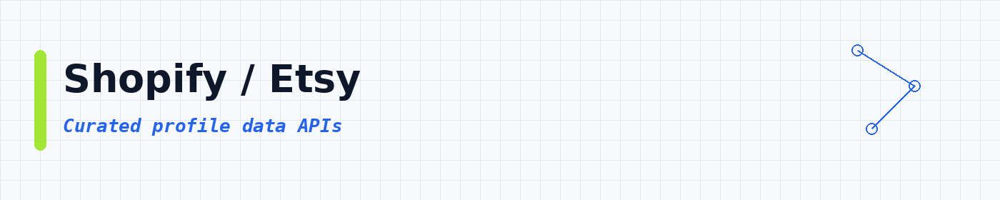

# Profile Data APIs: Get Public Info From Any Social Media Profile

 

 
 
 

 <a href="#top-10-most-popular">Top 10</a> ·
 <a href="#table-of-contents">Categories</a>

Curious about an account on Instagram, TikTok or LinkedIn? Give one of these APIs a username, and it brings back the public bio, picture and follower count. **22,543 ready-to-use APIs**, sorted by real users so the best ones come first.

These profile data APIs help you scrape public social media profiles, bios, follower counts and creator stats. Use them for Instagram, TikTok, LinkedIn, X (Twitter), YouTube, Facebook and Threads profile scraping, influencer research, username search and lead enrichment. Each API runs in the cloud and exports JSON, CSV or Excel.

---

## Collection statistics

| Metric | Count |
|--------|-------|
| **Profile Data APIs** | **22,543** |
| **Categories** | **18** |
| **Last updated** | 2026-11-02 |

---

## What is a profile data API?

A profile data API is a tool you call to pull public facts about a person or creator account. Things like display name, bio, avatar, follower count and profile links. You give it a username or profile URL. It gives you clean rows you can save as CSV or JSON.

People also call this a social profile scraper or a people data API. Same idea: get public profile fields without copying them by hand.

---

## What can you build?

These **22,543 ready-to-use profile data APIs** help you pull people data into your own apps. You can:

- Export LinkedIn-style public profile fields
- Pull Instagram, TikTok and X profile stats
- Build influencer lists with follower counts
- Enrich leads with public social URLs
- Collect creator bios and avatars
- Watch profile changes over time
- Export clean CSV or JSON for CRM or research

Pick an API below, open it, try a small run, then export the results.

---

## ⭐ Star This Repository

If this API list helped you, please give it a star! ⭐

Your support helps other people discover this resource and keeps the list updated and growing.

---

## Table of contents

- [Other / General](#other-general) : **4,106**
- [LinkedIn](#linkedin) : **2,825**
- [Google / Maps](#google-maps) : **2,627**
- [Email / Phone](#email-phone) : **1,999**
- [SEO / SERP](#seo-serp) : **1,930**
- [Instagram](#instagram) : **1,922**
- [TikTok](#tiktok) : **1,702**
- [Facebook / Meta](#facebook-meta) : **1,099**
- [Reviews / Brand](#reviews-brand) : **991**
- [X / Twitter](#x-twitter) : **874**
- [Jobs / Recruiting](#jobs-recruiting) : **746**
- [News / Content](#news-content) : **480**
- [AI / Agents / MCP](#ai-agents-mcp) : **455**
- [Company / B2B](#company-b2b) : **362**
- [Real Estate](#real-estate) : **235**
- [Shopify / Etsy](#shopify-etsy) : **85**
- [Amazon](#amazon) : **76**
- [eBay / Walmart](#ebay-walmart) : **29**

---

## Top 10 most popular

| API | What it does | Users | Rating | Price |
|-----|-------------|-------|--------|-------|
| [Instagram Scraper](https://apify.com/apify/instagram-scraper?fpr=data) | Extract Instagram posts, reels, profiles, places, hashtags, carousels, and comments. Get data from Instagram using one or more Instagram UR… | 463.2K | 4.68 | Pay per event |
| [TikTok Scraper](https://apify.com/clockworks/tiktok-scraper?fpr=data) | Extract data from TikTok videos, hashtags, and users. Use URLs or search queries to scrape TikTok profiles, hashtags, posts, URLs, shares,… | 377.3K | 4.75 | Pay per event |
| [Instagram Profile Scraper](https://apify.com/apify/instagram-profile-scraper?fpr=data) | Scrape all Instagram profile info. Just add Instagram usernames, IDs or URLs and extract name, join date, number of followers, location, bi… | 272.5K | 4.75 | Pay per event |
| [YouTube Scraper](https://apify.com/streamers/youtube-scraper?fpr=data) | YouTube crawler and video scraper. Alternative YouTube API with no limits or quotas. Extract and download channel name, likes, number of vi… | 198.6K | 4.81 | Pay per event |
| [Instagram Reel Scraper](https://apify.com/apify/instagram-reel-scraper?fpr=data) | Scrape or download Instagram reels. Just add Instagram profile or reel URL, and get caption, timestamp, transcript, hashtags, mentions, tag… | 182.6K | 4.39 | Pay per event |
| [Linkedin Jobs Scraper](https://apify.com/curious_coder/linkedin-jobs-scraper?fpr=data) | Scrape Linkedin jobs from jobs search results using search URLs or filters. Get full job details, job poster and company details. | 178.0K | 4.51 | Pay per event |
| [Instagram Post Scraper](https://apify.com/apify/instagram-post-scraper?fpr=data) | Scrape Instagram posts. Just add one or more Instagram usernames and get your data in seconds including caption, metrics, images, mentions,… | 151.7K | 4.26 | Pay per event |
| [Instagram Hashtag Scraper](https://apify.com/apify/instagram-hashtag-scraper?fpr=data) | Scrape Instagram posts and reels by hashtags. Just add one or more hashtags and extract captions, locations, likes, plays, shares, comments… | 145.2K | 3.49 | Pay per event |
| [Facebook Posts Scraper](https://apify.com/apify/facebook-posts-scraper?fpr=data) | Extract posts, videos, and engagement metrics from Facebook pages. Get text captions, reactions, video transcripts, images, external links,… | 135.6K | 4.67 | Pay per event |
| [Tweet Scraper V2: X Scraper / Twitter Scraper / X.com Scraper](https://apify.com/apidojo/tweet-scraper?fpr=data) | Lightning-fast search, URL, list, and profile scraping, with customizable filters. At $0.40 per 1000 tweets, and 30-80 tweets per second, i… | 128.8K | 3.86 | Pay per event |

---

## Other / General

**4,106 APIs in this category** | [View all →](lists/other-general.md)

| API | What it does | Users | Rating | Price |
|-----|-------------|-------|--------|-------|
| [Reddit Scraper Lite](https://apify.com/trudax/reddit-scraper-lite?fpr=data) | Pay Per Result, unlimited Reddit web scraper to crawl posts, comments, communities, and users without login. Limit web scraping by number o… | 51.4K | 4.35 | Pay per event |
| [Sherlock](https://apify.com/misceres/sherlock?fpr=data) | 🔎 Hunt down social media accounts by username across social networks using open-source project | 39.4K | 4.80 | Free |
| [Quora Scraper \| No Cookies \| $1 / 1K](https://apify.com/fatihtahta/quora-scraper?fpr=data) | Extracts detailed data from Questions, Answers, Posts, and Profiles for any search query, filter combination, or direct URL on Quora. Ideal… | 33.1K | 5.00 | Pay per event |
| [小红书数据 API：笔记搜索与评论 \| SocialDataX Xiaohongshu XHS RedNote](https://apify.com/socialdatax/socialdatax-xhs-data-api?fpr=data) | 社媒数据助手 SocialDataX 小红书 / Xiaohongshu / XHS / RedNote API：笔记搜索 note search、图片搜索、评论 comments 与回复、博主资料 user profiles 与作品、用户搜索、搜索词建议、商品搜索与详情、商品… | 11.4K | 5.00 | Pay per event |
| [抖音数据 API：商品、用户、视频与评论 \| Douyin API](https://apify.com/socialdatax/socialdatax-douyin-data-api?fpr=data) | 社媒数据助手 SocialDataX 提供只读抖音 / Douyin data API，支持商品搜索、用户搜索、作品搜索、评论与回复、作品详情、博主信息、博主作品、合集/短剧列表和热榜，并可导出 Dataset、CSV、Excel。 | 10.6K | 5.00 | Pay per event |
| [Bilibili Scraper: Videos, Comments, Danmaku & Creator Uploads](https://apify.com/zhorex/bilibili-scraper?fpr=data) | Bilibili (哔哩哔哩, B站) scraper API for China social media video: search, video details, comment threads, Chinese influencer uploads and creato… | 7.4K | 2.00 | Pay per event |
| [Snapchat Profile Scraper](https://apify.com/argusapi/snapchat-profile-scraper?fpr=data) | Scrape profile data of snapchat accounts, supports scraping private (normal) / public (influencer) / banned / no existing accounts. | 7.2K | 3.46 | Free |
| [Telegram Messages Scraper](https://apify.com/curious_coder/telegram-scraper?fpr=data) | Scrape messages from any telegram group / channel / chats | 7.2K | 2.01 | Free |
| [Reddit Scraper](https://apify.com/automation-lab/reddit-scraper?fpr=data) | Scrape public Reddit search results and subreddit listings, with posts, comments, and profiles available on a best-effort basis. No Reddit… | 7.1K | 4.73 | Pay per event |
| [Discord Username Checker: Bulk Availability](https://apify.com/maged120/discord-username-checker?fpr=data) | Bulk-checks whether Discord usernames are available or already taken. Supports up to 500 usernames per run with concurrent requests and pro… | 6.2K | 4.88 | Pay per event |
| [知乎 / Zhihu API: 搜索、回答文章、评论、用户数据](https://apify.com/socialdatax/socialdatax-zhihu-data-api?fpr=data) | 社媒数据助手 SocialDataX 提供的只读知乎 / Zhihu data API，支持知乎搜索 / Zhihu content search、回答和文章详情、评论 / comments、评论回复 / comment replies、用户资料 / creator profi… | 5.8K | n/a | Pay per event |
| [Meta Threads Profile Scraper](https://apify.com/apify/threads-profile-api-scraper?fpr=data) | Scrape Threads profile info. Add one or more Threads usernames and extract number of followers, bio, profile details, URLs, picture URL, fu… | 5.3K | 4.99 | Pay per event |
| [Douyin 抖音 Video Scraper: Metadata + MP4 Downloads](https://apify.com/zen-studio/douyin-video-scraper?fpr=data) | Download Douyin (抖音) MP4s with post captions, engagement counts, music and available creator data. Save covers and slideshow images, or exp… | 5.2K | 5.00 | Pay per event |
| [Telegram Scraper](https://apify.com/tri_angle/telegram-scraper?fpr=data) | Scrape public Telegram channels: the profile, follower count, and bio, plus every message with its date, views, and links. Limit it to the… | 5.0K | 2.81 | Pay per event |
| [Patreon Video Downloader \| How to Download Patreon Videos](https://apify.com/serpdownloaders/patreon-downloader?fpr=data) | Patreon Video Downloader gives creators and teams a dependable way to save Patreon content instantly to your device. Instead of juggling ma… | 4.8K | 5.00 | Free |
| [Threads Scraper](https://apify.com/automation-lab/threads-scraper?fpr=data) | Scrape Meta Threads posts, profiles, and search results. No login needed. Extract text, likes, reply counts, reposts, media, and user data. | 3.9K | 4.24 | Pay per event |
| [Pinterest Scraper](https://apify.com/danielmilevski9/pinterest-crawler?fpr=data) | Our free Pinterest Scraper allows you to get "pins" along with a user's profile. This unofficial Pinterest API is designed to give you more… | 3.4K | 3.19 | Free |
| [Pinterest Scraper \| All-In-One](https://apify.com/fatihtahta/pinterest-scraper-search?fpr=data) | Scrape Pinterest profiles, pins and boards into clean JSON. Get titles, descriptions, images/video, creator + board info, links, domains, t… | 2.9K | 5.00 | Pay per event |
| [Clips4Sale Video Downloader](https://apify.com/datavoid/clips4sale-video-downloader?fpr=data) | Download Clips4Sale videos from a URL for offline viewing. | 2.9K | 5.00 | Pay per event |
| [Douyin Comments Scraper](https://apify.com/natanielsantos/douyin-comments-scraper?fpr=data) | Easily scrape Douyin (抖音) comments. Just add a Douyin URL. Get text, user ID, images. timestamp, number of replies and replies content, num… | 2.8K | 4.29 | Pay per event |
| [Loom Video Downloader](https://apify.com/expanditumarca/loom-video-downloader?fpr=data) | Downloads any Loom video with just a link or embed code. Fast, reliable, and supports batch processing to download multiple videos at once.… | 2.8K | 5.00 | Pay per event |
| [Reddit Post Comments Scraper \| Bulk Thread & Reply Export](https://apify.com/clearpath/reddit-post-comments-bulk-scraper?fpr=data) | Scrape Reddit posts with full comment trees. 6 sort orders, Q&A filtering, and deep sub-thread expansion. Bulk URLs, CSV upload, any format. | 2.8K | n/a | Pay per event |
| [Patreon Extractor 🎯 ⭐5.0](https://apify.com/jupri/patreon?fpr=data) | 💫 All-in-One Patreon.com Scraper [v5.0] | 2.8K | 4.95 | Pay per event |
| [Onlyfans profile scraper](https://apify.com/curious_coder/onlyfans-scraper?fpr=data) | Onlyfans data extractor scrapes profiles in bulk with all details including, name, bio, last online, engagement insights, social media urls… | 2.7K | 5.00 | Pay per event |
| [Terabox Fast Video Downloader](https://apify.com/igview-owner/terabox-fast-video-downloader?fpr=data) | Instantly generate direct download links, streaming URLs, and full metadata for any Terabox video or file. Fast, free, and no login require… | 2.7K | 5.00 | Pay per event |
| [Threads Posts Scraper](https://apify.com/logical_scrapers/threads-post-scraper?fpr=data) | Threads scraper for public posts and replies. Extract Threads posts by URL: caption text, media, like, reply and repost counts, author deta… | 2.2K | 4.48 | Pay per event |
| [Douyin Hot Search Scraper: Real-Time Trending Topics](https://apify.com/zen-studio/douyin-hot-search-scraper?fpr=data) | Scrape Douyin (抖音) real-time trending topics across all 5 hot-search boards. Get rank, hot value, view count, video count, cover image, and… | 2.2K | n/a | Pay per event |
| [Snapchat Scraper](https://apify.com/tri_angle/snapchat-scraper?fpr=data) | Scrape public Snapchat profiles by username or URL: subscriber count, bio, and website, plus their stories and Spotlight videos with views… | 2.1K | 5.00 | Pay per event |
| [Pinterest Search Scraper: Pins & Creators](https://apify.com/easyapi/pinterest-search-scraper?fpr=data) | Search Pinterest by query and export pin images, titles, creator stats and dates: built for moodboards, trends and creative research. | 2.1K | 5.00 | Pay per event |
| [Reddit Scraper](https://apify.com/epctex/reddit-scraper?fpr=data) | Tap into the wealth of Reddit's data with our Reddit Scraper. Extract valuable insights from posts, subreddits, comments, and user data eff… | 2.0K | 5.00 | Pay per event |
| [Truth Social Scraper](https://apify.com/muhammetakkurtt/truth-social-scraper?fpr=data) | Extract Truth Social profile posts with this professional APIs tool. Collect content from Donald Trump and key profiles. Analyze interactio… | 2.0K | 4.42 | Pay per event |
| [Threads Replies Scraper](https://apify.com/futurizerush/threads-replies-scraper?fpr=data) | Extract public Threads post replies and comments with author info, available engagement metrics, media details, quote/repost signals, and v… | 2.0K | 1.79 | Pay per event |
| [Pinterest Scraper: Pins, Boards & Search Results](https://apify.com/automation-lab/pinterest-scraper?fpr=data) | Extract Pinterest pins from search queries, board URLs, or pin URLs. Get images, descriptions, saves, pinner and board metadata, hashtags,… | 1.9K | 5.00 | Pay per event |
| [RedNote (Xiaohongshu) Note Scraper: Video & Image Downloader](https://apify.com/zen-studio/rednote-note-detail-scraper?fpr=data) | Scrape RedNote (Xiaohongshu) notes: text, likes, comments, author, tags. Optionally download 4K videos, original images, Live Photos and SR… | 1.9K | n/a | Pay per event |
| [Telegram Username Checker](https://apify.com/akula.marketing/Telegram-Get-Username-Info?fpr=data) | Verify Telegram usernames in bulk. Check existence, user vs channel type, subscriber count, title, bio, and profile photo. | 1.8K | 5.00 | Pay per event |
| [ONLYFANS Scraper 🪶](https://apify.com/jupri/onlyfans?fpr=data) | 💫 All-in-One OnlyFans.com Scraper ❤️💛💚💙💜 | 1.8K | 5.00 | Pay per event |
| [Snapchat Video Downloader: Spotlight & Public Stories (HD MP4)](https://apify.com/convertfleetdotonline/snapchat-downloader?fpr=data) | Snapchat video downloader for Spotlight clips and public Story content in HD MP4: no watermark. Direct CDN download URLs, bulk by URL, no l… | 1.6K | n/a | Pay per event |
| [Telegram Media Downloader 📥](https://apify.com/easyapi/telegram-media-downloader?fpr=data) | A powerful Telegram media downloader that extracts videos, photos, and other media content from Telegram posts. Simply input the post URLs… | 1.6K | 4.69 | Pay per event |
| [Telegram Member Scraper](https://apify.com/agentx/telegram-member-scraper?fpr=data) | Telegram member scraper for public groups, returning 23-field profiles from the visible participant list and optional message-author discov… | 1.5K | 4.80 | Pay per event |
| [Username Checker & Search: OSINT Across 3000+ Sites (Maigret)](https://apify.com/ntriqpro/maigret-actor?fpr=data) | Username search across 3000+ social, forum, gaming, dating and developer sites, with a profile URL per hit. Open-source Maigret engine (MIT… | 1.5K | 5.00 | Pay per event |

[View all 4,106 in this section →](lists/other-general.md)

## LinkedIn

**2,825 APIs in this category** | [View all →](lists/linkedin.md)

| API | What it does | Users | Rating | Price |
|-----|-------------|-------|--------|-------|
| [Linkedin Jobs Scraper](https://apify.com/curious_coder/linkedin-jobs-scraper?fpr=data) | Scrape Linkedin jobs from jobs search results using search URLs or filters. Get full job details, job poster and company details. | 178.0K | 4.51 | Pay per event |
| [LinkedIn Profile Scraper + Email (No Cookies)](https://apify.com/harvestapi/linkedin-profile-scraper?fpr=data) | Extract detailed information from LinkedIn profiles in bulk, including complete work experience, education history, skills and more. No coo… | 91.6K | 4.64 | Pay per event |
| [Contact Details Scraper](https://apify.com/vdrmota/contact-info-scraper?fpr=data) | Email extractor and lead scraper to extract and download emails, phone numbers, Facebook, Twitter, LinkedIn, Instagram, Threads, Snapchat,… | 66.4K | 4.23 | Pay per event |
| [✨Mass Linkedin Profile Scraper with Email 📧 (No Cookies)](https://apify.com/dev_fusion/Linkedin-Profile-Scraper?fpr=data) | 🚀 Extract full LinkedIn profile insights: verified email 📧, phone number 📞, work history, education, and more... | 63.8K | 2.99 | Pay per event |
| [LinkedIn Jobs Scraper \| Remove Duplicate Jobs \| Pay Per Result](https://apify.com/cheap_scraper/linkedin-job-scraper?fpr=data) | Scrape LinkedIn jobs by keywords and location or by LinkedIn search URLs, or both. Export to JSON, CSV or Excel. No login or cookies needed… | 54.9K | 4.37 | Pay per event |
| [LinkedIn Profile Search Scraper (No Cookies) Find all people](https://apify.com/harvestapi/linkedin-profile-search?fpr=data) | Search for LinkedIn profiles with filters and extract detailed profile information, including work experience, education history, location,… | 54.0K | 4.40 | Pay per event |
| [✨Leads Finder - $1.5/1k leads with Emails [Apollo Alternative]](https://apify.com/code_crafter/leads-finder?fpr=data) | ✅ Affordable alternative to ZoomInfo, Lusha & Apollo. ✅ Get Business email, 📞Mobile Number, Personal email, LinkedIn profiles, company deta… | 49.7K | 3.44 | Pay per event |
| [🔥 LinkedIn Jobs Scraper](https://apify.com/bebity/linkedin-jobs-scraper?fpr=data) | ℹ️ Designed for both personal and professional use, simply enter your desired job title and location to receive a tailored list of job oppo… | 47.7K | 4.45 | Pay per event |
| [LinkedIn Profile Posts Scraper (No Cookies)](https://apify.com/harvestapi/linkedin-profile-posts?fpr=data) | Extract posts from LinkedIn profiles, including content, media, engagement, reactions, comments, and more. No cookies or account required. | 45.9K | 4.40 | Pay per event |
| [LinkedIn Company Employees Scraper (No Cookies)](https://apify.com/harvestapi/linkedin-company-employees?fpr=data) | Extract all LinkedIn Company employees with filters and detailed profile information, including complete work experience, and more. No cook… | 41.9K | 4.02 | Pay per event |
| [Linkedin Post Search Scraper (No Cookies)](https://apify.com/harvestapi/linkedin-post-search?fpr=data) | Search LinkedIn Posts with advanced filters by target profiles or companies. No cookies or account required. | 40.0K | 4.95 | Pay per event |
| [🏆 LinkedIn Jobs Scraper](https://apify.com/valig/linkedin-jobs-scraper?fpr=data) | $0.4/1K jobs \| Scrape LinkedIn job listings based on your selected role and location, saving you time and effort. | 36.9K | 4.68 | Pay per event |
| [LinkedIn Company Details Scraper (No Cookies)](https://apify.com/harvestapi/linkedin-company?fpr=data) | Extract detailed information from LinkedIn Companies such as company name, address, phone numbers, website, employee count, and more. Find… | 31.2K | 4.86 | Pay per event |
| [Profile Details Scraper for LinkedIn + EMAIL (No Cookies)](https://apify.com/apimaestro/linkedin-profile-detail?fpr=data) | Scrape comprehensive LinkedIn profile data including work experience, education history, certifications, and location details. Get structur… | 30.3K | 4.71 | Pay per event |
| [Profile Posts Scraper for LinkedIn [No Cookies]](https://apify.com/apimaestro/linkedin-profile-posts?fpr=data) | Scrape LinkedIn posts data for a given LinkedIn profile including post content, reactions, comments count, and media attachments | 23.7K | 4.84 | Pay per event |
| [🍏 Leads Finder: Email 📧 + Mobile Number 📞​](https://apify.com/microworlds/leads-finder?fpr=data) | ✅ Cheap alternative to Apollo, ZoomInfo & Lusha. ✅ Get business emails, LinkedIn profiles, company details etc.. With verified email 📧 and… | 23.2K | 2.85 | Pay per event |
| [🎉Leads Scraper ✅ $1/1k Leads ✅ 50K/Run With EMAILS✅Like Apollo](https://apify.com/pipelinelabs/lead-scraper-apollo-zoominfo-lusha-ppe?fpr=data) | $1/1k Leads: Scrape Up to 50K leads per run with Emails, LinkedIn URL, Phone Numbers, & More! Similar to Apollo, ZoomInfo, Lusha. 250+ Mill… | 17.9K | 2.82 | Pay per event |
| [Linkedin Post Scraper ✅ No cookies](https://apify.com/supreme_coder/linkedin-post?fpr=data) | Scrape unlimited Linkedin posts without risking your Linkedin account. Live data, Super fast scraping at affordable cost. High success rate | 17.7K | 4.05 | Pay per event |
| [Posts Search Scraper for LinkedIn \| No Cookies](https://apify.com/apimaestro/linkedin-posts-search-scraper-no-cookies?fpr=data) | Scrape LinkedIn posts by keyword without login. Get post content, reactions, author details, and media. Sort by relevance or date. Perfect… | 17.3K | 4.71 | Pay per event |
| [Advanced LinkedIn Job Search API](https://apify.com/fantastic-jobs/advanced-linkedin-job-search-api?fpr=data) | Access our real-time LinkedIn Jobs database with over 10 million new jobs per month. With detailed company data, recruiter data, and AI enr… | 16.6K | 2.95 | Pay per event |
| [LinkedIn Company Posts Scraper (No Cookies)](https://apify.com/harvestapi/linkedin-company-posts?fpr=data) | Extract posts from LinkedIn companies including content, media, engagement, reactions, comments and more. No cookies or account required. C… | 16.5K | 4.97 | Pay per event |
| [🔥 Linkedin Companies & Profiles Bulk Scraper](https://apify.com/bebity/linkedin-premium-actor?fpr=data) | Companies & Profiles Linkedin scraper. Get comprehensive profiles of individuals and companies based on your keywords and filters. Unleash… | 16.0K | 3.27 | Pay per event |
| [⚡️Rapid Linkedin Jobs Scraper](https://apify.com/worldunboxer/rapid-linkedin-scraper?fpr=data) | 🔥$0.10/1K jobs. Advanced filters, 23 data fields, JSON/CSV/Excel export, cron schedules, webhooks and MCP for AI agents. Scrape Linkedin jo… | 15.8K | 4.04 | Pay per event |
| [💎 Leads Scraper $1/1K With EMAILS \| 300M base \| Like Apollo](https://apify.com/x_guru/Leads-Scraper-apollo-zoominfo?fpr=data) | Extract up to 100K leads per run with Emails, LinkedIn URLs, Phone Numbers & More! Similar to Apollo, ZoomInfo, Lusha. 300M+ Verified Datab… | 13.6K | 1.98 | Pay per event |
| [LinkedIn Company Search Scraper (No Cookies)](https://apify.com/harvestapi/linkedin-company-search?fpr=data) | Search for LinkedIn companies with filters and extract detailed company information. No cookies or account required. Fast and reliable API | 13.0K | 4.39 | Pay per event |
| [Profile Details Batch Scraper for LinkedIn + EMAIL (No Cookies)](https://apify.com/apimaestro/linkedin-profile-batch-scraper-no-cookies-required?fpr=data) | (no cookies need) Extract In Bulk comprehensive LinkedIn profile data including work experience, education history, certifications, and loc… | 12.2K | 4.38 | Pay per event |
| [Company Employees Scraper for LinkedIn \| No Cookies](https://apify.com/apimaestro/linkedin-company-employees-scraper-no-cookies?fpr=data) | Extract LinkedIn company employees without sharing your cookies or account. Get structured data including profile details, job titles, and… | 11.8K | 2.92 | Pay per event |
| [🔥Bulk Linkedin Company Profile Scraper (No Cookies)](https://apify.com/dev_fusion/Linkedin-Company-Scraper?fpr=data) | The LinkedIn Company Scraper API efficiently extracts comprehensive company information from LinkedIn, including names, industries, website… | 11.2K | 4.49 | Pay per event |
| [LinkedIn Profile Search By Name scraper (No Cookies)](https://apify.com/harvestapi/linkedin-profile-search-by-name?fpr=data) | Search for LinkedIn profiles by name with filters and extract detailed profile information, including work experience, education history, l… | 10.7K | 4.45 | Pay per event |
| [LinkedIn Post Comments Scraper (No Cookies)](https://apify.com/harvestapi/linkedin-post-comments?fpr=data) | Extract LinkedIn post comments or comment replies in bulk, as well as comment social activities such as the number of likes and reactions.… | 10.5K | 4.78 | Pay per event |
| [Linkedin post scraper](https://apify.com/curious_coder/linkedin-post-search-scraper?fpr=data) | Scrape linkedin posts or updates from linkedin post search results. Supports advanced linkedin search filters. Extract posts from any linke… | 10.4K | 4.66 | Pay per event |
| [🎉 Leads Scraper ✅ $0.8/1k Leads ✅ 250M+ Database ✅ Like Apollo](https://apify.com/pipelinelabs/lead-scraper-apollo-zoominfo-lusha?fpr=data) | Find Leads With Emails, LinkedIn URL, Phone Numbers, & More! Similar to Apollo, ZoomInfo, Lusha. 250+ Million Verified Database! | 10.3K | 3.74 | Pay per event |
| [LinkedIn Profile Scraper for cheap lead enrichment ✅](https://apify.com/anchor/linkedin-profile-enrichment?fpr=data) | Extract LIVE LinkedIn profile data from LinkedIn URLs. Works with people and companies. Upload a CSV of LinkedIn URLs or use the API. Autom… | 10.2K | 4.86 | Pay per event |
| [Linkedin Profile Scraper ✅ No cookie](https://apify.com/supreme_coder/linkedin-profile-scraper?fpr=data) | Scrape Linkedin profiles without risking your Linkedin account. Live data | 9.5K | 4.86 | Pay per event |
| [Company Posts Scraper for LinkedIn: No Cookies](https://apify.com/apimaestro/linkedin-company-posts?fpr=data) | Extract public posts and activity from companies including post content, reactions, comments count, and media attachments | 9.1K | 4.99 | Pay per event |
| [Career Site Job Listing API](https://apify.com/fantastic-jobs/career-site-job-listing-api?fpr=data) | The perfect Job Posting API for high-quality real jobs! Direct postings from over 275k+ company career sites across 58 ATS platforms like:… | 9.1K | 4.11 | Pay per event |
| [Social Media Finder](https://apify.com/tri_angle/social-media-finder?fpr=data) | Search for public social media profiles related to given names or nicknames. Find profile handles and URLs across 13 popular social media p… | 9.1K | 4.57 | Pay per event |
| [Linkedin Sales Navigator Scraper](https://apify.com/curious_coder/linkedin-sales-navigator-search-scraper?fpr=data) | Scrape Linkedin sales navigator search results, lists, new results, profiles to extract social media urls, company website, positions | 9.0K | 4.41 | Pay per event |
| [Advanced LinkedIn Job Scraper (No Cookies)](https://apify.com/harvestapi/linkedin-job-search?fpr=data) | Advanced LinkedIn Job Search Scraper. No cookies or account required. Concurrency + fast response times | 8.5K | 3.81 | Pay per event |
| [Email ✉️ & Phone ☎️ Extractor](https://apify.com/anchor/email-phone-extractor?fpr=data) | Extract emails, phone numbers, and other contact information like Twitter, LinkedIn, Instagram... from websites you provide. Best for lead… | 8.3K | 3.94 | Pay per event |

[View all 2,825 in this section →](lists/linkedin.md)

## Google / Maps

**2,627 APIs in this category** | [View all →](lists/google-maps.md)

| API | What it does | Users | Rating | Price |
|-----|-------------|-------|--------|-------|
| [YouTube Scraper](https://apify.com/streamers/youtube-scraper?fpr=data) | YouTube crawler and video scraper. Alternative YouTube API with no limits or quotas. Extract and download channel name, likes, number of vi… | 198.6K | 4.81 | Pay per event |
| [YouTube Shorts Scraper](https://apify.com/streamers/youtube-shorts-scraper?fpr=data) | Extract YouTube Shorts data from one or multiple YouTube channels. Get video URL, caption, timestamp, likes, dislikes, views and comments c… | 71.8K | 4.35 | Pay per event |
| [Youtube Scraper (Pay Per Result)](https://apify.com/apidojo/youtube-scraper?fpr=data) | Experience unparalleled efficiency and depth with its ultra-fast capabilities in searching, URL, playlist, channel, and profile scraping. I… | 53.3K | 3.29 | Pay per event |
| [Fast YouTube Channel Scraper](https://apify.com/streamers/youtube-channel-scraper?fpr=data) | This alternative YouTube Data API has no limits or quotas. Use it to scrape one or multiple YouTube channels: channel info, URL, total numb… | 28.9K | 4.56 | Pay per event |
| [YouTube Comments Scraper](https://apify.com/streamers/youtube-comments-scraper?fpr=data) | This alternative YouTube Data API has no limits or quotas. Extract YouTube comments data from one or multiple YouTube videos: full comment… | 28.7K | 4.90 | Pay per event |
| [YouTube Video Downloader](https://apify.com/streamers/youtube-video-downloader?fpr=data) | Use YouTube Video Downloader to download YouTube videos in MP4, MP3, avi, and other formats directly to your cloud storage service. Just ad… | 28.4K | 4.26 | Pay per event |
| [Youtube Transcript Scraper](https://apify.com/pintostudio/youtube-transcript-scraper?fpr=data) | Looking for a reliable way to extract transcripts from YouTube videos? 🎥✨ Look no further! The YouTube-Transcript-Scraper has you covered.… | 27.1K | 3.72 | Pay per event |
| [Leads Scraper ✅ $1/1k with EMAILS ✅ Apollo \| LinkedIn Profile](https://apify.com/peakydev/leads-scraper-ppe?fpr=data) | ✅ - Cheap ways to Extract leads with verified ☎️ Mobile ✅ Work & Personal Emails. Similar to Apollo, ZoomInfo, Lusha, LinkedIn \| Google Ma… | 17.8K | 3.98 | Pay per event |
| [YouTube Video Transcript](https://apify.com/starvibe/youtube-video-transcript?fpr=data) | This APIs extracts full transcripts (with timestamps) and metadata from YouTube videos, including title, description, upload date, views, l… | 15.3K | 5.00 | Pay per event |
| [Youtube Transcripts](https://apify.com/karamelo/youtube-transcripts?fpr=data) | Extract 1 transcript or 1000s of YouTube transcripts fast. Save time & effort. Get accurate structured transcripts or captions in seconds f… | 9.1K | 4.99 | Pay per event |
| [Youtube Channel Video Scraper](https://apify.com/grow_media/youtube-channel-video-scraper?fpr=data) | Extract videos from any YouTube channel using handle or ID. Scrape long-form videos and Shorts with sorting by latest, popular, or oldest.… | 6.9K | n/a | Pay per event |
| [Youtube Video Downloader: No Platform Costs! No Proxy Costs!](https://apify.com/epctex/youtube-video-downloader?fpr=data) | Download YouTube videos by URL or ID at any quality from 360p to 4K. Save to 's built-in storage with zero setup, or to your own AWS S3, Go… | 5.5K | 2.16 | Pay per event |
| [Youtube Channel Email Scraper](https://apify.com/dataovercoffee/Youtube-Channel-Business-Email-Scraper?fpr=data) | 🚀🔒 Extract real YouTube channel emails at scale with logged-in accounts & CAPTCHA solving: No BS, Real Emails ✉️✨ | 5.2K | 4.40 | Pay per event |
| [Youtube Transcript Scraper](https://apify.com/topaz_sharingan/Youtube-Transcript-Scraper?fpr=data) | Are you in search of a robust solution for extracting transcripts from YouTube videos? Look no further 😉, YouTube-Transcript-Scraper will m… | 4.9K | 4.88 | Pay per event |
| [YouTube Comments Scraper API: Extract Video Comments Fast](https://apify.com/apidojo/youtube-comments-scraper?fpr=data) | YouTube Comments Scraper, the ultimate solution for extensive YouTube comments data retrieval. With its high-speed scraping abilities, it p… | 4.5K | 4.84 | Pay per event |
| [Youtube Search Api](https://apify.com/grow_media/youtube-search-api?fpr=data) | Search YouTube videos, channels, and playlists using the YouTube Data API. Features comprehensive filtering options, automatic authenticati… | 4.2K | 5.00 | Pay per event |
| [YouTube Search Scraper ($0.5/1000 results)](https://apify.com/api-ninja/youtube-search-scraper?fpr=data) | Extract structured YouTube search results with advanced filtering. Search videos, channels, playlists, shorts, movies, and shows using YouT… | 3.9K | 4.88 | Pay per event |
| [Fast YouTube Channel Scraper API \| Profiles, Subs & Stats](https://apify.com/apidojo/youtube-channel-information-scraper?fpr=data) | Extreme flexibility with search functionalities enables you to retrieve extensive channel information in detail. Not just that but YouTube… | 3.8K | 5.00 | Pay per event |
| [Linkedin Email Scraper](https://apify.com/bhansalisoft/linkedin-email-scraper?fpr=data) | Linkedin Email Scraper- Scrap Emails from linkedin specific profile using google search engine | 3.7K | 3.04 | Pay per event |
| [YouTube Full Channel Transcripts Extractor](https://apify.com/karamelo/youtube-full-channel-transcripts-extractor?fpr=data) | With only the channel or playlist link You can extract 1 to 1000s of all the transcripts of a channel, be it videos or shorts or streams/li… | 3.2K | 4.89 | Pay per event |
| [Youtube Channel Scraper](https://apify.com/newbs/Youtube-Channel?fpr=data) | Scrape YouTube channels or keyword searches for video URLs, titles, metrics, transcripts, channel profiles, social links, descriptions and… | 3.1K | 4.33 | Pay per event |
| [All in one Social media Email Scraper](https://apify.com/bhansalisoft/all-in-one-social-media-email-scraper?fpr=data) | All in One Social Email Extractor: Software can Extract Email from All Social Network Profile Linkedin Email Extractor Facebook Email Extra… | 3.1K | 3.80 | Pay per event |
| [Google Maps Scraper](https://apify.com/poidata/google-maps-scraper?fpr=data) | 🔥 $0.40/1K results 🔥 Get 📧 emails, 📞 phones, 🌐 websites, 📱 social profiles, addresses, ratings, reviews, hours & more. Find businesses by k… | 3.1K | 4.34 | Pay per event |
| [Best Youtube Transcripts Scraper](https://apify.com/scrape-creators/best-youtube-transcripts-scraper?fpr=data) | Extract transcripts from YouTube videos. Simply enter video URLs. Get full text, timestamps, and metadata where available. Perfect for rese… | 3.0K | 4.52 | Pay per event |
| [YouTube Transcript Scraper Pro (Captions + AI Fallback)](https://apify.com/codepoetry/youtube-transcript-ai-scraper?fpr=data) | Extract YouTube transcripts at scale without burning through your budget. It starts with free captions whenever they're available, then swi… | 2.7K | 5.00 | Pay per event |
| [Youtube Email Scraper](https://apify.com/bhansalisoft/youtube-email-scraper?fpr=data) | Youtube Email Scraper- Scrap Emails from Youtube specific profile using google search engine | 2.6K | 4.51 | Pay per event |
| [📩 Google Maps Email Extractor](https://apify.com/poidata/google-maps-email-extractor?fpr=data) | Quickly collect all business details, including emails, phone numbers, and social media links from Google Maps listings and their websites.… | 2.5K | 1.89 | Pay per event |
| [TikTok \| Instagram \| Facebook \| YouTube Shorts Transcriber](https://apify.com/tictechid/anoxvanzi-Transcriber?fpr=data) | Extract accurate transcripts from Instagram Reels, Facebook Reels, YouTube Shorts, and TikTok videos. Use video URLs to transcribe public c… | 2.5K | 4.06 | Pay per event |
| [Youtube Channel Scraper](https://apify.com/grow_media/youtube-channel-scraper?fpr=data) | Extract comprehensive data from YouTube channels including video stats, channel details, and engagement metrics. Support for multiple chann… | 2.3K | 4.98 | Pay per event |
| [YouTube Video Downloader: MP4 & MP3](https://apify.com/marielise.dev/youtube-video-downloader?fpr=data) | Download YouTube videos and Shorts directly to your device in MP4 or MP3 format. Supports batch downloads, quality selection from 360p to 1… | 2.2K | 4.57 | Pay per event |
| [Google Maps Business Leads Scraper (Email, Phone...)](https://apify.com/lurkapi/google-maps-business-leads-scraper?fpr=data) | Scrape business listings from Google Maps and enrich with emails, phones, and social profiles from each company website. Lead generation in… | 2.1K | 4.85 | Pay per event |
| [Social Media Hashtag Research](https://apify.com/apify/social-media-hashtag-research?fpr=data) | Extract information about posts across social media with the same hashtag. Get details from Instagram, YouTube, TikTok, and Facebook about… | 1.8K | 4.99 | Free |
| [YouTube Channel Search Scraper](https://apify.com/maximedupre/youtube-channel-search-scraper?fpr=data) | Find public YouTube channels from search terms or public YouTube search-result URLs. Review channel IDs, handles, public metrics, and profi… | 1.7K | 5.00 | Pay per event |
| [Facebook Email Scraper](https://apify.com/perfectscrape/facebook-email-scraper?fpr=data) | Extract emails from Facebook fast and effortlessly! Search by keywords, scrape unlimited Google pages, and filter by domains like Gmail, Ya… | 1.7K | n/a | Free |
| [TikTok Email Scraper](https://apify.com/bhansalisoft/tiktok-email-scraper?fpr=data) | TikTok Email Scraper- Scrap Emails from TikTok specific profile using google search engine | 1.6K | 4.97 | Pay per event |
| [Video Transcript Scraper: Youtube, X, Facebook, Tiktok, etc.](https://apify.com/invideoiq/video-transcript-scraper?fpr=data) | Scrapes transcripts from online video/audio content on multiple platforms (Youtube, X,..) in any available language. It delivers outputs in… | 1.6K | 4.39 | Pay per event |
| [Youtube Instant Email Scraper](https://apify.com/endspec/youtube-instant-email-scraper?fpr=data) | [Instant response] [Passes most reCAPTCHA] Extract YouTube email addresses from channel ID or handle. | 1.5K | 1.00 | Pay per event |
| [Youtube View Traffic Machine](https://apify.com/bhansalisoft/youtube-view-traffic-machine?fpr=data) | Youtube View Traffic Machine is advance unique pro software that is useful increase YouTube Video View and Watch time. | 1.4K | 3.41 | Pay per event |
| [YouTube Channel Email Scraper](https://apify.com/lurkapi/youtube-channel-email-scraper?fpr=data) | Extract business emails, contact info, and social media links from YouTube channel About pages. Supports @handles, channel URLs, and channe… | 1.4K | 5.00 | Pay per event |
| [Website Contact Finder: Emails, Phones & Socials for Leads](https://apify.com/automation-lab/website-contact-finder?fpr=data) | Turn company websites from Google Maps, directories, CRMs, or spreadsheets into outreach-ready contact signals. Extract public emails, phon… | 1.3K | n/a | Pay per event |

[View all 2,627 in this section →](lists/google-maps.md)

## Email / Phone

**1,999 APIs in this category** | [View all →](lists/email-phone.md)

| API | What it does | Users | Rating | Price |
|-----|-------------|-------|--------|-------|
| [Deep Email, Phone, & Social Media Scraper Search](https://apify.com/peterasorensen/snacci?fpr=data) | A powerful tool that searches emails, phone numbers, and social media profiles from any website. It intelligently navigates, prioritizing p… | 5.3K | 4.86 | Pay per event |
| [Telegram Phone Number Lookup](https://apify.com/akula.marketing/Telegram-Get-Phone-Info?fpr=data) | Look up Telegram accounts by phone number. Get username, profile photo, premium status, and account details for lead verification and OSINT. | 4.6K | 4.94 | Pay per event |
| [Whatsapp Profiles Scraper](https://apify.com/inutil_labs/wscrp-free?fpr=data) | Scrape the Whatsapp network and fetch profile info of any user, including: Profile picture, About status, or check if it's a Whatsapp for B… | 4.4K | 5.00 | Free |
| [Email OSINT Lookup: Find Accounts, Breaches & Identity](https://apify.com/s-r/apifyosintemail?fpr=data) | Email OSINT for investigators, fraud and security teams: check which of 133 platforms an address is registered on, get the name and profile… | 3.4K | 4.31 | Pay per event |
| [Telegram Channel Scraper](https://apify.com/danielmilevski9/telegram-channel-scraper?fpr=data) | Telegram channel Scraper for getting public messages without login, phone number, or Telegram app. In the message supported forward and tel… | 2.8K | 3.00 | Free |
| [WhatsApp Number Lookup: Profile, Leaks, Telegram, Bulk](https://apify.com/eduair94/whatsapp-data-lookup?fpr=data) | Verify any WhatsApp number worldwide. Returns profile picture (real pics for normal users, not just businesses), about/status, business fla… | 2.4K | 4.95 | Pay per event |
| [Naver Product Detail Scraper](https://apify.com/delicious_zebu/naver-product-detail-scraper?fpr=data) | Scrape complete product data from any Naver SmartStore or Brand Store URL: price, discount, per-SKU options & stock, images, reviews, deliv… | 2.1K | 5.00 | Pay per event |
| [Website Email Scraper: All Contacts](https://apify.com/thenetaji/website-email-scraper?fpr=data) | The API crawls a website and returns one evidence-rich record per URL supplied: emails, phone numbers, social profiles, and addresses, each… | 1.9K | 4.86 | Pay per event |
| [Snapchat Email Scraper](https://apify.com/easyapi/snapchat-email-scraper?fpr=data) | 🚀 Effortlessly scrape email addresses from Snapchat profiles! 👻 Find Snapchat users matching your keywords and specific email domains. Perf… | 1.3K | 1.00 | Pay per event |
| [Telegram Profile](https://apify.com/truefetch/telegram-profile?fpr=data) | Telegram profile scraper for resolving up to 1,000 usernames, @handles, t.me URLs, accessible invites, or phone numbers into 41-field spars… | 1.3K | 4.87 | Pay per event |
| [Avvo Scraper with Mails \| US Lawyer Directory](https://apify.com/fatihtahta/avvo-scraper?fpr=data) | Get verified US attorney profiles from Avvo.com including names, contacts, firms, ratings, practice areas, and locations. Build legal direc… | 1.3K | 5.00 | Pay per event |
| [Telegram Channel Content & Media Scraper](https://apify.com/webfinity/telegram-channel-content-media-scraper-v2?fpr=data) | Download photos, videos and posts from any public Telegram channel. Pick only photos, videos, audio or files, get size, resolution and dura… | 1.2K | 5.00 | Pay per event |
| [Clutch.co Scraper: Agencies, Reviews, Emails + AI Insights](https://apify.com/memo23/apify-clutch-cheerio?fpr=data) | Clutch.co scraper for B2B lead gen: agency profiles with 30+ fields, reviews, hourly rates, employee counts, contact emails and buyer leads… | 1.2K | 4.60 | Pay per event |
| [WhatsApp Number Validator: Bulk Check 10K per Run](https://apify.com/clearpath/whatsapp-phone-number-validator-api?fpr=data) | Check if phone numbers have WhatsApp. Validate up to 10,000 numbers per run from CSV, Excel, or direct input. Yes/no result per number. Cle… | 1.1K | 3.49 | Pay per event |
| [Telegram Info Scraper](https://apify.com/agentx/telegram-info-scraper?fpr=data) | Telegram info scraper for resolving up to 1,000 usernames, @handles, t.me URLs, accessible invites, or phone numbers into 41-field sparse u… | 1.1K | 5.00 | Pay per event |
| [Domain Contact Scraper: Email, Phone & Social Extractor](https://apify.com/emastra/website-contact-scraper?fpr=data) | Extract public emails, phone numbers, WhatsApp numbers, and social profiles from websites. Priority-first crawling returns one clean, conso… | 1.1K | 5.00 | Pay per event |
| [Find Mobile Phones of Decision Makers](https://apify.com/parvenu/mobile-phone-enrichment?fpr=data) | Find mobile phones for decision makers for $.20 / cell phone | 1.1K | 5.00 | Pay per event |
| [Telegram Number Validator: Bulk Check](https://apify.com/clearpath/telegram-phone-number-validator?fpr=data) | Bulk verify phone numbers for active Telegram accounts. Check 1,000-10,000 numbers per run. Upload CSV or Excel files, get instant yes/no r… | 1.1K | 5.00 | Pay per event |
| [Threads Full Scraper: Posts, Profiles & Replies \| No Login](https://apify.com/pro100chok/threads-scraper-usage?fpr=data) | All-in-one Meta Threads.net scraper: search posts by keyword, extract user profiles with followers, and collect reply threads. Full engagem… | 1.0K | 4.89 | Pay per event |
| [Contact Info Scraper](https://apify.com/delicious_zebu/contact-info-scraper?fpr=data) | Crawl any website and get one deduplicated row per company: emails with deliverability checks (MX, role mailbox), validated phone numbers,… | 1.0K | 5.00 | Pay per event |
| [Website Email Scraper: Emails, Phones & Socials](https://apify.com/jurassic_jove/website-email-extractor?fpr=data) | Pull emails, phones, and social links from any website. Auto-follows Linktree and bio pages: no manual digging. | 856 | n/a | Pay per event |
| [Skip Trace: People Search, Phones & Emails API](https://apify.com/apivault_labs/skip-trace-people-finder?fpr=data) | Research publicly available people and contact evidence by names, addresses, phones or emails. Bulk JSON/CSV/Excel API. PPE per1K: Free$6,… | 847 | 5.00 | Pay per event |
| [SKOOL \| Members/Groups \| Discovery Search \| Scraper (PPE)](https://apify.com/memo23/skool-members-scraper?fpr=data) | No login needed for public Skool communities: export members: name, bio, location, social links, join date. Roster, admins and member searc… | 791 | 3.98 | Pay per event |
| [Website Contact Extractor](https://apify.com/betterdevsscrape/contact-details-extractor?fpr=data) | The cheapest contact scraper on. Extract emails, phone numbers, company names, addresses & 25+ social profiles at $0.001/page: 50% less tha… | 745 | 5.00 | Pay per event |
| [Social & Email Scraper](https://apify.com/lead.gen.labs/social-email-scraper?fpr=data) | Empower your data quest! The Social & Email Scraper APIs: your precision-driven solution for effortlessly extracting vital contact details… | 675 | 1.11 | Free |
| [ImportYeti Scraper: US Import Records & Supplier Data](https://apify.com/zen-studio/importyeti-scraper?fpr=data) | Extract supplier profiles, shipment records, and trade data from ImportYeti. Search by company, product, or address. 60+ fields per result:… | 624 | 5.00 | Pay per event |
| [WhatsApp Number Filter Pro](https://apify.com/wilcode/whatsapp-number-filter-pro?fpr=data) | Quickly verify and filter valid WhatsApp registered phone numbers in bulk | 613 | 4.98 | Free |
| [Pagesjaunes Scraper](https://apify.com/saswave/pagesjaunes-scraper?fpr=data) | $0.8 / 1000 results. Non official French Yellow page scraper. Pagesjaunes.fr scraper. Extract non protected, public available informations… | 605 | 5.00 | Pay per event |
| [WhatsApp Messages Scraper](https://apify.com/extremescrapes/whatsapp-messages-scraper?fpr=data) | Scrape and monitor WhatsApp group or private chat messages in real time. Scan the QR code to connect and start collecting structured WhatsA… | 558 | 3.95 | Free |
| [Skip Trace \| Owner Phones & Emails: Pay Only for Hits](https://apify.com/thermostatic/skiptrace?fpr=data) | Skip tracing & people search: name, address or phone in → ranked phones (type, carrier, confidence), emails, addresses, relatives out. Name… | 555 | n/a | Pay per event |
| [✅ WhatsApp Number #️⃣ Validator ✅](https://apify.com/thinkerpro/whatsapp-number-validator?fpr=data) | ✅ This tool validates whether a phone number is registered on WhatsApp. It is essential for marketing campaigns and other communication str… | 522 | 4.13 | Pay per event |
| [Whatsapp Scraper Profile Bulk, CSV, SpreadSheet or Input file](https://apify.com/antonio_cesar/whatsapp-scraper-profile-bulk?fpr=data) | Whatsapp Bulk Scraper Profile send your spreadsheet or CSV file and scrape | 511 | n/a | Pay per event |
| [Telegram Channels Scraper: Messages, Contacts & Leads](https://apify.com/khadinakbar/telegram-channel-scraper?fpr=data) | Scrape public Telegram channel messages with every email and link in each post pulled out for you, plus views, reactions and media. Schedul… | 484 | n/a | Pay per event |
| [TruePeopleSearch Scraper](https://apify.com/scrapedo/truepeoplesearch-scraper?fpr=data) | Scrape TruePeopleSearch profiles by name, phone number, address or URL: age, address, every phone, emails, aliases and relatives. Free tria… | 479 | n/a | Free |
| [Crunchbase: 200K Company DB, Funding, Investors & News ($8/1k)](https://apify.com/memo23/crunchbase-scraper?fpr=data) | Crunchbase four ways: live company scrape (Cloudflare handled), the Instant Database of 200K+ profiles served in seconds, 19,000+ VC firms… | 475 | 5.00 | Pay per event |
| [$1.5/1K 🔥 Rumble Scraper PRO (Videos, Channels & Search)](https://apify.com/azzouzana/rumble-all-inclusive-scraper?fpr=data) | 🚀 Extract videos information (revenue included), channels (socials, stats, emails..), playlists details & top search results from Rumble us… | 451 | 3.84 | Pay per event |
| [Contact Details Scraper](https://apify.com/poidata/contact-details-scraper?fpr=data) | 🔥💰 $1.25 / 1K results 💰🔥 Contact Details Scraper extracts public emails, phone numbers, social profiles, company details, and named contact… | 446 | n/a | Pay per event |
| [Telegram Profile Scraper](https://apify.com/brilliant_gum/telegram-profile-scraper?fpr=data) | Extract 80+ fields from any Telegram account by username, @handle, t.me link, or phone number. Users, bots, channels, groups. Includes trus… | 431 | 1.00 | Pay per event |
| [Waterfall Contact Enrichment: Email & Phone Lookup](https://apify.com/ryanclinton/waterfall-contact-enrichment?fpr=data) | Find business emails, phones, and social profiles from a name + company domain. Cascades through MX validation, website scraping, pattern d… | 426 | n/a | Pay per event |
| [WhatsApp Group Link Search](https://apify.com/lofomachines/whatsapp-group-search?fpr=data) | Find public WhatsApp group links and group chat invite URLs by keyword for shopping deals, tourist spots, fashion ideas, recipes, travel, l… | 398 | 4.55 | Pay per event |

[View all 1,999 in this section →](lists/email-phone.md)

## SEO / SERP

**1,930 APIs in this category** | [View all →](lists/seo-serp.md)

| API | What it does | Users | Rating | Price |
|-----|-------------|-------|--------|-------|
| [Search Threads By Keywords](https://apify.com/watcher.data/search-threads-by-keywords?fpr=data) | Fast and reliable scraper for searching posts on Threads by Meta. Perfect for social media monitoring, research, and business intelligence. | 33.4K | 3.44 | Pay per event |
| [Threads Search Scraper](https://apify.com/igview-owner/threads-search-scraper?fpr=data) | Powerful Meta Threads search scraper for posts and users. Filter by keywords or usernames, export structured data for analytics, research,… | 23.6K | 3.46 | Pay per event |
| [Reddit Scraper: Posts, Comments, Search & Subreddits](https://apify.com/harshmaur/reddit-scraper?fpr=data) | Scrape Reddit posts, comments, subreddits, user profiles, and keyword search results: no API key, no rate limits, no login. From $2 per 1,0… | 19.7K | 4.69 | Pay per event |
| [Douyin 抖音 Search Scraper + Video Downloader: 60+ Fields](https://apify.com/zen-studio/douyin-search-scraper?fpr=data) | Search Douyin (抖音) across up to 50 keywords. Export unique posts with available creator usernames, bios, follower counts, engagement, music… | 16.7K | 5.00 | Pay per event |
| [RedNote (Xiaohongshu) Search Scraper: 500 Notes/30s](https://apify.com/zen-studio/rednote-search-scraper?fpr=data) | Extract Xiaohongshu (RedNote / 小红书) search results by keyword. Get author profile, engagement counts (likes, comments, collects), image gal… | 10.5K | 4.03 | Pay per event |
| [Threads Scraper: Posts, Profiles & Search](https://apify.com/futurizerush/meta-threads-scraper?fpr=data) | Threads scraper for public posts and profiles: search posts by keyword or hashtag, collect an account's posts, replies or reposts, find acc… | 8.1K | 4.20 | Pay per event |
| [WeChat Official Account Scraper 公众号 \| Articles & Read Counts](https://apify.com/zen-studio/wechat-official-account-scraper?fpr=data) | Extract WeChat Official Account (公众号) data: search articles and accounts by keyword, pull read counts, likes, shares and comments, resolve… | 7.2K | 5.00 | Pay per event |
| [Weibo Scraper](https://apify.com/sian.agency/weibo-scraper?fpr=data) | Weibo scraper: extract Weibo posts, user profiles, fans, followers, and keyword search results from Sina Weibo. KOL discovery, social graph… | 6.6K | n/a | Pay per event |
| [Douyin 抖音 Product Search Scraper: Price, Sales & Commission](https://apify.com/zen-studio/douyin-product-search-scraper?fpr=data) | Search Douyin Shop (抖音商城) products by keyword and extract price, monthly sales, a 30-day sales trend, positive-review ratio, shop name and… | 5.1K | 5.00 | Pay per event |
| [Reddit Scraper: Lead Finder, Brand Monitor, Mentions & Alerts](https://apify.com/harshmaur/reddit-scraper-pro?fpr=data) | Find leads and track brand mentions on Reddit. Monitor buying-intent phrases like "is there a tool", competitor names and keywords, flag re… | 3.9K | 4.88 | Pay per event |
| [Pinterest Scraper: Pins, Boards, Comments & User Profiles](https://apify.com/epctex/pinterest-scraper?fpr=data) | Scrape Pinterest pins, boards, idea pages, comments, replies and user profiles from URLs or a keyword. Full pins at $3.10 per 1,000, summar… | 3.7K | 5.00 | Pay per event |
| [Clutch.co Scraper: Company Search, Reviews & Portfolio Data](https://apify.com/epctex/clutchco-scraper?fpr=data) | $2 per 1,000 Clutch.co, The Leading Marketplace for Finding Business Services search results, or $0.002 each, with 8 fields per company. Fi… | 2.7K | 5.00 | Pay per event |
| [Weibo Scraper: Hot Search, Posts, Comments & Creator Feeds](https://apify.com/zhorex/weibo-scraper?fpr=data) | Sina Weibo (微博) scraper API, no login: keyword search, trending posts, hot-search board (微博热搜), comments, user profiles and post details, p… | 2.5K | 1.00 | Pay per event |
| [Ahrefs Scraper](https://apify.com/radeance/ahrefs-scraper?fpr=data) | Extract key SEO data from Ahrefs including Domain / URL Rating (DR / UR), AI Traffic, Keyword Rankings, Backlink Profiles, Organic Traffic… | 2.4K | 3.02 | Pay per event |
| [Telegram Keyword Search Scraper](https://apify.com/lofomachines/telegram-keyword-search-scraper?fpr=data) | The most versatile Telegram scraper. Search message by keyword across all public channels, or scrape any channel's full history by username… | 2.4K | 5.00 | Pay per event |
| [Reddit API Scraper](https://apify.com/comchat/reddit-api-scraper?fpr=data) | Reddit Scraper is a powerful tool that allows you to extract data from Reddit such as posts by keyword. With Reddit Scraper, you can easily… | 2.0K | 3.18 | Pay per event |
| [Reddit Search Scraper: Keyword Monitoring \| $0.99/1K](https://apify.com/clearpath/reddit-search-scraper?fpr=data) | Search Reddit posts and comments by keyword and monitor brand mentions on a schedule, for $0.99 per 1,000 results. Boolean operators, exact… | 1.9K | 1.00 | Pay per event |
| [Semrush Scraper](https://apify.com/radeance/semrush-scraper?fpr=data) | Access Semrush Domain Authority (DA), Desktop / Mobile Traffic, Keyword Difficulty, Backlink profiles, trending sites & competitor insights… | 1.8K | 4.99 | Pay per event |
| [Reddit Scraper & Search API: Posts, Users, Subreddits](https://apify.com/parseforge/reddit-posts-scraper?fpr=data) | Search Reddit and scrape posts, subreddits and users from searches, subreddits or URLs. Filter by date, keywords, score and flair, get only… | 1.6K | 5.00 | Pay per event |
| [🔥 FREE BETA: Douyin 抖音 Scraper, 20 Keywords, No-Watermark MP4](https://apify.com/plutonus/douyin-scraper?fpr=data) | FREE BETA; no provider fee. ≤20 keywords/run; rich public creator/content/engagement data; cross-keyword dedup; eligible No-Watermark MP4 d… | 1.6K | n/a | Free |
| [Pinterest Scraper \| Pins, Boards and Profiles](https://apify.com/silentflow/pinterest-scraper-ppr?fpr=data) | Pay per result Pinterest scraper. Extract pins, boards, users and search results. Pay only for the data you get - $0.002 per pin. 30+ data… | 1.5K | 5.00 | Pay per event |
| [Bilibili Scraper 哔哩哔哩采集器: Videos, Profiles, Comments & Search](https://apify.com/lofomachines/bilibili-scraper?fpr=data) | Bilibili scraper API / 哔哩哔哩(B站)数据采集. Extract videos, creator profiles, stats, tags and comments by keyword or URL. 视频/UP主/评论/搜索数据导出 Excel/C… | 1.5K | n/a | Pay per event |
| [Goofish Scraper 闲鱼 Xianyu (Idlefish) - Listings + Sellers](https://apify.com/zen-studio/goofish-xianyu-search-scraper?fpr=data) | Search Goofish 闲鱼 (Xianyu/Idlefish) listings by keyword or batches of keywords. Export prices, full descriptions, photos, condition, provin… | 1.5K | 1.00 | Pay per event |
| [Douyin 抖音 Search Scraper ✅ Free Video Downloader](https://apify.com/atomus/douyin-scraper?fpr=data) | Scrape Douyin (抖音) by keyword or URL: video search with likes, comments and shares; profiles; video detail; comments; danmaku; trends; plus… | 1.4K | 5.00 | Pay per event |
| [Douyin Video Search Scraper](https://apify.com/toolzerhub/douyin-video-search-scraper?fpr=data) | Search public Douyin videos by keyword, with filters for sort order, recency, length, and content type. Every row returns the caption, publ… | 1.3K | n/a | Pay per event |
| [Douyin Scraper: Search 抖音 Videos, Creators & Downloads](https://apify.com/vulnv/douyin-search-scraper?fpr=data) | Scrape Douyin (抖音) videos by keyword. Export likes, comments, shares, creator profiles, music, hashtags and video tags to JSON/CSV/Excel. O… | 1.2K | n/a | Pay per event |
| [Threads Search Scraper](https://apify.com/burbn/threads-search-scraper?fpr=data) | Threads Keyword Search Scraper helps you search Threads by any keyword or phrase, Get post text, post links, timestamps, user details, and… | 1.1K | n/a | Pay per event |
| [Reddit Posts Search Scraper](https://apify.com/vulnv/reddit-posts-search-scraper?fpr=data) | Search and scrape Reddit posts by keyword. Extract detailed post data, comments, scores, timestamps, and metadata for research and analysis. | 999 | 5.00 | Pay per event |
| [Reddit Search Scraper: Posts by Keyword, Score & Date](https://apify.com/scrapersdelight/reddit-search-scraper?fpr=data) | Search Reddit by keyword: site-wide or inside chosen subreddits: and get posts with real score, upvote ratio, comment count, author, flair,… | 769 | n/a | Pay per event |
| [AliExpress Scraper API: Products, Variants, Reviews & Sellers](https://apify.com/pro100chok/aliexpress-scraper?fpr=data) | Scrape AliExpress by keyword, category or URL. One row per product: price, discount, orders sold, rating, every SKU variant with live stock… | 765 | n/a | Pay per event |
| [Storeleads Scraper](https://apify.com/saswave/storeleads-scraper?fpr=data) | Storeleads scraper. Extract companies results from a search url. Get data about social network, name, monthly sales, visits, location, prod… | 721 | 4.98 | Pay per event |
| [Skool Scraper Pro](https://apify.com/dz_omar/skool-scraper-pro?fpr=data) | Discover 📚 Skool communities by keyword or category, then extract courses, lessons, posts, comments, and community feeds. 🎥 Download videos… | 669 | 5.00 | Pay per event |
| [小红书 API \| Xiaohongshu (XHS / RedNote) Pro Scraper](https://apify.com/selleraim.com/xiaohongshu-pro-scraper?fpr=data) | 小红书 / Xiaohongshu / XHS / RedNote data API. Seven modes: keyword search, note details, comments, creator profile, topic feed, hot list, key… | 666 | 5.00 | Pay per event |
| [Backlink Checker API: Backlinks, Referring Domains & Anchors](https://apify.com/s-r/backlinks-checker?fpr=data) | Get the full backlink profile for any domain as structured JSON: domain score, referring-domain count, total-link count and one row per bac… | 662 | n/a | Pay per event |
| [Google Images Scraper](https://apify.com/easyapi/google-images-scraper?fpr=data) | Powerful Google Images scraper collect up to 5000 image results per runn with flexible search options, language support. Perfect for visual… | 637 | 4.59 | Pay per event |
| [Meetup Scraper](https://apify.com/filip_cicvarek/meetup-scraper?fpr=data) | Scrape Meetup.com events, groups or organizers by keyword, city or coordinates. Get 30+ fields per event including dates, venue with GPS, R… | 559 | 4.93 | Pay per event |
| [Naver Blog & Cafe Scraper \| 네이버 블로그·카페](https://apify.com/huggable_quote/naver-blog-cafe-scraper?fpr=data) | Scrape Naver Blog and Naver Cafe posts by keyword, post URL, or a blog/cafe's latest posts: full text, images, places with GPS, comments an… | 543 | n/a | Pay per event |
| [Pinterest Trends Scraper for Keyword & Product Research](https://apify.com/automation-lab/pinterest-trends-scraper?fpr=data) | Scrape Pinterest trend keywords, growth scores, seasonality, and country metadata for content calendars, ecommerce planning, and ad researc… | 533 | 5.00 | Pay per event |
| [Douyin User Search Scraper](https://apify.com/toolzerhub/douyin-user-search-scraper?fpr=data) | Search public Douyin accounts by keyword, narrowed by follower range or account type. Every row returns the handle, nickname, sec_user_id,… | 500 | n/a | Pay per event |
| [Fiverr Scraper](https://apify.com/automation-lab/fiverr-scraper?fpr=data) | Scrape Fiverr gigs, seller profiles, packages, reviews, and pricing. Search by keyword or provide direct URLs. Export to JSON, CSV, Excel.… | 477 | 5.00 | Pay per event |

[View all 1,930 in this section →](lists/seo-serp.md)

## Instagram

**1,922 APIs in this category** | [View all →](lists/instagram.md)

| API | What it does | Users | Rating | Price |
|-----|-------------|-------|--------|-------|
| [Instagram Scraper](https://apify.com/apify/instagram-scraper?fpr=data) | Extract Instagram posts, reels, profiles, places, hashtags, carousels, and comments. Get data from Instagram using one or more Instagram UR… | 463.2K | 4.68 | Pay per event |
| [Instagram Profile Scraper](https://apify.com/apify/instagram-profile-scraper?fpr=data) | Scrape all Instagram profile info. Just add Instagram usernames, IDs or URLs and extract name, join date, number of followers, location, bi… | 272.5K | 4.75 | Pay per event |
| [Instagram Reel Scraper](https://apify.com/apify/instagram-reel-scraper?fpr=data) | Scrape or download Instagram reels. Just add Instagram profile or reel URL, and get caption, timestamp, transcript, hashtags, mentions, tag… | 182.6K | 4.39 | Pay per event |
| [Instagram Post Scraper](https://apify.com/apify/instagram-post-scraper?fpr=data) | Scrape Instagram posts. Just add one or more Instagram usernames and get your data in seconds including caption, metrics, images, mentions,… | 151.7K | 4.26 | Pay per event |
| [Instagram Hashtag Scraper](https://apify.com/apify/instagram-hashtag-scraper?fpr=data) | Scrape Instagram posts and reels by hashtags. Just add one or more hashtags and extract captions, locations, likes, plays, shares, comments… | 145.2K | 3.49 | Pay per event |
| [Instagram Comments Scraper](https://apify.com/apify/instagram-comment-scraper?fpr=data) | Scrape Instagram comments from posts or reels. Just add one or more Instagram post URLs to get comment text, post and comment IDs, replies,… | 67.2K | 4.38 | Pay per event |
| [Facebook Ads Library Scraper](https://apify.com/apify/facebook-ads-scraper?fpr=data) | Extract advertising data from Facebook, Instagram, WhatsApp, Threads. Get ads, publishers, prices, reach estimates, impressions, links, ima… | 49.3K | 3.99 | Pay per event |
| [Instagram Search Scraper](https://apify.com/apify/instagram-search-scraper?fpr=data) | Scrape Instagram search results: places, businesses, locations, users, popular reels, and hashtags. Add a keyword and extract search result… | 39.7K | 4.84 | Pay per event |
| [Instagram API Scraper](https://apify.com/apify/instagram-api-scraper?fpr=data) | Scrape and download Instagram posts, profiles, places, hashtags, photos without login. Supports search keywords and URL lists. Download you… | 19.6K | 3.00 | Pay per event |
| [Instagram Followers/Following Scraper \| No Login \| No Cookies](https://apify.com/scraping_solutions/instagram-scraper-followers-following-no-cookies?fpr=data) | Download Instagram followers or following from any public account. No login, no cookies required. Supports multiple usernames, auto-paginat… | 19.1K | 4.83 | Pay per event |
| [Instagram Followers Count Scraper](https://apify.com/apify/instagram-followers-count-scraper?fpr=data) | Scrape the number of followers & follows from any Instagram profile. Schedule the scraper to run regularly to monitor how the numbers chang… | 16.6K | 4.83 | Pay per event |
| [Instagram Profile Scraper (Bio & Posts)](https://apify.com/coderx/instagram-profile-scraper-bio-posts?fpr=data) | Instagram Profile Insights Scraper is a lightweight tool that collects detailed public data from a list of Instagram usernames. It fetches… | 13.3K | 5.00 | Pay per event |
| [Instagram Mentions Scraper](https://apify.com/apify/instagram-tagged-scraper?fpr=data) | Extract data from tagged posts and mentions on Instagram. Just add one or more Instagram usernames and get post text, hashtags, mentions, c… | 11.5K | 5.00 | Pay per event |
| [Instagram Scraper (Pay Per Result)](https://apify.com/apidojo/instagram-scraper?fpr=data) | Famous for its blazing-fast speed and completeness, it offers rapid and efficient scraping of many URLs such as; location, audio, tag, and… | 10.3K | 4.70 | Pay per event |
| [Instagram Posts Scraper: Posts & Reels, No Login, $0.30/1K](https://apify.com/sones/instagram-posts-scraper-lowcost?fpr=data) | Instagram scraper for posts and Reels of any public profile, no login. Captions, likes, comment and view counts, carousels, tagged users, c… | 9.9K | 4.83 | Pay per event |
| [Fast Instagram Profile Posts Scraper 🚀](https://apify.com/instagram-scraper/fast-instagram-post-scraper?fpr=data) | Instagram Post Scraper. Post data: hashtags, comment_count, like_count, usertags, images, videos, shortcode and etc. Scrape Instagram Posts… | 8.1K | 4.72 | Pay per event |
| [Instagram Email Scraper](https://apify.com/bhansalisoft/instagram-email-scraper?fpr=data) | Instagram Email Scraper[𝗖𝗵𝗲𝗮𝗽𝗲𝘀𝘁 𝗣𝗿𝗶𝗰𝗲] efficiently extracts email addresses from Instagram profiles based on custom keywords. Ideal for in… | 6.8K | 1.83 | Pay per event |
| [Instagram Followers Scraper (No Cookie)](https://apify.com/datadoping/instagram-followers-scraper?fpr=data) | Extract Instagram profile followers in bulk without requiring login, session ID, or cookies. This API provides complete API support, and se… | 6.6K | 4.50 | Pay per event |
| [Export Instagram Comments and Posts](https://apify.com/apify/export-instagram-comments-posts?fpr=data) | Scrape Instagram posts and their comments in one run. Add a username and get post details: caption, likes, tagged users, timestamp, and com… | 6.2K | 3.73 | Free |
| [🔔 Instagram Following Scraper](https://apify.com/louisdeconinck/instagram-following-scraper?fpr=data) | 🚀 Instantly scrape who any Instagram user follows: no login needed. Just drop a profile URL, get thousands of “Following” users in seconds.… | 6.1K | 3.95 | Pay per event |
| [Instagram Hashtag Analytics Scraper](https://apify.com/apify/instagram-hashtag-analytics-scraper?fpr=data) | Extract detailed Instagram hashtag metrics fast. Get total post count, posts per day, top and latest posts, related hashtags (literal and s… | 5.6K | 4.08 | Pay per event |
| [Instagram Followers and Following Scraper](https://apify.com/apify/instagram-followers-following-scraper?fpr=data) | Scrape Instagram followers' names. Just add Instagram profile and extract followers' username, name, profile picture URL, private or public… | 5.4K | 4.79 | Pay per event |
| [Instagram Post & Reel Details Scraper · No Login](https://apify.com/data-slayer/instagram-post-details?fpr=data) | Get full details from any Instagram post or Reel by URL: no login. 128 fields: likes, comments, views, shares, saves, reposts, captions, au… | 5.1K | 5.00 | Pay per event |
| [Instagram Like Bot](https://apify.com/dead00/instagram-like-bot?fpr=data) | Automatically like Instagram posts and reels in bulk. Just paste the post URLs, set a delay, and let the bot handle the rest: with built-in… | 5.1K | 3.10 | Pay per event |
| [Instagram Profile & Email Scraper: Instagram Keyword Search](https://apify.com/afanasenko/instagram-profile-scraper?fpr=data) | Instagram profile scraper, hashtag scraper, email extractor: followers and following lists, post likers and commenters, similar-account and… | 4.5K | 2.54 | Pay per event |
| [Instagram Hashtag Scraper](https://apify.com/apidojo/instagram-hashtag-scraper?fpr=data) | Best posts & reels hashtag scraper! $0.016 / hashtag gets you 60 items FREE, then $0.0004 / additional item. No authentication, no proxy ne… | 4.4K | 3.39 | Pay per event |
| [💬 Instagram Comments Scraper (No Login)](https://apify.com/louisdeconinck/instagram-comments-scraper?fpr=data) | Scrape all comments from any Instagram post in seconds. No login required. Get text, likes, timestamps, and usernames: even from large post… | 4.4K | 4.46 | Pay per event |
| [Instagram Email Phone Scraper: No Cookies](https://apify.com/devil_port369-owner/instagram-email-phone-scraper-pay-per-result?fpr=data) | Scrape Instagram email, phone number, bio, and business data from any public profile: no login or cookies needed. Includes optional real-ti… | 4.2K | 4.00 | Pay per event |
| [Instagram Transcript Scraper: Instagram Reels Transcript API](https://apify.com/steadyfetch/instagram-reel-transcript-scraper?fpr=data) | Instagram reel transcripts: a creator's reels as text: full speech-to-text, the first-3s hook, language and timestamps, one row per reel wi… | 4.1K | n/a | Pay per event |
| [Instagram Reels Search & Trend Discovery · No Login](https://apify.com/data-slayer/instagram-search-reels?fpr=data) | Search Instagram Reels by keyword and discover trending content: no login, no cookies. Get play counts, likes, comments, shares, video URLs… | 3.9K | 5.00 | Pay per event |
| [Instagram Transcript API & Profile Scraper: AI Video to Text](https://apify.com/apple_yang/instagram-transcripts-scraper?fpr=data) | Instagram Reels Transcript API for converting video audio into structured text using AI. Extract transcripts, timestamped segments, media U… | 3.6K | 4.50 | Pay per event |
| [Instagram Following Scraper (No Cookie)](https://apify.com/datadoping/instagram-following-scraper?fpr=data) | Extract Instagram profile following in bulk without requiring login, session ID, or cookies. This API provides complete API support, and se… | 3.6K | 3.39 | Pay per event |
| [Instagram Followers List Scraper](https://apify.com/coderx/instagram-followers-list-scraper?fpr=data) | Easily scrape followers from public Instagram profiles. This tool automatically collects the full list of followers from any public Instagr… | 3.6K | 4.91 | Pay per event |
| [Instagram AI Transcript Extractor](https://apify.com/sian.agency/instagram-ai-transcript-extractor?fpr=data) | Instagram Reel transcript extractor. Address by Reel URL, bulk list or whole channel. Returns AI transcription with speaker diarization, wo… | 3.5K | 2.27 | Pay per event |
| [🔥 Instagram Profile Scraper API](https://apify.com/coderx/instagram-profile-scraper-api?fpr=data) | Instagram Profile Insights Scraper is a fast and lightweight tool for extracting rich public data from Instagram usernames. It retrieves pr… | 3.4K | 4.96 | Pay per event |
| [Fast Instagram Comments Scraper API: No Duplicates](https://apify.com/apidojo/instagram-comments-scraper-api?fpr=data) | The fastest and cheapest Instagram Comments Scraper: extract comments & replies at 100-200 comments/sec for just $0.0075 per post (15 FREE)… | 3.4K | 3.82 | Pay per event |
| [Instagram Profiles Scraper PPR](https://apify.com/danek/instagram-profiles-scraper-ppr?fpr=data) | Scrap all necessary data from Instagram Profile in no-time. No need for a Instagram account. | 3.4K | 4.38 | Pay per event |
| [Instagram Reels Scraper from any keyword: No Login: No cookie](https://apify.com/patient_discovery/instagram-search-reels?fpr=data) | The Instagram Reels Keyword Scraper is a no cookie data extraction tool. It retrieves rich metadata from Reels based on keyword searches, i… | 3.2K | 4.17 | Pay per event |
| [Instagram Comments Scraper](https://apify.com/scrapesmith/instagram-comments-scraper?fpr=data) | ⚡ Instagram Comments Scraper: Extract comments, usernames, likes, replies & timestamps from any public post or reel. Bulk scraping, no logi… | 3.2K | 3.98 | Pay per event |
| [🔥Instagram Profile Posts Scraper](https://apify.com/instagram-scraper/instagram-profile-posts-scraper?fpr=data) | Instagram Profile Post Scraper. Post data: hashtags, comment_count, like_count, view_count, shortcode and etc. Scrape Instagram Posts with… | 3.2K | 5.00 | Pay per event |

[View all 1,922 in this section →](lists/instagram.md)

## TikTok

**1,702 APIs in this category** | [View all →](lists/tiktok.md)

| API | What it does | Users | Rating | Price |
|-----|-------------|-------|--------|-------|
| [TikTok Scraper](https://apify.com/clockworks/tiktok-scraper?fpr=data) | Extract data from TikTok videos, hashtags, and users. Use URLs or search queries to scrape TikTok profiles, hashtags, posts, URLs, shares,… | 377.3K | 4.75 | Pay per event |
| [TikTok Search Scraper: Keywords, Hashtags, Creators](https://apify.com/xmolodtsov/tiktok-search-scraper?fpr=data) | Scrape TikTok search results by keyword or hashtag and discover creators. Pay only per result. Views, likes, comments, shares, bookmarks, c… | 79.0K | 5.00 | Pay per event |
| [TikTok Profile Scraper](https://apify.com/clockworks/tiktok-profile-scraper?fpr=data) | Extract data from TikTok profiles and videos they post. Get TikTok profile data, URLs, numbers of shares, followers, comments, hearts, vide… | 62.1K | 4.73 | Pay per event |
| [TikTok Data Extractor](https://apify.com/clockworks/free-tiktok-scraper?fpr=data) | Extract data about videos, users, and channels based on hashtags or scrape full user profiles including posts, total likes, name, nickname,… | 60.8K | 4.82 | Pay per event |
| [Advanced Search TikTok API (free-watermark videos)](https://apify.com/novi/advanced-search-tiktok-api?fpr=data) | TikTok Search Scraper: Explore, discover, and analyze TikTok content with ease. Gain valuable insights and optimize your marketing efforts.… | 56.7K | 4.68 | Pay per event |
| [TikTok Comments Scraper](https://apify.com/clockworks/tiktok-comments-scraper?fpr=data) | Extract TikTok comments. Just add a TikTok URL and get TikTok video and profile data: comments, URLs, numbers of shares, followers, hashtag… | 51.7K | 4.73 | Pay per event |
| [TikTok Profile Scraper (Private & Public)](https://apify.com/abe/tiktok-profile-scraper?fpr=data) | Scrapes basic profile info for a TikTok page for a given username(s), both private & public. Info returned includes counts for followers, f… | 24.6K | 4.60 | Pay per event |
| [TikTok Video Scraper](https://apify.com/clockworks/tiktok-video-scraper?fpr=data) | Extract data from chosen tiktoks. Just add a TikTok URL and get TikTok video and profile data: URLs, numbers of shares, followers, hashtags… | 20.4K | 4.60 | Pay per event |
| [TikTok Hashtag Scraper](https://apify.com/clockworks/tiktok-hashtag-scraper?fpr=data) | Scrape TikTok hashtag data. Just add one or more hashtags and extract TikTok videos with that hashtag: URLs, likes, country of creation, vi… | 20.3K | 4.92 | Pay per event |
| [Tiktok Scraper (Pay Per Result)](https://apify.com/apidojo/tiktok-scraper?fpr=data) | Extract TikTok profiles, videos, hashtags, comments at 600 posts/sec. No proxy, 98% success rate. Scrape music, locations & user data with… | 13.4K | 4.36 | Pay per event |
| [TikTok Followers Scraper](https://apify.com/clockworks/tiktok-followers-scraper?fpr=data) | Scrape TikTok followers and following profiles from any account. Input a profile name, and get detailed lists of followers and following pr… | 13.1K | 4.72 | Pay per event |
| [Tiktok Profile Scraper (Pay Per Result)](https://apify.com/apidojo/tiktok-profile-scraper?fpr=data) | Scrape TikTok user profiles at 425 posts/sec with 98% success, no proxy needed. Get followers, bio, badges, full video history & engagement… | 6.2K | 4.42 | Pay per event |
| [Full TikTok API Scraper](https://apify.com/scraptik/tiktok-api?fpr=data) | ’s LOWEST-COST TikTok Scraper ($0.002/request). Access the TikTok mobile API for user, posts, sounds, search, comments, followers, and more… | 5.6K | 4.44 | Pay per event |
| [TikTok User Search Scraper](https://apify.com/clockworks/tiktok-user-search-scraper?fpr=data) | Extract data about users based on TikTok user search. You'll get full user profiles, including name, nickname, signature, number of followe… | 5.3K | 4.64 | Pay per event |
| [Douyin 抖音 Scraper](https://apify.com/natanielsantos/douyin-scraper?fpr=data) | This powerful tool enables you to extract data from Douyin (抖音), the Chinese version of TikTok. Use it to scrape post data, like URLs, numb… | 5.1K | 3.81 | Pay per event |
| [Tiktok Comments Scraper (Pay Per Result)](https://apify.com/apidojo/tiktok-comments-scraper?fpr=data) | Extract TikTok comments at 100: 200 comments/second. No proxy required. 98% success rate. Scrape text, likes, replies, and user data with s… | 4.3K | 4.95 | Pay per event |
| [Tiktok User Profile API](https://apify.com/novi/tiktok-user-info-api?fpr=data) | Get infomation a TikTok profile/user with fast API. Gain access to TikTok user information with remarkable speed and efficiency through our… | 4.2K | 4.07 | Pay per event |
| [TikTok User Profile Scraper](https://apify.com/xtdata/tiktok-user-information-scraper?fpr=data) | TikTok Profile Scraper: Extract profile data by username, user ID, or URL. Real-time, authentic data. No pre-built databases. Perfect for m… | 3.5K | 5.00 | Pay per event |
| [TikTok Trends Scraper](https://apify.com/clockworks/tiktok-trends-scraper?fpr=data) | Scrape TikTok Trends data. Just add one or more channels and the scraper will extract related videos, posts, authors, music, and channel in… | 3.4K | 4.78 | Pay per event |
| [Best Tiktok Following Scraper](https://apify.com/scrape-creators/best-tiktok-following-scraper?fpr=data) | Extract the list of TikTok accounts a user is following, including their usernames, bios, follower counts, and more. Just enter one or more… | 3.1K | 4.90 | Pay per event |
| [Tiktok Shop Scraper](https://apify.com/pratikdani/tiktok-shop-scraper?fpr=data) | This API automates TikTok Shop data extraction, gathering product details, pricing, sales, and competitor insights. Scrape crucial e-commer… | 3.0K | 4.58 | Pay per event |
| [Best Tiktok Transcripts Scraper](https://apify.com/scrape-creators/best-tiktok-transcripts-scraper?fpr=data) | Extract spoken transcripts from TikTok videos (where available) with Best TikTok Transcripts Scraper. Just enter video URLs to get transcri… | 2.8K | 4.78 | Pay per event |
| [TikTok Location Scraper](https://apify.com/apidojo/tiktok-location-scraper?fpr=data) | The fastest and cheapest TikTok Location Scraper: extract geo-tagged posts at 400: 600 posts/sec for just $0.30 per 1,000 posts. Retrieve a… | 2.7K | 5.00 | Pay per event |
| [Tiktok Shop Search Scraper ✅](https://apify.com/pratikdani/tiktok-shop-search-scraper?fpr=data) | This API scrapes TikTok Shop search results for detailed product data, including titles, prices, sellers, ratings, descriptions, and media… | 2.6K | 3.64 | Pay per event |
| [TikTok Sound Scraper](https://apify.com/clockworks/tiktok-sound-scraper?fpr=data) | Scrape TikTok videos with a chosen sound. Just add one or more sound URLs and extract tiktoks that have it: URLs, likes, country of creatio… | 2.5K | 5.00 | Pay per event |
| [TikTok Shop Scraper [NO COOKIES] ✅](https://apify.com/unseenuser/TikTok-Shop-Scraper?fpr=data) | Extract product data, reviews, seller info, creator related sites, and GMV/sales estimates from TikTok Shop at scale. Filter by category, pric… | 2.5K | 5.00 | Pay per event |
| [Fast TikTok API (free-watermark videos)](https://apify.com/novi/fast-tiktok-api?fpr=data) | Fastest TikTok API for Trend, Hashtag, Search, Music, User, Comment. Real-time, authentic data. No pre-built databases. Provides no-waterma… | 2.3K | 4.88 | Pay per event |
| [Tiktok Search Scraper](https://apify.com/epctex/tiktok-search-scraper?fpr=data) | Unleash the power of data extraction with our advanced TikTok Search Scraper. Gather videos, hashtags, posts, URLs, share numbers, follower… | 2.3K | 5.00 | Pay per event |
| [TikTok Posts Scraper](https://apify.com/scrapeforge/tiktok-posts?fpr=data) | Scrape TikTok posts, video metadata, and engagement data from profiles, hashtags, or keyword searches. Fast bulk extraction with sorting, d… | 2.2K | 5.00 | Pay per event |
| [TikTok Trends](https://apify.com/data_xplorer/tiktok-trends?fpr=data) | 🏆 BEST TIKTOK TRENDS SCRAPER, Scrape TikTok trending hashtags, viral videos, and top creators from Creative Center. Get rankings, views, en… | 2.1K | 5.00 | Pay per event |
| [TikTok User Scraper](https://apify.com/apidojo/tiktok-user-scraper?fpr=data) | Scrape TikTok users at 425/sec with 98% success: no proxy needed. Extract usernames, bios, followers, verification, engagement & account st… | 1.8K | 5.00 | Pay per event |
| [TikTok Profile Videos API](https://apify.com/novi/tiktok-user-api?fpr=data) | Scrape TikTok Profile feeds with NO watermarks! Get video URLs, descriptions, music, stats, and more. Extract data by username, URL, or Use… | 1.6K | 1.00 | Pay per event |
| [Best Tiktok Followers Scraper](https://apify.com/scrape-creators/best-tiktok-followers-scraper?fpr=data) | Scrape the followers of any public TikTok account. Get usernames, profile URLs, bios, follower counts, and more. Just enter one or more Tik… | 1.6K | 4.50 | Pay per event |
| [Tiktok Creative Center Scraper](https://apify.com/doliz/tiktok-creative-center-scraper?fpr=data) | Scrape TikTok Creative Center Top Ads and trends in one API. Search ads by brand or product keyword, extract ad analytics, keyframes, perce… | 1.5K | 5.00 | Pay per event |
| [Fast TikTok Scraper API \| Influencer Data & Analytics API](https://apify.com/apidojo/tiktok-scraper-api?fpr=data) | TikTok Scraper API: fast TikTok data extraction for videos, profiles, hashtags, music, locations and search. 200 posts/sec, 98% success rat… | 1.4K | 5.00 | Pay per event |
| [TikTok Trends Scraper](https://apify.com/automation-lab/tiktok-trends-scraper?fpr=data) | Scrape ranked TikTok Creative Center hashtags plus live videos, sounds, and creators surfaced by TikTok Explore, with metrics when TikTok p… | 1.4K | n/a | Pay per event |
| [TikTok Ads Scraper](https://apify.com/lexis-solutions/tiktok-ads-scraper?fpr=data) | Find and scrape current and past ads on TikTok. Get video URL, dates and locations, impressions, and more. Download and analyze data from t… | 1.4K | 4.92 | Pay per event |
| [TikTok Shop Scraper](https://apify.com/sian.agency/tiktok-shop-scraper?fpr=data) | TikTok Shop scraper: product listings, prices, ratings, sellers, and search results across US, UK, Singapore, Malaysia, Philippines, Thaila… | 1.4K | n/a | Pay per event |
| [TikTok Profile Scraper: Followers, Bio & Score](https://apify.com/khadinakbar/tiktok-profile-scraper?fpr=data) | Vet TikTok creators in one run: each username becomes one row with followers, hearts, videos, bio link, verification and a 0: 80 Influencer… | 1.2K | n/a | Pay per event |
| [Best Tiktok Ai Transcript Extractor](https://apify.com/sian.agency/best-tiktok-ai-transcript-extractor?fpr=data) | TikTok transcript and metadata extractor. Returns AI transcription with SRT and VTT subtitles, timestamped segments and speaker diarization… | 1.2K | 5.00 | Pay per event |

[View all 1,702 in this section →](lists/tiktok.md)

## Facebook / Meta

**1,099 APIs in this category** | [View all →](lists/facebook-meta.md)

| API | What it does | Users | Rating | Price |
|-----|-------------|-------|--------|-------|
| [Facebook Posts Scraper](https://apify.com/apify/facebook-posts-scraper?fpr=data) | Extract posts, videos, and engagement metrics from Facebook pages. Get text captions, reactions, video transcripts, images, external links,… | 135.6K | 4.67 | Pay per event |
| [Facebook Search Posts](https://apify.com/scrapeforge/facebook-search-posts?fpr=data) | Search Facebook posts, pages, groups, people, videos and events by keyword. Returns detailed data including reactions breakdown, media URLs… | 85.1K | 3.66 | Pay per event |
| [Facebook Pages Scraper](https://apify.com/apify/facebook-pages-scraper?fpr=data) | Extract basic data from multiple Facebook Pages or Profiles. Extract Facebook page details, website, email, address, messenger, likes, foll… | 73.4K | 4.67 | Pay per event |
| [Facebook Search Scraper](https://apify.com/danek/facebook-search-ppr?fpr=data) | Scrap Facebook search results fast and easy. It is designed to be fast and efficient, so it can extract a large number of results for low p… | 69.4K | 4.13 | Pay per event |
| [Facebook Comments Scraper](https://apify.com/apify/facebook-comments-scraper?fpr=data) | Extract data from hundreds of Facebook comments from one or multiple Facebook posts. Get comment text, timestamp, likes count and basic com… | 68.1K | 4.75 | Pay per event |
| [Facebook Ad Library Scraper](https://apify.com/curious_coder/facebook-ads-library-scraper?fpr=data) | Scrape ads from facebook ads library search results and facebook pages. Cost: $0.75 per 1K ads | 49.6K | 4.80 | Pay per event |
| [Facebook Groups Scraper](https://apify.com/apify/facebook-groups-scraper?fpr=data) | Extract data from one or multiple public Facebook groups. Get group and post URLs, post text, comments, timestamp, likes and comments count… | 46.5K | 4.90 | Pay per event |
| [Facebook Search API (No Cookies)](https://apify.com/mina_safwat/facebook-search-actor?fpr=data) | If you want to search on Facebook at a large scale, this is the best tool available, offering the best accuracy and price. | 27.5K | n/a | Pay per event |
| [Facebook Search Scraper: People, Pages, Posts & More](https://apify.com/memo23/facebook-search-scraper?fpr=data) | The most complete Facebook search: people, pages, places, events, posts, videos and top: in one API, no login and no cookies. Get names, UR… | 25.4K | 5.00 | Pay per event |
| [Facebook Posts Search](https://apify.com/scraper_one/facebook-posts-search?fpr=data) | ✨ Search for Facebook posts using keywords or hashtags. Retrieve post URLs, content, publication dates, author details, and engagement metr… | 25.3K | 4.22 | Pay per event |
| [Facebook Search Scraper](https://apify.com/silentflow/facebook-search-scraper?fpr=data) | Search Facebook by keyword and export posts, pages, places, events and people as clean structured data. Get text, author, reactions breakdo… | 23.7K | n/a | Pay per event |
| [Facebook Search Scraper](https://apify.com/apify/facebook-search-scraper?fpr=data) | Scrape Facebook search results: posts, pages, profiles and reels. Add a keyword and extract search results like pages details, profile info… | 20.2K | 4.96 | Pay per event |
| [Facebook Comments Pay per comment (PPR)](https://apify.com/expected_knight/facebook-comments-pay-per-comment?fpr=data) | Pull the comments from any Facebook post in a structured format. | 17.2K | n/a | Pay per event |
| [Facebook Followers & Following Scraper](https://apify.com/apify/facebook-followers-following-scraper?fpr=data) | Extract data from Facebook pages and profiles about its followers and profiles it follows. Just enter the URL, and you'll get data such as… | 17.0K | 4.73 | Pay per event |
| [Facebook Search Scraper](https://apify.com/igview-owner/facebook-old-posts-search?fpr=data) | Search Facebook posts in seconds. Find viral posts, photos and videos by keyword, date range and engagement: perfect for research, content… | 13.8K | 4.83 | Pay per event |
| [Facebook Marketplace Scraper](https://apify.com/apify/facebook-marketplace-scraper?fpr=data) | Extract data from one or multiple Facebook Marketplace listings. Scrape data on apartments, whole categories, items for sale, prices, locat… | 12.1K | 3.91 | Pay per event |
| [Facebook Reels Scraper](https://apify.com/apify/facebook-reels-scraper?fpr=data) | Extract data from hundreds of Facebook reels from one or multiple Facebook pages and profiles. Get reel URL, text, page or profile URL, tim… | 10.3K | 2.81 | Pay per event |
| [Facebook Likes and Reactions Scraper](https://apify.com/apify/facebook-likes-scraper?fpr=data) | Extract Facebook likes data from one or multiple Facebook posts. Get post URL, reaction type (like, love, care, sad, angry, laugh), and bas… | 10.0K | 4.57 | Pay per event |
| [Facebook Post Search Scraper](https://apify.com/powerai/facebook-post-search-scraper?fpr=data) | Extract Facebook posts by keyword with advanced filters, supporting auto-pagination and up to 5000 results per run. Ideal for social media… | 8.0K | 5.00 | Pay per event |
| [Facebook Page Contact Info Scraper](https://apify.com/apify/facebook-page-contact-information?fpr=data) | Get Facebook pages addresses, email, likes, website, check-ins, and phone information | 6.9K | 4.97 | Pay per event |
| [Facebook URL to ID](https://apify.com/apify/facebook-url-to-id?fpr=data) | Scraping any Facebook URL as data object with internal Facebook ID and metadata if-when available. | 6.4K | 4.99 | Free |
| [Facebook marketplace scraper](https://apify.com/curious_coder/facebook-marketplace?fpr=data) | Scrape facebook marketplace listings from search URLs or using filters and get complete details including seller info. ✅ Option to get only… | 5.7K | 4.92 | Pay per event |
| [Facebook Photos Scraper](https://apify.com/apify/facebook-photos-scraper?fpr=data) | Extract data from one or multiple Facebook images. Get image ID, Facebook photo URL, image URL, OCR text, and more. Download the data in JS… | 5.2K | 4.74 | Pay per event |
| [Facebook Hashtag Scraper](https://apify.com/apify/facebook-hashtag-scraper?fpr=data) | Extract data from hundreds of Facebook posts using one or multiple hashtags. Get post text&URL, time of posting, basic poster info, image&v… | 5.1K | 4.17 | Pay per event |
| [Facebook Groups Post & Comments: No cookies require](https://apify.com/thedoor/facebook-group-post-scraper?fpr=data) | ⚡1.5$ Facebook Group & Post Comments Scraper. Process 100+ public group URLs in parallel High Speed and extract post text, authors, timesta… | 5.0K | 4.48 | Pay per event |
| [Facebook Ads Library Scraper](https://apify.com/automation-lab/facebook-ads-library?fpr=data) | Scrape Facebook / Meta Ad Library for competitor ad monitoring. Search by keyword, Page URL, pasted Ads Library URL, country, status, and m… | 4.8K | 4.46 | Pay per event |
| [Facebook Events Scraper](https://apify.com/apify/facebook-events-scraper?fpr=data) | Facebook Events Scraper extracts data such as event name, location, description or number of users who are interested. You can use URLs of… | 4.5K | 4.97 | Pay per event |
| [Facebook (Meta) Ads Library Scraper](https://apify.com/igolaizola/facebook-ad-library-scraper?fpr=data) | Extract powerful ad insights from Meta's Facebook Ads Library. Scrape comprehensive data including IDs, ad text, images, links, and page de… | 4.4K | 3.91 | Pay per event |
| [Facebook page scraper](https://apify.com/curious_coder/facebook-profile-scraper?fpr=data) | Scrape facebook page and profiles in bulk and get important details such as email, social media urls, website and contact info. | 4.0K | 3.16 | Pay per event |
| [Facebook Reviews Scraper](https://apify.com/apify/facebook-reviews-scraper?fpr=data) | Extract data from hundreds of Facebook reviews from one or multiple Facebook pages. Get review text, timestamp, review URL, likes and comme… | 3.9K | 4.62 | Pay per event |
| [Meta (Facebook) Ad Library Scraper: Fast & Reliable](https://apify.com/whoareyouanas/meta-ad-scraper?fpr=data) | Scrape Meta ads in seconds: no fluff, just instant access to the ad data and insights you need. Get detailed ad information including title… | 3.7K | 4.97 | Pay per event |
| [Facebook posts scraper: Group, Page, Search](https://apify.com/curious_coder/facebook-post-scraper?fpr=data) | Scrape facebook posts from profiles, pages, groups and search results. Get complete details such as author details, post text, attachments,… | 3.6K | 3.06 | Pay per event |
| [Facebook Profile & Posts Scraper](https://apify.com/cleansyntax/facebook-profile-posts-scraper?fpr=data) | Fetch public Facebook profile data with one tool. Collect profile posts, get profile details by page ID/URL, or get a profile ID from a URL. | 3.4K | 4.96 | Pay per event |
| [Facebook Profile Scraper (Private & Public)](https://apify.com/igolaizola/facebook-profile-scraper?fpr=data) | Facebook scraper for profile posts, comments, media, links, engagement totals, and date-filtered monitoring. Run anonymously for public con… | 3.4K | 3.00 | Pay per event |
| [Facebook Groups Search Scraper](https://apify.com/easyapi/facebook-groups-search-scraper?fpr=data) | Find Facebook groups by keyword and export name, URL, member count and post frequency for community research and outreach lists. | 2.5K | 1.83 | Pay per event |
| [Facebook Email Scraper](https://apify.com/bhansalisoft/facebook-email-scraper?fpr=data) | Facebook Email Scraper and Extractor to find available emails by keyword, location and domain. Extract Facebook data for lead research. | 2.3K | 5.00 | Pay per event |
| [Facebook Public Group Posts & Comments [Only $1.5💰] NO COOKIES](https://apify.com/memo23/facebook-public-group-posts-scraper?fpr=data) | [Only $1.5💰] Scrape Facebook public group posts and comments: text, dates, media URLs, author info, engagement metrics (likes/shares) and f… | 2.3K | 5.00 | Pay per event |
| [Facebook Search Scraper](https://apify.com/alien_force/facebook-search-scraper?fpr=data) | Powerful Facebook search that scrapes and searches posts, pages, and profiles by keyword. Get detailed info like author, engagement metrics… | 2.2K | 5.00 | Pay per event |
| [Facebook group member scraper](https://apify.com/curious_coder/facebook-group-member-scraper?fpr=data) | Scrape facebook group members of any group with all available information | 2.1K | 2.47 | Pay per event |
| [Facebook Pages Posts PPR](https://apify.com/danek/facebook-pages-posts-ppr?fpr=data) | Scrap Facebook pages posts fast and easy. It is designed to be fast and efficient, so it can extract a large number of results for low pric… | 2.1K | 2.29 | Pay per event |

[View all 1,099 in this section →](lists/facebook-meta.md)

## Reviews / Brand

**991 APIs in this category** | [View all →](lists/reviews-brand.md)

| API | What it does | Users | Rating | Price |
|-----|-------------|-------|--------|-------|
| [Reddit Scraper \| Enterprise Grade](https://apify.com/fatihtahta/reddit-scraper-search-fast?fpr=data) | Extract Reddit posts and full comment threads from searches, subreddits, user pages, and direct post URLs. Built for enterprise-grade speed… | 78.0K | 4.10 | Pay per event |
| [Xiaohongshu Comments Scraper: Reply Threads (RedNote)](https://apify.com/zen-studio/rednote-comments-scraper?fpr=data) | Extract every Xiaohongshu (RedNote) comment with nested reply threads, author profile, avatar URL, IP city, like counts, attached pictures,… | 9.7K | n/a | Pay per event |
| [Douyin 抖音 Profile Scraper: 博主 Followers, Posts & Hashtags](https://apify.com/zen-studio/douyin-profile-scraper?fpr=data) | Export Douyin (抖音) creator followers, total likes, bio and public IP region. Process up to 25 profiles per run. Choose profile-only results… | 7.4K | 5.00 | Pay per event |
| [RedNote Xiaohongshu Scraper: Posts, Comments, Profiles, Video](https://apify.com/zhorex/rednote-xiaohongshu-scraper?fpr=data) | Scrape RedNote (Xiaohongshu) posts, comments, profiles and video: six modes in one API. Chinese social media and user generated content at… | 2.1K | 5.00 | Pay per event |
| [Sherlock Username Recon](https://apify.com/datacach/userrecon?fpr=data) | Scan 400+ social networks for any username in minutes. Returns confirmed profile URLs with platform categories and metadata. Built for OSIN… | 897 | 5.00 | Pay per event |
| [Goodreads Scraper](https://apify.com/epctex/goodreads-scraper?fpr=data) | Scrape goodreads.com for data on millions of books. Crawl book details for images, ISBN, author, description, title, buy links, number of r… | 721 | 5.00 | Pay per event |
| [Threads User Posts Scraper](https://apify.com/apibox/threads-user-posts-scraper?fpr=data) | Extract User Posts from Threads, including captions, media, tags, mentions, and metrics such as likes, comments, and quotes. Easily collect… | 671 | 2.35 | Free |
| [Yelp Reviews Scraper](https://apify.com/delicious_zebu/yelp-reviews-scraper?fpr=data) | Scrape Yelp reviews from any business URL: rating, full text, date, photos, reviewer name, location and Elite status, useful/funny/cool vot… | 587 | 4.69 | Pay per event |
| [🔥Vinted Scraper](https://apify.com/bebity/vinted-premium-actor?fpr=data) | 🚀 Vinted Data Scraper: Fast & Robust! 🔥 🛒 Items and catalogs 👥 User profiles with stats and balances 🏷️ Brands 🌟 Seamlessly integrate with… | 535 | 2.92 | Pay per event |
| [Парсер отзывов 2ГИС \| 2GIS Reviews Scraper (2026)](https://apify.com/zen-studio/2gis-reviews-scraper?fpr=data) | Парсер отзывов 2ГИС: текст, рейтинг, автор, дата, фото, ответ бизнеса. Выгрузка в JSON/CSV/Excel. 7 фильтров: тональность, дата, тема, ключ… | 476 | 5.00 | Pay per event |
| [Pinterest Scraper: Pins, Boards, Profiles, Search & Comments](https://apify.com/memo23/pinterest-scraper?fpr=data) | Pinterest Scraper: pull pins, boards, profiles, search results and ideas hubs in one API. Get images, video, descriptions, links, engagemen… | 411 | 5.00 | Pay per event |
| [Unlimited Trustpilot Reviews Scraper](https://apify.com/saswave/unlimited-trustpilot-reviews-scraper?fpr=data) | $0.2 / 1000 results in 20 seconds, no proxies. Trustpilot reviews scraper handles requests at scale for faster output return and results. U… | 385 | 5.00 | Pay per event |
| [Reddit Comments Search Scraper](https://apify.com/easyapi/reddit-comments-search-scraper?fpr=data) | Search and extract Reddit comments with advanced filtering options. Get detailed metadata including comment content, author info, post cont… | 357 | 5.00 | Pay per event |
| [Yelp Reviews Scraper: Most Comprehensive](https://apify.com/kaix/yelp-reviews-scraper?fpr=data) | 🔥 ~$0.05/1K reviews 🔥 Scrape all reviews for any Yelp business. Full review text, ratings, author profiles, photos, reactions, owner replie… | 356 | n/a | Pay per event |
| [Snapchat User Stories Scraper](https://apify.com/easyapi/snapchat-user-stories-scraper?fpr=data) | Scrape Snapchat user stories effortlessly. Extract story details including media URLs, creation time, and preview images from any public Sn… | 342 | n/a | Pay per event |
| [👽 Reddit Scraper: Posts, Comments & Subreddits](https://apify.com/renzomacar/reddit-scraper?fpr=data) | Scrape Reddit posts, comments & full threads with built-in sentiment scoring: no login, no API key, no rate limits. Pull titles, authors, s… | 334 | n/a | Pay per event |
| [Threads User Posts Scraper](https://apify.com/futurizerush/threads-user-posts-scraper?fpr=data) | Collect public Threads posts from user profiles without login. Save post text, media URLs, engagement metrics, public view counts when avai… | 329 | 5.00 | Pay per event |
| [Telegram Post Scraper · Media downloader, stats & metadata](https://apify.com/arachnetix/tg-post-stats?fpr=data) | Paste any public Telegram-message URLs: the API will pull text, hashtags, mentions, full reaction stats, photos, voice messages and short v… | 308 | n/a | Pay per event |
| [iFood Restaurant Scraper](https://apify.com/yasmany.casanova/ifood-scraper?fpr=data) | Find restaurants in a nationwide index of 98,000+ iFood Brazil establishments, with address, opening hours and the public company registry,… | 307 | 5.00 | Pay per event |
| [Reddit Comments Scraper](https://apify.com/easyapi/reddit-comments-scraper?fpr=data) | Extract Reddit comments with their complete thread structure, including nested replies, user information, and engagement metrics. Perfect f… | 288 | 5.00 | Pay per event |
| [Telegram Info Scraper](https://apify.com/maximedupre/telegram-info-scraper?fpr=data) | Get public Telegram profile data from usernames, @handles, t.me links, channels, groups, and bots. Export Telegram IDs, titles, bios, membe… | 288 | n/a | Pay per event |
| [Fast Yelp Reviews Scraper API \| Extract Review Text & Ratings](https://apify.com/theagents/yelp-reviews?fpr=data) | Transform Yelp reviews into actionable insights with our high-performance scraper. Access detailed customer feedback, ratings, and reviewer… | 283 | 4.63 | Pay per event |
| [Clutch Reviews Scraper](https://apify.com/powerai/clutch-reviews-scraper?fpr=data) | Scrape client reviews from Clutch.co company profiles with automatic pagination and comprehensive review data extraction. | 281 | 5.00 | Pay per event |
| [Vinted Scraper: Search, Items, Prices & Profiles](https://apify.com/scrape.badger/vinted-scraper?fpr=data) | Scrape Vinted listings, item details, user profiles, and catalog data across 26 European markets. Filter by brand, price, color, condition.… | 280 | n/a | Pay per event |
| [Apple App Store Review Scraper](https://apify.com/scraped/apple-app-store-review-scraper?fpr=data) | Scrape reviews for apps on the Apple App Store | 257 | 5.00 | Pay per event |
| [Vivino data scraper: wine rating and wine reviews](https://apify.com/mrbridge/vivino-wine-data-scraper?fpr=data) | Extract wine ratings, prices, taste profiles, wine reviews and grape varieties from Vivino, by wine name or by URL. Vivino has no public AP… | 242 | 4.88 | Pay per event |
| [Stocktwits Scraper](https://apify.com/automation-lab/stocktwits-scraper?fpr=data) | Extract stock and crypto messages, bullish/bearish sentiment, trending symbols, and user posts from Stocktwits. Monitor market mood for any… | 240 | n/a | Pay per event |
| [Bluesky Scraper \| Enterprise Grade](https://apify.com/fatihtahta/All-In-One-Bluesky-Scraper?fpr=data) | Extract Bluesky posts and full comment threads from searches, subreddits, user pages, and direct post URLs. Built for enterprise-grade spee… | 238 | 5.00 | Pay per event |
| [Truth Social Scraper](https://apify.com/louisdeconinck/truth-social-scraper?fpr=data) | The Truth Social Scraper is your go-to tool for extracting data from Truth Social profiles. Ideal for monitoring updates, conducting sentim… | 236 | 5.00 | Free |
| [Telegram Channel Scraper: Posts, Views & Engagement](https://apify.com/viralanalyzer/telegram-channel-scraper?fpr=data) | Extract posts, view counts, subscriber numbers, and engagement metrics from public Telegram channels. Pure HTTP via t.me/s/ public preview:… | 230 | 4.82 | Pay per event |
| [Trustpilot Scraper](https://apify.com/automation-lab/trustpilot-scraper?fpr=data) | Scrape Trustpilot reviews and business profiles for brand reputation monitoring: ratings, review text, dates, verified status, and company… | 225 | 5.00 | Pay per event |
| [Yelp Reviews Scraper ($0.5/1000 results)](https://apify.com/api-ninja/yelp-reviews-scraper?fpr=data) | 🍎 Scrape Yelp customer reviews from business URLs or IDs with sorting, rating filters, pagination, and resilient API retries. | 215 | 5.00 | Pay per event |
| [Threads Post Scraper](https://apify.com/trantus/threads-post-scraper?fpr=data) | Scrape any public Threads post, including full media, text, mentions, links, and all nested comments. Supports multiple URLs, raw JSON mode… | 213 | 5.00 | Pay per event |
| [Threads Profile Media Downloader](https://apify.com/igview-owner/threads-user-media-scraper?fpr=data) | Extract public Threads user posts in bulk, including videos, images, captions and engagement stats. Perfect for content research, influence… | 205 | n/a | Pay per event |
| [Mercadolibre Reviews Scraper](https://apify.com/saswave/mercadolibre-reviews-scraper?fpr=data) | $0.6 / 1000 results, no proxies needed. A fast and reliable scraper that extracts customer reviews from any MercadoLibre website domain nam… | 181 | 5.00 | Pay per event |
| [BBB Scraper](https://apify.com/alizarin_refrigerator-owner/bbb-scraper?fpr=data) | Scrape Better Business Bureau (BBB) business profiles, ratings, complaints, reviews, and accreditation data. Get comprehensive trust signal… | 177 | n/a | Pay per event |
| [Sherlock](https://apify.com/futurizerush/sherlock?fpr=data) | Sherlock: username search across 400+ social networks. Built on the open-source Sherlock project (MIT). Streaming results, dataset overview… | 171 | n/a | Free |
| [Whop.com [only $1.5💰] Search & Details & Leaderboards Scraper](https://apify.com/memo23/whop-leaderboards-scraper?fpr=data) | 💰$1.5 per 1,000 results. Unlock comprehensive insights from Whop.com leaderboards effortlessly with our scraper. Extract user rankings, sta… | 153 | 5.00 | Pay per event |
| [Wildberries Product Detail Scraper: Reviews & Price History](https://apify.com/zen-studio/wildberries-detail-scraper?fpr=data) | Scrape any Wildberries product by URL or ID: full specs, live price, stock, ratings, price history, and the seller profile. Get every revie… | 152 | n/a | Pay per event |
| [Douyin Xingtu Creator Rankings: Brand-Deal KOLs & Rates](https://apify.com/zen-studio/douyin-xingtu-rankings-scraper?fpr=data) | Extract top Douyin (抖音) commercial creators with CPM rates, follower counts, brand-order metrics, and stable creator IDs from Xingtu (巨量星图)… | 150 | n/a | Pay per event |

[View all 991 in this section →](lists/reviews-brand.md)

## X / Twitter

**874 APIs in this category** | [View all →](lists/x-twitter.md)

| API | What it does | Users | Rating | Price |
|-----|-------------|-------|--------|-------|
| [Tweet Scraper V2: X Scraper / Twitter Scraper / X.com Scraper](https://apify.com/apidojo/tweet-scraper?fpr=data) | Lightning-fast search, URL, list, and profile scraping, with customizable filters. At $0.40 per 1000 tweets, and 30-80 tweets per second, i… | 128.8K | 3.86 | Pay per event |
| [Twitter (X.com) Scraper Unlimited: No Limits](https://apify.com/apidojo/twitter-scraper-lite?fpr=data) | Introducing Twitter Scraper Unlimited, the most comprehensive Twitter data extraction solution available. Our enterprise-grade scraper offe… | 58.1K | 4.76 | Pay per event |
| [Tweet Scraper\|$0.18/1K Tweets \| Pay-Per Result \| No Rate Limits](https://apify.com/kaitoeasyapi/twitter-x-data-tweet-scraper-pay-per-result-cheapest?fpr=data) | Only $0.18/1000 tweets for Twitter scraping, 100% reliability, swift data retrieval.This incredible low price is almost too good to be true… | 40.0K | 4.33 | Pay per event |
| [Fast Twitter (X) User Scraper API \| Extract Profiles, Followers](https://apify.com/apidojo/twitter-user-scraper?fpr=data) | Introducing Twitter (X) User Scraper, the ultimate solution for direct user extraction from Twitter (X). It offers blazing speed and compre… | 10.2K | 4.44 | Pay per event |
| [X (Twitter) Tweet Scraper \| $0.00015/Tweet \| Pay-Per-Result](https://apify.com/xquik/x-tweet-scraper?fpr=data) | Twitter scraper & X scraper for tweets, replies, profiles, lists & search from $0.00015 per delivered tweet on every plan. Use it as a Twit… | 8.3K | 4.67 | Pay per event |
| [Twitter Scraper](https://apify.com/danek/twitter-scraper?fpr=data) | Scrap Twitter fast and easy. It is designed to be fast and efficient, so it can extract a large number of post for low price. | 8.3K | 4.43 | Pay per event |
| [Twitter (X.com) Tweets & Profiles Scraper](https://apify.com/web.harvester/twitter-scraper?fpr=data) | Extract tweets and full profile data from any Twitter (X.com) account with our powerful scraper. Search profiles, scrape tweets with replie… | 7.9K | 4.56 | Pay per event |
| [Twitter (X.com) Search Scraper](https://apify.com/web.harvester/easy-twitter-search-scraper?fpr=data) | Easily extract tweets from Twitter (X.com) search results with our powerful Twitter Search Scraper. Get full tweet data, including text, en… | 6.2K | 4.74 | Pay per event |
| [Twitter (X) Follower Scraper \| $0.1 / 1K \| Email\| No Rate Limit](https://apify.com/kaitoeasyapi/premium-x-follower-scraper-following-data?fpr=data) | $0.1 per 1000 twitter followers/following! The most affordable X data scraper. Get instant access to follower & following lists. Trusted by… | 6.2K | 3.77 | Pay per event |
| [Twitter Profile Scraper: All X Tweets by Date Range](https://apify.com/delicious_zebu/advanced-x-twitter-profile-scraper?fpr=data) | Scrape all tweets from any Twitter (X) profile, not just the recent ones. Date-range search captures the full history, with rich per-tweet… | 6.0K | 5.00 | Pay per event |
| [Twitter Tweets Scraper](https://apify.com/gentle_cloud/twitter-tweets-scraper?fpr=data) | Enter the X URL to quickly collect the latest tweet data. Based on the X search interface, with countless quantity and time constraints, th… | 4.9K | 4.97 | Pay per event |
| [X Tweet Scraper \| $0.15/1K Tweets \| Pay-Per-Result](https://apify.com/scrape.badger/twitter-tweets-scraper?fpr=data) | Scrape X/Twitter tweets for just $0.15 per 1,000 results. Advanced search with 40+ filters, batch tweet lookup, replies, retweeters, favori… | 3.7K | 3.56 | Pay per event |
| [Twitter Profile Scraper](https://apify.com/epctex/twitter-profile-scraper?fpr=data) | Scrape any Twitter profile of any user. Extract tweets, replies, favorites, retweets, conversation threads and many more without any limit.… | 3.7K | 4.22 | Free |
| [X (Twitter) Advanced Search Scraper 𝕏](https://apify.com/api-ninja/x-twitter-advanced-search?fpr=data) | Advanced X (Twitter) post search with 50+ filters: content, users, geo, time, engagement, media. Dual modes: simple queries or structured f… | 3.6K | 4.89 | Pay per event |
| [Twitter Profile Scraper: Get Profile Tweets + Their Replies](https://apify.com/apidojo/twitter-profile-scraper?fpr=data) | Extract tweets, replies & engagement data from Twitter profiles. $0.016 per profile includes 40 tweets FREE. Get likes, retweets, views & m… | 3.3K | 3.38 | Pay per event |
| [X (Twitter) Profile Posts Scraper](https://apify.com/scraper_one/x-profile-posts-scraper?fpr=data) | Extract posts published by specified X (Twitter) profiles. Retrieve URLs, IDs, content, publication dates, text and engagement metrics. Ide… | 3.3K | 4.34 | Pay per event |
| [X.com Twitter API Scraper](https://apify.com/xtdata/twitter-x-scraper?fpr=data) | Scrape Twitter (X) data efficiently with this powerful APIs. Real-time, authentic data. No pre-built databases. Extract tweets, user profil… | 3.1K | 3.45 | Pay per event |
| [X (Twitter) Posts Search](https://apify.com/scraper_one/x-posts-search?fpr=data) | ✨ Search for X (formerly Twitter) posts using keywords or hashtags. Retrieve post URLs, content, publication dates, author details, and eng… | 2.9K | 5.00 | Pay per event |
| [X (Twitter) Post Replies Scraper](https://apify.com/scraper_one/x-post-replies-scraper?fpr=data) | Extract replies/comments from X posts (tweets) provided as input URLs. Retrieve comment text, author, timestamp, reactions, and more. Ideal… | 2.7K | 3.33 | Pay per event |
| [Twitter followers scraper](https://apify.com/curious_coder/twitter-scraper?fpr=data) | Scrape followers, following and subscriptions list of any twitter profile | 2.7K | 1.16 | Pay per event |
| [Email OSINT Checker: Account Finder & Reverse Lookup](https://apify.com/ntriqpro/email-osint-search?fpr=data) | Looks an email up on 210+ sites (Twitter/X, Spotify, Pinterest, Adobe, Dropbox and more) and lists where it is registered. Silent: no passw… | 2.3K | 5.00 | Pay per event |
| [Scweet Twitter/X Scraper](https://apify.com/altimis/scweet?fpr=data) | Scrape X (Twitter) tweets and follower lists. Search by keywords, hashtags, users, dates. Export JSON/CSV/XLSX. From $0.30/1k rows. Free pl… | 2.3K | 4.85 | Pay per event |
| [Twitter Trends Scraper](https://apify.com/karamelo/twitter-trends-scraper?fpr=data) | Scrape the top trends for each data point spanning 8 time periods from live... to... 3 days about trending tweets and hashtags and topics o… | 1.8K | 5.00 | Pay per event |
| [Twitter/X Scraper: Tweets, Profiles & Search](https://apify.com/automation-lab/twitter-scraper?fpr=data) | Twitter scraper and X scraper for profiles, tweets, timelines, search, followers, and following. Profiles/timelines work without login; sea… | 1.4K | 5.00 | Pay per event |
| [X (Twitter) Profile Scraper: Users & Tweets](https://apify.com/logical_scrapers/x-twitter-user-profile-tweets-scraper?fpr=data) | [$0.00169/profile] Twitter scraper for public profiles and tweets, no login: follower counts, bio and the latest tweets with likes, replies… | 1.4K | 5.00 | Pay per event |
| [Search X By Keywords](https://apify.com/watcher.data/search-x-by-keywords?fpr=data) | Fast and reliable scraper for searching tweets and users on X (Twitter). Supports multiple output formats (JSON, CSV, Excel), advanced filt… | 1.3K | 4.00 | Pay per event |
| [Fast Twitter List Scraper API \| Extract Tweets & Members](https://apify.com/apidojo/twitter-list-scraper?fpr=data) | Discover the Twitter (X) List Scraper you've been looking for! Find the ultimate tool for extracting Tweets List from X / Twitter! It offer… | 1.1K | 5.00 | Pay per event |
| [Twitter Search Scraper](https://apify.com/epctex/twitter-search-scraper?fpr=data) | Scrape any keyword or hashtag from Twitter. Extract tweets, replies, favorites, retweets, and conversation threads without limit. Gather us… | 1.1K | 5.00 | Free |
| [Twitter Tweet Reply Scrape \| $0.25/1K Tweets \| Pay-Per Result](https://apify.com/kaitoeasyapi/twitter-reply?fpr=data) | 🚀 Instantly scrape Twitter/X replies & conversations with Pay only $0.25/1K tweets. Get complete reply chains, user info & engagement metri… | 1.1K | 1.85 | Pay per event |
| [X (Twitter) Followers Scraper ($0.25/1000 results)](https://apify.com/api-ninja/x-twitter-followers-scraper?fpr=data) | 🔥 Scrape X(Twitter) followers, following, related sites, list members, list followers, and community members. Get structured Twitter user data… | 1.0K | 3.82 | Pay per event |
| [Twitter Advanced Search Scraper: Export X Tweets & Media](https://apify.com/delicious_zebu/ultimate-x-twitter-advanced-search-scraper?fpr=data) | Search X (Twitter) and export tweets without logging in. Filter by keyword, hashtag, user, engagement, media, language and date range, and… | 978 | 4.97 | Pay per event |
| [X / Twitter Scraper: 42 Fields Per Post](https://apify.com/parseforge/x-com-scraper?fpr=data) | Scrapes tweets from X.com (formerly Twitter) using GraphQL API without authentication. Supports direct URLs, user timelines, and search fil… | 949 | 5.00 | Pay per event |
| [X (Twitter) Media Downloader](https://apify.com/mikolabs/x-twitter-media-downloader?fpr=data) | Download high-quality images, videos, and GIFs from X/Twitter: including tweets, replies, quote tweets, threads, and public profiles in hig… | 928 | 5.00 | Pay per event |
| [Twitter (X) Profiles and Tweets Scraper](https://apify.com/memo23/apify-twitter-profile-scraper?fpr=data) | This API allows you to scrape Twitter/X profiles, extract tweets, key metrics, metadata and gather insights such as tweet content, engageme… | 894 | 4.00 | Pay per event |
| [Twitter comments scraper](https://apify.com/curious_coder/twitter-replies-scraper?fpr=data) | Scrape twitter comments and users from given tweet url. Useful to DM to people who might be interested in your product or service. | 867 | 4.84 | Free |
| [Twitter Posts Scraper](https://apify.com/pratikdani/twitter-posts-scraper?fpr=data) | The **Twitter Posts Scraper** extracts detailed information from any public Twitter post. Simply provide the URL, and the scraper will gath… | 860 | 1.00 | Pay per event |
| [X (Twitter) Replies Scraper \| $0.00015/Reply \| Pay-Per-Result](https://apify.com/xquik/x-reply-scraper?fpr=data) | Twitter replies scraper for X replies, comments & whole conversations from $0.00015 per delivered reply. Read Twitter replies without an ac… | 825 | 5.00 | Pay per event |
| [Tweet(X)/Twitter scraper\|$0.05/1K\| Pay-Per Result v2](https://apify.com/fastcrawler/tweet-x-twitter-scraper-0-05-1k-pay-per-result-v2?fpr=data) | Need a no-code, online Twitter (X)/Tweet scraper? Get real-time data for just $0.1 per 1K results with our pay-per-result model: no hidden… | 791 | 4.75 | Pay per event |
| [Twitter Profile Ppr](https://apify.com/danek/twitter-profile-ppr?fpr=data) | Scrap Twitter profiles fast and easy. It is designed to be fast and efficient, so it can extract a large number of profiles for low price. | 775 | 4.97 | Pay per event |
| [X / Twitter Profile Scraper](https://apify.com/clappi/x-twitter-profile-scraper?fpr=data) | Instantly scrape any public X (Twitter) profile: no login, no API keys. Get followers, following, bio, location, website, tweet count, veri… | 762 | 5.00 | Pay per event |

[View all 874 in this section →](lists/x-twitter.md)

## Jobs / Recruiting

**746 APIs in this category** | [View all →](lists/jobs-recruiting.md)

| API | What it does | Users | Rating | Price |
|-----|-------------|-------|--------|-------|
| [Indeed Jobs Scraper: Most Comprehensive](https://apify.com/kaix/indeed-scraper?fpr=data) | 🔥 ~$0.05/1K jobs 🔥 Extract accurate, structured job data from Indeed. Get ALL page results, not just the first page. 60+ fields per job wit… | 8.4K | 4.34 | Pay per event |
| [Naukri Job Scraper 💰 Just $0.27/1k: Salary, Skills & Detail](https://apify.com/blackfalcondata/naukri-jobs-feed?fpr=data) | Naukri Job Scraper for naukri.com: India's largest job board (500K+ listings). Salary, walk-in contacts, skills, company profiles, full des… | 5.9K | 5.00 | Pay per event |
| [CutShort Jobs Scraper: India Tech Jobs & Salaries](https://apify.com/getascraper/cutshort-scraper?fpr=data) | Collect public CutShort tech job listings in India with displayed and internal salary ranges, skills, role and remote data, optional compan… | 610 | n/a | Pay per event |
| [🔥 Indeed Jobs Scraper Salary/60 Countries/No Login (/w EMAILS)](https://apify.com/memo23/apify-indeed-cheerio?fpr=data) | $0.90/1K Keyword or URL, Salary, 60 Countries, No Login, bypassing the 25-per-page limit. Get parsed salary (min/max + currency), company r… | 568 | 4.99 | Pay per event |
| [StepStone Job Scraper [💰$0.70]: Full Descriptions, DE/AT/BE](https://apify.com/blackfalcondata/stepstone-de-scraper?fpr=data) | 💰 $0.70 per 1,000 jobs from StepStone Germany, Austria & Belgium, all-in. Search by keyword or job URL: full job description, salary and sk… | 552 | 5.00 | Pay per event |
| [Xing Scraper: Jobs, Companies, Profiles & Contact Emails](https://apify.com/memo23/xing-scraper?fpr=data) | Xing scraper: jobs, companies & profiles in one API at $1.19 / 1,000 results. Paste any xing.com URL (search, /jobs/{slug}, /pages/{slug},… | 546 | 5.00 | Pay per event |
| [Indeed [$1.5💰] Reviews \| Interviews \| Location \| Salary \| Job](https://apify.com/memo23/apify-indeed-reviews-ppr?fpr=data) | 💰$1.5 per 1,000 results-No limits, no quotas, unlimited extraction, scrape reviews, salaries, jobs, interviews, company profiles, and cultu… | 507 | 5.00 | Pay per event |
| [Upwork Freelancers Scraper: Hourly Rate & Earnings](https://apify.com/parseforge/upwork-freelancers-scraper?fpr=data) | Scrapes Upwork freelancer profiles by skill keyword. Returns a flat row with title, hourly rate, total earnings, job success score, and loc… | 482 | 5.00 | Pay per event |
| [XING Data Extractor](https://apify.com/epctex/xing-scraper?fpr=data) | Unleash the power of advanced scraping to gather comprehensive data on companies, jobs, profiles, communities, and groups from XING. Extrac… | 410 | 5.00 | Pay per event |
| [RocketReach Scraper](https://apify.com/lexis-solutions/rocketreach-pr-226?fpr=data) | Scrape professional contact data from RocketReach.com: including names, emails, phone numbers, company info, and social profiles. Ideal for… | 388 | 3.30 | Pay per event |
| [Indeed India Jobs Scraper](https://apify.com/unfenced-group/indeed-in-scraper?fpr=data) | Scrape job listings from Indeed India. Returns titles, full descriptions, salary, company profiles, geo-coordinates and hiring signals. Pay… | 381 | n/a | Pay per event |
| [🔥 Indeed [From $0.7💰] Jobs Scraper (Search by keywords)](https://apify.com/memo23/apify-indeed-cheerio-keywords-ppr?fpr=data) | [From💰$0.7/1K] Search Indeed by keyword, country and filters: no URL needed. Returns salary, company rating, full description, the resolved… | 347 | 4.78 | Pay per event |
| [Indeed Company: Reviews, Interview, Salary, Jobs, About Scraper](https://apify.com/memo23/apify-indeed-reviews?fpr=data) | Unlock 360° workforce intelligence: scrape reviews, salaries, jobs, interviews, company profiles, and cultural metrics from Indeed in one c… | 333 | 3.70 | Pay per event |
| [Zoominfo People Profile Scraper](https://apify.com/pratikdani/zoominfo-people-profile-scraper?fpr=data) | This API scrapes Zoominfo people profiles, extracting valuable contact information like email addresses, phone numbers, job titles, and com… | 313 | n/a | Pay per event |
| [Wellfound (AngelList) Jobs & Startups Scraper](https://apify.com/rupom888/wellfound-scraper?fpr=data) | Scrape startup job listings and company profiles from Wellfound (formerly AngelList). Search jobs by role, location, remote, job type, and… | 294 | n/a | Pay per event |
| [Y Combinator Scraper with Founders & Emails](https://apify.com/fatihtahta/y-combinator-directory-scraper?fpr=data) | Scrape the Y Combinator directory and get rich company profiles with socials, founder details + emails, hiring status/job links, and news m… | 291 | 3.44 | Pay per event |
| [Wellfound (AngelList) Jobs Scraper: Flat $0.003, No Fees](https://apify.com/gio21/wellfound-jobs-scraper?fpr=data) | Search Wellfound (AngelList) startup jobs by keyword: salary, equity when disclosed, company profile and apply link. $0.003 per job, no API… | 258 | n/a | Pay per event |
| [Instahyre Jobs Scraper \| 14 Fields, Monitor Mode, No Login](https://apify.com/themineworks/instahyre-jobs-scraper?fpr=data) | Scrape Instahyre's public India tech job-search feed: title, company profile, skills and location. No login, no cookies, pay per job. Full… | 244 | n/a | Pay per event |
| [Instahyre Jobs Scraper: India Tech Jobs & Hiring Monitor](https://apify.com/memo23/instahyre-jobs-scraper?fpr=data) | Search and monitor India tech jobs on Instahyre: title, skills, city, apply URL and the full hiring-company profile (headcount, founded yea… | 234 | 5.00 | Pay per event |
| [Indeed Comprehensive Crawler](https://apify.com/memo23/apify-indeed?fpr=data) | The most comprehensive Indeed crawler Extract every field Indeed exposes: salary, job type, benefits, company rating & reviews, hiring insi… | 220 | 5.00 | Pay per event |
| [Glassdoor + ZipRecruiter](https://apify.com/canadesk/glassdoor-ziprecruiter?fpr=data) | Find Glassdoor and ZipRecruiter jobs by role and location. Collect companies, salaries, posting dates, job links and available descriptions. | 213 | n/a | Pay per event |
| [Upwork Talent Search Scraper](https://apify.com/powerai/upwork-talent-scraper?fpr=data) | Collect rich freelancer profiles from any Upwork talent search link for faster recruiting decisions. | 180 | 1.00 | Pay per event |
| [Github Email Scraper](https://apify.com/louisdeconinck/github-email-scraper?fpr=data) | Instantly extract contributor emails and detailed profiles from any public GitHub repository or organization to supercharge your developer… | 172 | 1.00 | Pay per event |
| [Gupy Jobs Scraper: Brazil Job Board Real-Time Data (2026)](https://apify.com/zen-studio/gupy-jobs-scraper?fpr=data) | Scrape job listings from Gupy.io, Brazil's largest job board. Extract 68 fields per job: descriptions, requirements, benefits, hiring pipel… | 160 | n/a | Pay per event |
| [JobsDB Scraper [Just 💰$0.99]: Hong Kong & Thailand Jobs](https://apify.com/blackfalcondata/jobsdb-scraper?fpr=data) | 💰 $0.99 per 1,000 jobs. Scrape JobsDB Hong Kong & Thailand: salary parsing · employer profile enrichment · applicant-demand signals · conta… | 142 | 5.00 | Pay per event |
| [Decision Makers Email Finder by Domain](https://apify.com/scalelist/domain-email-finder?fpr=data) | Input: domain name -> Get: decision makers associated with the domain. Includes business emails, first name, last name, department, job tit… | 133 | n/a | Pay per event |
| [Wellfound Company & Job Scraper](https://apify.com/saswave/wellfound-company-job-scraper?fpr=data) | $0.8 / 1000 results. Data extractor for Wellfound (formerly AngelList Talent). Extract structured startup job postings, company profiles, c… | 131 | 5.00 | Pay per event |
| [Email Enrichment](https://apify.com/tomba-io/email-enrichment?fpr=data) | Enrichment lets you find the current job title, company,location and social profiles of the person behind the email. 💡 | 128 | n/a | Pay per event |
| [🔥Advanced Company Details (Business Intelligence Scraper)](https://apify.com/tech_gear/advanced-company-details?fpr=data) | ✅Extract detailed company data.✅Access organizational structure, technologies, employees, funding events, and more.✅Get comprehensive insig… | 127 | 1.00 | Free |
| [US Schools & Coaching Staff](https://apify.com/agenscrape/us-schools-coaching-staff?fpr=data) | Access 35,000+ US schools and 800,000+ coaching staff members. Search by zip code, county, or state. Get complete school profiles with cont… | 109 | n/a | Pay per event |
| [Dice.com Jobs Scraper: Emails, Applicant Counts & Monitoring](https://apify.com/memo23/apify-dice-scraper?fpr=data) | Dice.com tech-jobs scraper: search by URL or filters. Deep job rows: pay rate, skills, visa sponsorship, applicant counts and full employer… | 101 | 5.00 | Pay per event |
| [Indeed Company Overview](https://apify.com/pratikdani/indeed-company-overview?fpr=data) | The Indeed Company Overview API is a powerful web scraping tool that extracts comprehensive company information from Indeed.com company pro… | 101 | 5.00 | Pay per event |
| [Career Scraper](https://apify.com/canadesk/career-scraper?fpr=data) | Collect Jobs from Greenhouse, Lever, Personio, Recruitee, SmartRecruiters, Workable and Workday in one go. It's fast and costs little. | 99 | n/a | Free |
| [Upwork Talent Scraper: Freelancers, Rates & Earnings](https://apify.com/bovi/upwork-talent-scraper?fpr=data) | Scrape public Upwork freelancer profiles into clean JSON: name, title, hourly rate, EXACT lifetime earnings, total hours, hourly/fixed job… | 99 | n/a | Pay per event |
| [Upwork Jobs & Freelancer Scraper: API & Data Export](https://apify.com/sian.agency/upwork-jobs-scraper?fpr=data) | Scrape Upwork jobs and freelancers into structured datasets. Pull job listings, full job detail with client spend and hire-rate intelligenc… | 97 | n/a | Pay per event |
| [Foundit Scraper: Jobs, Salaries, Skills & Recruiter Leads](https://apify.com/scrapesage/foundit-scraper?fpr=data) | Scrape Foundit (formerly Monster) jobs across India, the Gulf & SE Asia: title, salary, experience, skills, company profile & recruiter pho… | 94 | n/a | Pay per event |
| [Behance Extractor](https://apify.com/jupri/behance-scraper?fpr=data) | 💫 All-In-One Behance.net Scraper: Projects, Assets, Images, Profiles, Jobs | 91 | n/a | Free |
| [Kununu Scraper · DACH Employer Reviews, Salaries & Jobs](https://apify.com/memo23/kununu-scraper?fpr=data) | Kununu scraper for Germany, Austria and Switzerland. Employer scores, employee reviews, interview questions and outcomes, salary medians an… | 91 | 5.00 | Pay per event |
| [Telegram Group Scrapers](https://apify.com/mikolabs/telegram-group-scrapers?fpr=data) | A powerful tool designed for researchers, analysts, and data scientists to scrape messages from public Telegram channels and groups. It lev… | 91 | n/a | Pay per event |
| [Github Profile Scraper](https://apify.com/kawsar/github-profile-scraper?fpr=data) | GitHub Profile Scraper that pulls followers, repos, bio, location, and contact info from any public GitHub account, so recruiters and resea… | 90 | n/a | Pay per event |

[View all 746 in this section →](lists/jobs-recruiting.md)

## News / Content

**480 APIs in this category** | [View all →](lists/news-content.md)

| API | What it does | Users | Rating | Price |
|-----|-------------|-------|--------|-------|
| [Sogou WeChat Article Search Scraper](https://apify.com/automation-lab/sogou-wechat-article-search-scraper?fpr=data) | 🔎 Search public WeChat Official Account articles on Sogou and extract titles, snippets, accounts, dates, images, and result links. | 1.3K | n/a | Pay per event |
| [Substack Scraper](https://apify.com/automation-lab/substack-scraper?fpr=data) | Scrape Substack newsletters: posts, comments, publication metadata. Full archive depth with no caps. Export to JSON, CSV, Excel, or connect… | 738 | n/a | Pay per event |
| [WeChat Official Account Scraper: Articles, Accounts & Search](https://apify.com/sian.agency/wechat-official-account-data-scraper?fpr=data) | Extract WeChat Official Account data into clean datasets: article content & detail, account profiles & registration info, today's & histori… | 630 | 5.00 | Pay per event |
| [Website Content Crawler \| Markdown for RAG](https://apify.com/xtech/news-source-crawler?fpr=data) | Turn public news, blog, and documentation pages into clean Markdown or plain text. Discover pages through sitemaps and feeds, or extract kn… | 445 | 4.76 | Pay per event |
| [Toutiao Scraper 📰](https://apify.com/natanielsantos/toutiao-scraper?fpr=data) | Easily scrape articles and videos from Toutiao (头条), a popular Chinese news and information content platform. | 345 | n/a | Pay per event |
| [Medium Scraper](https://apify.com/ivanvs/medium-scraper?fpr=data) | Scrape data such as authors, titles, applause, responses and publication dates from the Medium blogging platform. Download listings data in… | 328 | 4.00 | Free |
| [Zhihu Scraper (知乎) \| Search, Answers, Comments & Profiles](https://apify.com/zen-studio/zhihu-scraper?fpr=data) | Search Zhihu and collect answers, articles, comments, replies, creator profiles and trending questions. Export structured JSON, CSV or Exce… | 322 | n/a | Pay per event |
| [Substack Scraper \| All-In-One](https://apify.com/fatihtahta/substack-scraper?fpr=data) | Get full articles, user profiles, and search results with All-in-One Substack Scraper. Extract rich data including titles, bios, subscriber… | 283 | n/a | Pay per event |
| [Naver Blog Search Scraper](https://apify.com/oxygenated_quagmire/naver-blog-search?fpr=data) | Search & scrape posts from Naver Blog (네이버 블로그): Korea's largest blogging platform. Extract naver blog scraper results, korean blog data, f… | 225 | n/a | Pay per event |
| [Naver Blog Scraper](https://apify.com/astronomical_lizard/naver-blog-scraper?fpr=data) | A scraper that crawl blogs from Naver after searching result. | 198 | 1.00 | Pay per event |
| [Loom Scraper](https://apify.com/automation-lab/loom-scraper?fpr=data) | Extract Loom video transcripts, metadata, and direct download URLs. All-in-one: transcript with timestamps + owner/view data + MP4 URL. Pur… | 166 | 5.00 | Pay per event |
| [TV & Movie Clips Finder 🎬](https://apify.com/easyapi/tv-movie-clips-finder?fpr=data) | Search and download specific dialogue clips from TV shows, movies, and music videos! Get instant access to video clips, GIFs, and images wi… | 163 | n/a | Pay per event |
| [North Data Scraper](https://apify.com/solidcode/northdata-scraper?fpr=data) | [💰 $4.0 / 1K] Extract European company data from North Data: profiles, registration numbers, addresses, officers and management, published… | 156 | n/a | Pay per event |
| [Douyin 抖音 Transcripts Scraper: 50+ Languages,.srt + MP4](https://apify.com/zen-studio/douyin-transcripts-scraper?fpr=data) | Get Douyin (抖音) transcripts with timestamps. Keep Chinese speech or translate into 50 languages. Export separate.srt subtitles and optional… | 153 | n/a | Pay per event |
| [Snapchat Profile & Spotlight Scraper](https://apify.com/parseforge/snapchat-scraper?fpr=data) | Scrape public Snapchat profiles, Spotlight videos with view, share, comment and boost counts, top comments, transcripts, stories, highlight… | 153 | 5.00 | Pay per event |
| [Substack Scraper: Posts, Comments & Notes](https://apify.com/sourabhbgp/substack-scraper?fpr=data) | Scrape any Substack newsletter, post or author profile: full article text, engagement counts, nested comment threads, reactors and Substack… | 125 | n/a | Pay per event |
| [Zhihu Scraper 2026](https://apify.com/devcake/zhihu-scraper?fpr=data) | Collect Zhihu answers, articles, comments, trending questions, and creator profiles. Export to Excel or CSV for market research and brand m… | 125 | n/a | Pay per event |
| [Google Scholar Scraper: Papers, Authors, Cites](https://apify.com/scrape.badger/google-scholar-scraper?fpr=data) | Scrape Google Scholar at scale: paper search with year range + language filters, author profile lookup (h-index, i10-index, interests, co-a… | 122 | n/a | Pay per event |
| [Google News API](https://apify.com/johnvc/GoogleNewsAPI?fpr=data) | Search and scrape news articles from Google News. Fast. Location-based searches, language filters, safe search, pagination control. Returns… | 113 | 5.00 | Pay per event |
| [Flashscore Sports Data API: 58 record types, 40 sports](https://apify.com/joaobrito/flashscore-sports-data-api?fpr=data) | The most comprehensive Flashscore data API on. Live scores, fixtures, results, match events, statistics, lineups, H2H, standings, team and… | 100 | n/a | Pay per event |
| [High Accuracy Douyin Transcripts Scraper](https://apify.com/apple_yang/high-accuracy-douyin-transcripts-scraper?fpr=data) | High-precision Chinese transcripts for Douyin videos: powered by a high-quality audio-to-text engine and built by a China-based team deeply… | 98 | 5.00 | Pay per event |
| [Naver Blog Profile Scraper (네이버 블로그)](https://apify.com/hgservices/naver-blog-profile-scraper?fpr=data) | Scrape a Naver blogger's profile and the full list of their posts: nickname, subscribers, visitor counts, category tree, and every post wit… | 84 | n/a | Pay per event |
| [Truth Social Scraper 📱](https://apify.com/easyapi/truth-social-scraper?fpr=data) | Extract posts, user profiles, and engagement metrics from Truth Social accounts. Scrape public posts with media attachments, replies, reblo… | 66 | n/a | Pay per event |
| [WeChat Articles & Official Account Scraper 公众号 [Only $1]](https://apify.com/memo23/wechat-official-account-scraper?fpr=data) | WeChat (Weixin, 公众号) scraper, no login: Sogou + WeChat search, account history, full article text, Markdown, read/like/share counts, commen… | 66 | n/a | Pay per event |
| [Bloomberg Full Article Scraper: Cheapest](https://apify.com/xtracto/bloomberg-news-article-scraper?fpr=data) | Extract full Bloomberg news articles: including premium content: fast and cost-efficient using HTTP-only requests. No proxy, no browser, no… | 65 | 5.00 | Pay per event |
| [Medium Scraper \| All-In-One \| $2 / 1k](https://apify.com/fatihtahta/medium-scraper?fpr=data) | Get full articles, user profiles, and search results with the All-in-One Medium Scraper. Extract rich data including titles, bios, subscrib… | 57 | n/a | Pay per event |
| [X Articles Scraper](https://apify.com/automation-lab/x-articles-scraper?fpr=data) | Extract public long-form X Articles as clean Markdown with author, media, links, publication, and engagement metadata. | 53 | n/a | Pay per event |
| [Hacker News Trends: Topic, Engagement & Viral-Story Analytics](https://apify.com/nexgendata/hacker-news-scraper?fpr=data) | Analyze Hacker News and surface what's trending. Clean JSON analytics: story counts, average and top scores, topic and domain breakdowns, e… | 51 | n/a | Pay per event |
| [Naver Blog Post Scraper (네이버 블로그)](https://apify.com/hgservices/naver-blog-post-scraper?fpr=data) | Scrape Naver Blog posts by URL or blogger ID: extract full body text and HTML, images, hashtags, category, date, likes, and comment counts.… | 49 | n/a | Pay per event |
| [Twitch Chat Scraper: VOD Chat Archive](https://apify.com/devilscrapes/twitch-vod-chat-archive?fpr=data) | Export and download the full timestamped chat replay from any public Twitch VOD as a one-row-per-message dataset: user color, badges, emote… | 48 | n/a | Pay per event |
| [Yandex Zen Scraper](https://apify.com/sashaebashu/yandex-zen-scraper?fpr=data) | Yandex Zen (Dzen) scraper: extract public stats from articles and videos in bulk: views, likes, comments, author info, subscribers. Paste a… | 47 | n/a | Pay per event |
| [Dealroom Scraper \| Companies and Investors](https://apify.com/silentflow/dealroom-scraper-ppe?fpr=data) | Dealroom scraper for startup, company and investor profiles. Paste a Dealroom URL, a website domain or a name and get funding rounds, valua… | 44 | n/a | Pay per event |
| [Finnhub Stock Market Data](https://apify.com/ryanclinton/finnhub-stock-data?fpr=data) | Pull real-time stock quotes, historical OHLCV candles, company profiles, financial metrics, earnings calendars, company news, and symbol lo… | 39 | n/a | Pay per event |
| [Tumblr Posts Scraper 📱](https://apify.com/easyapi/tumblr-posts-scraper?fpr=data) | Scrape Tumblr blog posts with media content, metadata, and engagement metrics. Extract post content, images, tags, notes count and more fro… | 37 | 5.00 | Pay per event |
| [Kick Video Transcript](https://apify.com/truefetch/kick-video-transcript?fpr=data) | Kick Video Transcript turns one public Kick Clip into searchable text for stream highlights, reactions, and creator monitoring. It returns… | 35 | n/a | Pay per event |
| [Kick Chat Scraper & Real-Time Archive](https://apify.com/devilscrapes/kick-chat-archive?fpr=data) | Archive live Kick.com chat via the Kick chat API: subscribe to one or more channels and capture every message with sender, role, badges, an… | 34 | n/a | Pay per event |
| [Medium Posts Search Scraper](https://apify.com/easyapi/medium-posts-search-scraper?fpr=data) | A powerful scraper that extracts comprehensive article data from Medium's search results. Get detailed information about articles, authors,… | 34 | n/a | Pay per event |
| [Tianyancha Company Data Scraper](https://apify.com/spider_studio/tianyancha-basic-info?fpr=data) | Scrape Tianyancha company profiles by gid: registration details, legal representatives, capital, credit codes, dates, status, and business… | 34 | n/a | Pay per event |
| [Stocktwits Stock Ticker & News Scraper](https://apify.com/saswave/stocktwits-stock-ticker-news-scraper?fpr=data) | Stocktwits scraper collect stock ticker and news information. Scale your monitoring and analytics activities in stock markets | 33 | n/a | Pay per event |
| [Medium User Posts Scraper](https://apify.com/easyapi/medium-user-posts-scraper?fpr=data) | Extract detailed post data from Medium user profiles. Get comprehensive information about articles, including engagement metrics, publicati… | 31 | n/a | Pay per event |

[View all 480 in this section →](lists/news-content.md)

## AI / Agents / MCP

**455 APIs in this category** | [View all →](lists/ai-agents-mcp.md)

| API | What it does | Users | Rating | Price |
|-----|-------------|-------|--------|-------|
| [Douyin Transcripts Scraper](https://apify.com/apple_yang/douyin-transcripts-scraper?fpr=data) | Extract spoken transcripts from Douyin videos with Douyin Transcripts Scraper. Just enter video URLs to get transcripts. Perfect for conten… | 5.4K | 5.00 | Pay per event |
| [Fast Reddit Scraper ($2/1k): Cheap & Bulk Data](https://apify.com/practicaltools/apify-reddit-api?fpr=data) | The most affordable Reddit scraper on the store. 60% cheaper than the competition. Perfect for training AI models, bulk historical data, an… | 2.4K | 5.00 | Pay per event |
| [PiSA-SR Image Upscaler: AI Image Upscaling & Restoration](https://apify.com/danitn11/pisa-sr-image-upscaler?fpr=data) | Upscale and restore any photo with PiSA-SR AI image upscaling. Sharpen blurry, low-res, and compressed images to a 1: 2 megapixel target in… | 2.1K | n/a | Pay per event |
| [WeChat Official Account Scraper: Profiles, Articles & Content](https://apify.com/haketa/wechat-official-account-scraper?fpr=data) | Search WeChat and Weixin Official Accounts, discover publisher profiles, collect publicly indexed account article history, or export articl… | 1.8K | n/a | Pay per event |
| [Face Search AI](https://apify.com/mikolabs/face-search-ai?fpr=data) | An advanced, performing fast and highly accurate reverse image searches for faces across the internet. Discover where an image appears onli… | 1.0K | 2.32 | Pay per event |
| [Douban Pro Scraper: Reviews, Discussions & Subject Data](https://apify.com/zhorex/douban-scraper?fpr=data) | Scrape long-form reviews of movies, books and music, short book and music comments with star ratings, and group discussion titles from Doub… | 1.0K | 5.00 | Pay per event |
| [Reddit Posts, Comments & Subreddit Analytics Scraper](https://apify.com/khadinakbar/reddit-posts-comments-scraper?fpr=data) | Scrape public Reddit posts, comments, search results and subreddit stats as structured JSON for research, AI and brand monitoring. No Reddi… | 950 | n/a | Pay per event |
| [Yandex Maps Reviews Scraper \| Парсер Отзывов Яндекс Карт](https://apify.com/zen-studio/yandex-maps-reviews-scraper?fpr=data) | Extract reviews from any Yandex Maps business. Ratings, text, photos, videos, author profiles, business replies, AI summaries & translation… | 693 | 5.00 | Pay per event |
| [FLUX.2 Klein Image Generator (Text-to-Image & Image-to-Image)](https://apify.com/danitn11/flux2-klein-image-generator?fpr=data) | Fast, cheap AI image generator & editor powered by FLUX.2 Klein. Text-to-image and image-to-image in seconds, just $4/1000 images. No GPU o… | 587 | n/a | Pay per event |
| [Adobe Stock Scraper](https://apify.com/igolaizola/adobe-stock-scraper?fpr=data) | Extract data from Adobe Stock's vast library of photos, videos, illustrations, vectors, and AI-generated content. This scraper gathers titl… | 566 | 4.46 | Pay per event |
| [Website Image Downloader Pro](https://apify.com/powerful_bachelor/website-image-downloader-pro?fpr=data) | 📸 Website Image Downloader Pro: Extract and download images from any URL! 🚀 Features include image URL extraction, SVG to PNG conversion, d… | 552 | 2.50 | Free |
| [Rednote Transcript API: AI Video to Text for Developers](https://apify.com/apple_yang/rednote-transcripts-scraper?fpr=data) | Xiaohongshu(Rednote) Transcript API for converting video audio into accurate text using AI. Extract transcripts, spoken content, and metada… | 476 | 5.00 | Pay per event |
| [Reddit Comment Scraper: Export Comments & Replies ($1.5/1k)](https://apify.com/harshmaur/reddit-comments-scraper?fpr=data) | Scrape Reddit comments without the API: every comment and nested reply from any post URL, 'load more comments' expanded automatically. Expo… | 458 | 5.00 | Pay per event |
| [Threads Scraper \| 25 Fields, 4 Modes, No Login, Monitor](https://apify.com/themineworks/threads-scraper?fpr=data) | Scrape Meta Threads (threads.com) posts, profiles, hashtags & search. No login, no cookies. Get text, media, likes, replies & reposts. Pay… | 443 | 5.00 | Pay per event |
| [Reddit Scraper](https://apify.com/labrat011/reddit-scraper?fpr=data) | Scrape Reddit posts, comments, search results, and user profiles. Monitor brand mentions, competitors, and product feedback across Reddit.… | 375 | 5.00 | Pay per event |
| [AI Image Generator: Text to Image](https://apify.com/akash9078/ai-image-generator?fpr=data) | Generate stunning AI images from text prompts. Create high-quality images using advanced AI models with support for multiple aspect ratios… | 346 | n/a | Pay per event |
| [Market Mind AI](https://apify.com/katzino/market-mind-ai?fpr=data) | Analyze real-time news and social media stock sentiment to uncover key market trends and investor interest. It provides a market summary wi… | 336 | 5.00 | Pay per event |
| [Patreon Premium Creator & Posts Scraper](https://apify.com/radeance/patreon-scraper?fpr=data) | Instantly access creator data including earnings estimates, membership tiers, posts, subscriber counts, Graphtreon content metrics, and soc… | 310 | 5.00 | Pay per event |
| [Whop Content Rewards Scraper \| Clipping Campaign Finder](https://apify.com/tactful_anvil/whop-content-rewards-scraper?fpr=data) | Scrape every Whop Content Rewards campaign: reward per 1K views, budget left, plus daily burn rate, days of budget left and payout per crea… | 280 | n/a | Pay per event |
| [Capterra Reviews Scraper](https://apify.com/azzouzana/capterra-reviews-scraper?fpr=data) | From $0.7/1K 💰 Fast Capterra product reviews: unlimited profiles, ten of thousands of reviews! Grab your products URLs & you’re set. Compre… | 273 | 5.00 | Pay per event |
| [Sora Scraper](https://apify.com/lexis-solutions/sora-scraper?fpr=data) | Discover AI-generated video insights from OpenAI’s Sora 2 community: extract posts, media, user profiles, comments, and engagement metrics.… | 272 | 5.00 | Pay per event |
| [Website Image Downloader Pro (Pay per Result)](https://apify.com/powerful_bachelor/website-image-downloader-pro-pay-per-result?fpr=data) | 📷 Website Image Downloader Pro: Scrape and download images effortlessly from any URL! 🌟 Features include extracting image URLs, converting… | 270 | n/a | Pay per event |
| [Reddit Scraper: Posts & Full Comment Threads, Excel Rows, MCP](https://apify.com/benthepythondev/reddit-scraper?fpr=data) | Public Reddit posts with full comment threads, as nested JSON or one Excel row per comment with depth and path. Subreddits, post links, use… | 229 | 5.00 | Pay per event |
| [Google Scholar \| Research Papers, Citations & Author Profiles](https://apify.com/johnvc/google-scholar-api?fpr=data) | Scrape Google Scholar at scale. Search research papers, get citation formats (MLA, APA, Chicago, BibTeX), author profiles with h-index and… | 223 | 5.00 | Pay per event |
| [GPT-Image-2 \| 1K/2K/4K AI Image Generator](https://apify.com/ai_stuffapi/gpt-image-2-generator?fpr=data) | Generate stunning AI images at 1K, 2K, and 4K resolution. Up to 76% cheaper than official pricing. New GPT Image 2 model: limited time pric… | 200 | 5.00 | Pay per event |
| [Reddit Scraper: Posts, Comments, Search & Subreddits](https://apify.com/makework36/reddit-scraper?fpr=data) | Reddit scraper with upvotes and engagement metrics. Posts, comments and subreddits from any subreddit or a global search, no Reddit API key… | 174 | n/a | Pay per event |
| [Reddit Scraper: Posts & Comments \| from $1.50/1K](https://apify.com/bovi/reddit-scraper?fpr=data) | Scrape Reddit posts, comments, and user activity from any public subreddit. Returns 25+ fields: score, upvote ratio, flair, author, timesta… | 170 | n/a | Pay per event |
| [Kick VOD Transcription: Stream to Text, SRT & VTT](https://apify.com/scrapersdelight/kick-transcript-scraper?fpr=data) | Transcribe Kick.com VODs (which have no captions) with AI speech-to-text: searchable transcript in TXT, SRT & VTT plus VOD metadata, by cha… | 161 | n/a | Pay per event |
| [Universal Content Extractor](https://apify.com/red.cars/universal-content-extractor?fpr=data) | Extract high-quality videos and metadata from 30+ social media platforms. Enterprise-grade media extraction for AI agent workflows. | 157 | 3.90 | Pay per event |
| [Reddit Scraper \| Posts, Comments and Search \| No API Key](https://apify.com/themineworks/reddit-scraper?fpr=data) | Scrape Reddit posts, comments, subreddits, search & user history. No login, pay per result, full nested comment trees, monitor mode for new… | 142 | 5.00 | Pay per event |
| [Bilibili Video Transcript API: AI Video to Text for Developers](https://apify.com/apple_yang/bilibili-transcripts-scraper?fpr=data) | Bilibili Video Transcript API for converting video audio into accurate text using AI. Extract transcripts, spoken content, and metadata fro… | 139 | 5.00 | Pay per event |
| [Google-LLM Image Search Scraper](https://apify.com/loongnian714/google-llm-image-search-scraper?fpr=data) | Just describe what you need: our AI interprets your prompt and searches from every angle to surface the most relevant, non-AI-generated vis… | 133 | 4.00 | Pay per event |
| [Pinterest Scraper: Pins from Search, Boards & Profiles](https://apify.com/khadinakbar/pinterest-scraper?fpr=data) | Scrape Pinterest pins from searches, boards, profiles and pin links, with full-size image, video link, saves, hashtags, outbound link, boar… | 112 | n/a | Pay per event |
| [Baidu Tieba Scraper](https://apify.com/natanielsantos/baidu-tieba-scraper?fpr=data) | This powerful tool allows you to easily extract posts and comments from forums, profiles, search terms and topics from tieba.baidu.com. Onl… | 107 | n/a | Pay per event |
| [Face Swap](https://apify.com/akash9078/ai-face-swap?fpr=data) | Swap faces between images using advanced AI deep learning for natural, high-resolution results. Ideal for dev teams, automated workflows, c… | 107 | 5.00 | Pay per event |
| [Telegram Member Adder: Native MCP Server 🚀](https://apify.com/opportunity-biz/apify-telegram-smart-member-adder?fpr=data) | Grow your Telegram channel on autopilot. Copy members from groups safely with smart delays, multi-account rotation and filters. 🧠 Native MC… | 106 | n/a | Pay per event |
| [Reddit Comment Scraper \| Replies & Monitoring](https://apify.com/newbs/reddit-comment-scraper?fpr=data) | Scrape Reddit comments and nested replies with authors, scores, timestamps, permalinks and thread context. Monitor new comments without dup… | 101 | n/a | Pay per event |
| [Quora Scraper: Q&A, Profiles & Spaces](https://apify.com/blackfalcondata/quora-scraper?fpr=data) | [💰$0.8/1K] Scrape Quora questions, answers, profiles, posts, and spaces by search or URL: with view counts, share counts, follower counts,… | 94 | n/a | Pay per event |
| [Polymarket Scraper: Prediction Market Odds & Whale Tracker](https://apify.com/jy-labs/polymarket-whale-tracker?fpr=data) | Prediction market intelligence from Polymarket without maintaining a Gamma + Data + CLOB pipeline: market odds, deep dives, whale wallet pr… | 90 | n/a | Pay per event |
| [Bloomberg News Scraper: Articles by Category](https://apify.com/piotrv1001/bloomberg-category-news-scraper?fpr=data) | Scrape Bloomberg news by category (Markets, Technology, AI, Crypto, Politics): headlines, authors, section, publish and update times, image… | 89 | 5.00 | Pay per event |

[View all 455 in this section →](lists/ai-agents-mcp.md)

## Company / B2B

**362 APIs in this category** | [View all →](lists/company-b2b.md)

| API | What it does | Users | Rating | Price |
|-----|-------------|-------|--------|-------|
| [Google Ads Scraper](https://apify.com/lexis-solutions/google-ads-scraper?fpr=data) | [From $0.77/ 1,000+Usage] Scrape any company's current & past Google ads: faster than any competitor with unique extra fields they don't ha… | 2.3K | 4.87 | Pay per event |
| [Zoominfo Scraper](https://apify.com/ecomscrape/zoominfo-company-scraper?fpr=data) | Zoominfo Scraper extracts detailed company data from Zoominfo, providing structured formats like JSON for reports, spreadsheets,.. It suppo… | 738 | 1.97 | Free |
| [Startup Investors Data Scraper](https://apify.com/johnvc/startup-investors-data-scraper?fpr=data) | 10,469 investment firms at your fingertips (as of Dec 2025). The most comprehensive startup investor firm database for finding funding and… | 663 | 3.19 | Pay per event |
| [Advanced Clutch.co Scrapper](https://apify.com/scrapeverse/advanced-clutch-co-scrapper?fpr=data) | Get most detailed response from this Advanced Clutch.co Scrapper. That automates data extraction process for Clutch.co company data. Just a… | 329 | 4.00 | Pay per event |
| [Zoominfo Companies Scraper](https://apify.com/pratikdani/zoominfo-companies-scraper?fpr=data) | The ZoomInfo Company Profile Scraper is designed to extract detailed information from valid ZoomInfo company profiles. This tool automates… | 282 | n/a | Pay per event |
| [Pitchbook Companies Scraper](https://apify.com/pratikdani/pitchbook-companies-scraper?fpr=data) | PitchBook Company Profile Scraper API scrapes detailed company information from PitchBook company profile pages. It extracts comprehensive… | 270 | 1.00 | Pay per event |
| [ImportYeti Scraper](https://apify.com/parseforge/importyeti-scraper?fpr=data) | Scrapes supplier and company profiles from ImportYeti search results. Filter by location, shipment recency, total shipments, or industry an… | 247 | n/a | Pay per event |
| [Sales Navigator Company Search Scraper ⚡ No Cookies ✅](https://apify.com/pratikdani/sales-navigator-company-search-scraper-no-cookies?fpr=data) | Unleash powerful sales insights! This tool scrapes Sales Navigator Company Search results effortlessly. Get data without cookies, saving yo… | 223 | 1.00 | Pay per event |
| [🚀Company Details Scraper](https://apify.com/tech_gear/company-details-scraper?fpr=data) | ✅Extract detailed company data.✅Access organizational structure, technologies, employees, funding events, and more.✅Get comprehensive insig… | 219 | 5.00 | Free |
| [Crunchbase Scraper: Company Data](https://apify.com/alizarin_refrigerator-owner/crunchbase-scraper?fpr=data) | Extract company profiles, funding rounds, investors, acquisitions & employee data from Crunchbase. Perfect for sales prospecting, market re… | 190 | n/a | Pay per event |
| [Dealroom Scraper](https://apify.com/saswave/dealroom-scraper?fpr=data) | $2.5 / 1000 results. Dealroom company scraper. Collect data from companies using their url / domain name. Dealroom web crawler extract data… | 171 | 5.00 | Pay per event |
| [YCombinator Companies Scraper \| 5,900+ YC Startup Directory](https://apify.com/haketa/ycombinator-companies-scraper?fpr=data) | Y Combinator companies scraper & API: export the YC startup directory by batch, industry & status: company name, description, website, batc… | 161 | 1.00 | Pay per event |
| [Business Entity Search](https://apify.com/openactor/business-entity-search?fpr=data) | Business Entity Search delivers compliance-ready company profiles from UK, Australia, Canada, and USA. Built for legal, risk, procurement,… | 142 | n/a | Pay per event |
| [Northdata Company Scraper](https://apify.com/silentflow/northdata-scraper?fpr=data) | Scrape Northdata.com for European company profiles. Pull registry, officers, address, foundingDate, industry, status, events and corporate… | 141 | n/a | Pay per event |
| [FMCSA Carrier Safety Scraper](https://apify.com/parseforge/fmcsa-carrier-safety-scraper?fpr=data) | Scrapes FMCSA carrier safety profiles by company name, DOT number, or MC number and returns each carrier as a flat row with operating autho… | 130 | n/a | Pay per event |
| [💰Company Funding Details Scraper](https://apify.com/tech_gear/company-funding-details?fpr=data) | ✅Extract detailed company funding information.✅Access funding events, revenue, total funding, and investors. | 107 | 1.00 | Free |
| [CB Insights](https://apify.com/canadesk/cbinsights?fpr=data) | Collect company search results, competitors, public analyst insights and company profiles from CB Insights. | 102 | n/a | Pay per event |
| [UK Companies House Scraper](https://apify.com/parseforge/uk-companies-house-scraper?fpr=data) | Scrapes UK Companies House for company profiles and officer details. Returns company number, name, status, address, and more as flat rows.… | 102 | n/a | Pay per event |
| [Crunchbase Company Organization Scraper](https://apify.com/saswave/crunchbase-company-organization-scraper?fpr=data) | $4 / 1000 results. Extract rich, structured company data from Crunchbase organization profiles. Ideal for market research, lead generation,… | 84 | n/a | Pay per event |
| [Crunchbase Scraper](https://apify.com/powerful_bachelor/Crunchbase-Scraper?fpr=data) | The 🛠️ Crunchbase Scraper Tool is a powerful software for extracting detailed business data from Crunchbase. Ideal for market research and… | 84 | n/a | Free |
| [PitchBook Companies Scraper](https://apify.com/mdataset/pitchbook-realtime-scraper?fpr=data) | PitchBook API gives you access to rich company information, including business details, financial history, deals, competitors, and research… | 84 | n/a | Pay per event |
| [GitHub Scraper: Repos, Stars, Forks and Users](https://apify.com/dami_studio/github-scraper?fpr=data) | GitHub scraper: search repos and users with the query you would type into GitHub's search box, or paste a list of usernames or repos. Repos… | 79 | 5.00 | Pay per event |
| [Company Funding Activities](https://apify.com/pratikdani/company-funding-activities?fpr=data) | Get complete funding information of a company | 68 | n/a | Pay per event |
| [Yahoo Finance Data Scraper](https://apify.com/pratikdani/yahoo-finance-data-scraper?fpr=data) | This API retrieves comprehensive business data from Yahoo Finance, including key statistics, financial statements, earnings history, and co… | 67 | n/a | Pay per event |
| [Company Domain Finder](https://apify.com/wildorigins/company-domain-finder?fpr=data) | 🏷️ From $0.60 / 1K \| Turn a list of company names into official websites and social profiles, with a confidence score, the signals that fi… | 66 | n/a | Pay per event |
| [Made-in-China Scraper: Suppliers, Products & B2B Leads](https://apify.com/scrapesage/made-in-china-scraper?fpr=data) | Scrape Made-in-China.com B2B suppliers & products: company profiles (business type, certifications, year, employees, markets, location), pr… | 65 | 5.00 | Pay per event |
| [Username Lookup: Social Media Account Search (200+ Sites)](https://apify.com/ntriqpro/user-scanner-osint?fpr=data) | Username search across 200+ social media, developer, gaming and creator platforms. Enter one or more usernames and get one row per confirme… | 65 | n/a | Pay per event |
| [PitchBook Scraper](https://apify.com/mdataset/pitchbook-scraper?fpr=data) | PitchBook API gives you access to rich company information, including business details, financial history, deals, competitors, and research… | 63 | 1.00 | Pay per event |
| [Signal NFX Investor Scraper](https://apify.com/powerai/signal-listing-scraper?fpr=data) | Scrape investor profiles from Signal NFX with automatic pagination and comprehensive investor data including firm details, check sizes, and… | 61 | 1.00 | Pay per event |
| [Stock Market Scraper](https://apify.com/moving_beacon-owner1/my-actor-78?fpr=data) | Scrape stock market data: the world's most popular free financial data source. Extract real-time prices, company profiles, financial statem… | 52 | n/a | Pay per event |
| [Clutch.co Search Results Scraper](https://apify.com/scrapeverse/clutch-search-results-scraper?fpr=data) | Ultimate Clutch.co search result scraper get company listing urls, company profiles list, resources. Supports powerful pagination to extrac… | 51 | n/a | Pay per event |
| [Tracxn Scraper Api](https://apify.com/fresh_cliff/tracxn-scraper-api?fpr=data) | Extract startup profiles, company data, funding information from Tracxn. Real-time startup intelligence with mirror fallbacks. Export to JS… | 50 | n/a | Free |
| [Yahoo Finance Historical Data Scraper](https://apify.com/eraydiler/yahoo-finance-historical-data-scraper?fpr=data) | Get detailed historical price, volume data, company profiles, dividends, splits and events from Yahoo Finance for multiple stocks and custo… | 47 | n/a | Pay per event |
| [LLC Scraper](https://apify.com/duwizer/llc-scraper?fpr=data) | LLC Scraper extracts detailed company info from U.S. business registries by name and jurisdiction. Returns status, address, parsed componen… | 42 | n/a | Pay per event |
| [Social Media Finder by Name: Profiles Across 3000+ Sites](https://apify.com/ntriqpro/social-media-finder-by-name?fpr=data) | Enter a person's name and get their public social media profiles. The name becomes ranked username candidates, each checked against 3000+ s… | 42 | n/a | Pay per event |
| [UK Companies House Search](https://apify.com/ryanclinton/uk-companies-house?fpr=data) | Search the official UK Companies House registry for company profiles, directors, officers, filing history, and registered addresses. | 34 | n/a | Pay per event |
| [UK Companies House Enricher](https://apify.com/silentflow/uk-companies-house-enricher?fpr=data) | Enrich any UK company with profile, directors, shareholders, and financial data (cash, net worth, assets, liabilities). 5-year history incl… | 31 | n/a | Pay per event |
| [Pinterest Ads Library Scraper](https://apify.com/saswave/pinterest-ads-library-scraper?fpr=data) | Extract ads from pinterest ads library. Collect post content, comments, shares, publication date. Allow to get domain and company name of t… | 30 | n/a | Pay per event |
| [Herold Business Search Scraper](https://apify.com/ecomscrape/herold-business-search-scraper?fpr=data) | Extract comprehensive Austrian business data effortlessly with Herold.at Business Search Scraper. Automated tool transforms millions of com… | 28 | n/a | Free |
| [Netherlands KVK Scraper](https://apify.com/parseforge/netherlands-kvk-scraper?fpr=data) | Scrapes Dutch company profiles from the KVK Handelsregister by company name or KvK number. Returns each record with registered name, addres… | 27 | n/a | Pay per event |

[View all 362 in this section →](lists/company-b2b.md)

## Real Estate

**235 APIs in this category** | [View all →](lists/real-estate.md)

| API | What it does | Users | Rating | Price |
|-----|-------------|-------|--------|-------|
| [Airbnb Rooms URLs Scraper](https://apify.com/tri_angle/airbnb-rooms-urls-scraper?fpr=data) | Turn any Airbnb listing URL into structured data. Get the price for your dates, the host profile and ratings, amenities, and house rules, r… | 2.7K | 4.56 | Pay per event |
| [Realtor.com [$1.5💰] [Download All Agents] [No 3K Limit]](https://apify.com/memo23/realtor-search-cheerio?fpr=data) | 💰$1.50 per 1,000 results. Effortlessly scrape real estate data from Realtor.com, including property listings AND agent profiles. Extract pr… | 712 | 5.00 | Pay per event |
| [Zillow Agents \| Search \| Detail pages \| with Email Scraper](https://apify.com/memo23/apify-zillow-agents-cheerio?fpr=data) | Unlock the power of Zillow with automated agent profile scraping: gather key insights and data on real estate agents effortlessly. | 661 | 5.00 | Pay per event |
| [TruePeopleSearch: People Search Scraper](https://apify.com/memo23/truepeoplesearch-people-search-scraper?fpr=data) | Scrape US people from TruePeopleSearch by name, phone or address. Each row: full phone numbers, emails, current + past addresses with geo,… | 544 | 5.00 | Pay per event |
| [Crexi.com \| intelligence \| Search \| Detail \| Agent (/w EMAILS)](https://apify.com/memo23/apify-crexi?fpr=data) | Unlock Crexi's commercial real estate network. Extract property listings and broker profiles for market insights, deal-making, and investme… | 505 | 5.00 | Pay per event |
| [Zillow Agent Scraper (All-in-one) 🏡📧📞🤖](https://apify.com/scrapestorm/zillow-agent-scraper-all-in-one?fpr=data) | Unlock the power of Zillow with automated agent profile scraping (All-in-one): effortlessly gather insights on Real Estate Agents, Home Imp… | 301 | 3.94 | Pay per event |
| [Zillow Real State Agents Scraper](https://apify.com/getdataforme/zillow-real-state-agents-scraper?fpr=data) | The Zillow Real Estate Agents Scraper API enables you to extract detailed information about real estate agents from Zillow's platform. The… | 271 | 4.97 | Pay per event |
| [Realtor.com Agent Scraper 🏠👥](https://apify.com/easyapi/realtor-com-agent-scraper?fpr=data) | Scrape real estate agent profiles from Realtor.com, including their contact details, service areas, experience, listings, and performance m… | 264 | 1.00 | Pay per event |
| [Realtor Agents Scraper Pro](https://apify.com/scrapingxpert/realtor-agents-scraper-pro?fpr=data) | Our Realtor scraper Pro tool helps overcome data retrieval challenges from Realtor, which lacks an API. Benefit from a range of features fo… | 216 | 5.00 | Free |
| [Airbnb Scraper: Prices, Reviews, Calendar & Revenue](https://apify.com/memo23/airbnb-scraper?fpr=data) | Airbnb scraper: search by location or URL, or pull any room or host profile. Flat per-listing rows: price, 40+ fields, amenities, host, GPS… | 207 | 3.53 | Pay per event |
| [Zillow (Find a Real Estate Agent) 🏡📧📞](https://apify.com/scrapestorm/zillow-find-a-real-estate-agent?fpr=data) | Unlock the power of Zillow with automated agent profile scraping: effortlessly gather key insights and data on real estate agents, with the… | 187 | 5.00 | Pay per event |
| [Airbnb Listings Url](https://apify.com/decorative_chimta/Airbnb-Listings-Url?fpr=data) | scrape airbnb profile listings url. | 161 | n/a | Pay per event |
| [Crexi [$1.9💰] Scraper: Properties, Brokers & Instant Database](https://apify.com/memo23/crexi-ppe?fpr=data) | Crexi scraper for commercial real estate: sale & lease listings, property records with tax/ownership history, demographics and agent profil… | 149 | 5.00 | Pay per event |
| [Realtor Agent Scraper](https://apify.com/realtorscraper/realtor-agent-scraper?fpr=data) | Realtor Agent Scraper converts Profile IDs, Fulfillment IDs, or NRDS IDs into complete, verified agent contact records. Using three robust… | 143 | n/a | Pay per event |
| [Airbnb Host Details Scraper](https://apify.com/creation/airbnb-host-details-scraper?fpr=data) | Extract Airbnb host profiles including host ID, name, profile photo, Superhost status, languages, hosting experience, listing count, proper… | 139 | 5.00 | Pay per event |
| [PropertyFinder Agent Scraper 🏠👨‍💼](https://apify.com/easyapi/propertyfinder-agent-scraper?fpr=data) | Scrape real estate agent profiles from PropertyFinder.ae including contact details, experience, ratings, property listings count, and more.… | 120 | n/a | Pay per event |
| [Zillow RealEstate Agents Scraper](https://apify.com/hello.datawizards/Real-Estate-Agents-Scraper?fpr=data) | Zillow-Real-Estate-Agents-Scraper is an APIs that extracts detailed real estate agent data. Get structured JSON with names, profiles, sales… | 120 | 1.00 | Pay per event |
| [Zillow Photographer Profile Lists Scraper](https://apify.com/coder_luffy/zillow-photographer-profile-lists-scraper?fpr=data) | Scrape Zillow photographer profiles by city, state, or profile ID. Get verified business details, contact info, ratings, and profile links.… | 119 | n/a | Pay per event |
| [Zillow Agent Details Scraper](https://apify.com/zillowscraper/zillow-agent-details-scraper?fpr=data) | Retrieve agent profile data from Zillow: name, brokerage, bio, contact, and more. Perfect for building realtor databases, lead generation t… | 117 | 5.00 | Pay per event |
| [Airbnb Host Listings Scraper](https://apify.com/cirkit/airbnb-host-scraper?fpr=data) | Paste any Airbnb host URL (or host ID) and get the host profile plus every public listing they manage. Pulls verified-since date, languages… | 115 | 1.45 | Pay per event |
| [Realtor Agent Extractor (Email)](https://apify.com/coder_zoro/realtor-agent-extractor?fpr=data) | Scrape and enrich Realtor agent profiles with contact details, emails, phone numbers, and professional information for real estate lead gen… | 115 | n/a | Pay per event |
| [Airbnb Email Scraper](https://apify.com/moving_beacon-owner1/my-actor-11?fpr=data) | Effortlessly extract property links, validate URLs, and retrieve email addresses from Airbnb pages. This tool automates data collection for… | 114 | n/a | Pay per event |
| [Realtor Agents Scraper With Email](https://apify.com/realtorscraper/realtor-agents-scraper-with-email?fpr=data) | Access agent email contacts through three distinct identification pathways. Using Profile ID, Fulfillment ID, or NRDS ID, you can instantly… | 111 | n/a | Pay per event |
| [Zillow Agent Scraper: Licenses, Contacts, Sales Stats](https://apify.com/sian.agency/zillow-agent-scraper?fpr=data) | Scrape Zillow agent profiles at scale: search by city or lookup by username, URL, or zuid. Returns verified contacts, license numbers + exp… | 109 | 5.00 | Pay per event |
| [Airbnb Room Reviews Scraper 🏠](https://apify.com/easyapi/airbnb-room-reviews-scraper?fpr=data) | Extract detailed Airbnb room reviews with comprehensive data including ratings, comments, reviewer profiles, host information, and review p… | 105 | 4.00 | Pay per event |
| [Domain.com.au $1.50/1k Property + Full Agent Data · Emails](https://apify.com/memo23/domain-com-au-scraper?fpr=data) | Scrape Domain.com.au rent / sale / sold listings: 66 fields per row incl. coordinates, photos, school catchment, suburb profile + full agen… | 104 | n/a | Pay per event |
| [Realtor Agent Extractor (Phone)](https://apify.com/coder_zoro/realtor-agent-extractor-phone?fpr=data) | To access the agent details, you can use the Profile ID, Fulfillment ID, and NRDS ID. These unique identifiers allow you to retrieve specif… | 104 | n/a | Pay per event |
| [RealEstate.com.au Scraper \| Fast & Reliable](https://apify.com/fatihtahta/realestate-com-au-scraper?fpr=data) | Collect structured Realestate.com.au listing data including pricing, locations, agency profiles, agent contacts, media, and property signal… | 89 | n/a | Pay per event |
| [Zillow Lenders \| Search \| Detail Page(s) \| Scraper](https://apify.com/memo23/zillow-lenders-scraper?fpr=data) | Extract mortgage lender data from Zillow including: lender names, NMLS IDs, contact info (phone, address, website), ratings & reviews, stat… | 86 | 5.00 | Pay per event |
| [UAE Real Estate Agent Scraper](https://apify.com/happyendpoint/uae-real-estate-agent-scraper?fpr=data) | Bayut agent scraper: extract UAE real estate agent profiles and leads: mobile numbers, WhatsApp, agency, RERA licence, TruBroker status and… | 82 | 5.00 | Pay per event |
| [Cheap & Fast Zillow Search Scraper](https://apify.com/saswave/cheap-fast-zillow-search-scraper?fpr=data) | $0.8 / 1000 results. Zillow website scraper. Advanced cheap & fast scraper. Extract home listing informations. Collect home price listing,… | 75 | n/a | Pay per event |
| [Realtor.ca Scraper\| 💰 $0.5 / 1K](https://apify.com/solidcode/realtorca-scraper?fpr=data) | [💰 $0.5 / 1K] Extract property listings and real estate agent profiles from Realtor.ca. Search by location, filter by price, property type,… | 69 | n/a | Pay per event |
| [Airbnb Professional Host Scraper \| Emails, Phones, SIRET](https://apify.com/silentflow/airbnb-professional-host-scraper?fpr=data) | Airbnb professional host scraper for B2B lead generation. Extract business emails, phone numbers, company names, addresses and registration… | 64 | 5.00 | Pay per event |
| [Airbnb Pro Host Contact & Email Scraper](https://apify.com/silentflow/airbnb-professional-host-scraper-ppe?fpr=data) | Airbnb host email and phone scraper for B2B lead generation. Find property managers, agencies and cohosts with company names, addresses and… | 61 | n/a | Pay per event |
| [Zillow Agents & Market Scraper](https://apify.com/jdtpnjtp/zillow-agents-market-intelligence?fpr=data) | Search real estate agents on Zillow with full profiles, reviews, sales stats, and active listings. Get market trends (median prices, invent… | 58 | n/a | Pay per event |
| [Realtor Leads Real Estate Agent Scraper](https://apify.com/olympus/realtor-leads-real-estate-agent-scraper?fpr=data) | $1/1k leads \| Pull verified real estate agent profiles, emails, phones, ratings, bios, social links, brokerage details from Realtor.com in… | 56 | 5.00 | Pay per event |
| [People Search API: Reverse Phone, Email and Address](https://apify.com/nabeelbaghoor/people-search-lookup-api?fpr=data) | Reverse lookup a phone number, email address, name, street address or username into the people behind it: names, ages, current and past add… | 55 | n/a | Pay per event |
| [Airbnb Host Properties List Scraper](https://apify.com/creation/airbnb-host-properties-list-scraper?fpr=data) | Extract all Airbnb property listings from any host profile, including property URLs, listing IDs, pagination support, and complete portfoli… | 53 | 5.00 | Pay per event |
| [Zillow Agent Profile Intelligence](https://apify.com/propertyapi/zillow-agent-profile-intelligence?fpr=data) | Enrich your real estate database with Zillow Agent Profile Intelligence. This API is a dedicated scraping utility that extracts deep biogra… | 52 | n/a | Pay per event |
| [Domain.com.au Agents Scraper](https://apify.com/shahidirfan/Domain-com-au-Real-Estate-Agents-Scraper?fpr=data) | Extract real estate agent profiles and contact details directly from Domain.com.au, one of Australia's leading property portals. This effic… | 51 | 5.00 | Pay per event |

[View all 235 in this section →](lists/real-estate.md)

## Shopify / Etsy

**85 APIs in this category** | [View all →](lists/shopify-etsy.md)

| API | What it does | Users | Rating | Price |
|-----|-------------|-------|--------|-------|
| [Etsy Product Scraper](https://apify.com/saswave/etsy-product-scraper?fpr=data) | Etsy scraper extract product details, descriptions, images, seller info, and more. Start from search url or product direct url. | 389 | n/a | Pay per event |
| [Etsy Shop Scraper](https://apify.com/axlymxp/etsy-shop-scraper?fpr=data) | Scrape Etsy shop profiles: Star Seller badge, total sales, ratings, location, and product listings. Search by keyword or look up a batch of… | 370 | 1.00 | Pay per event |
| [Etsy Search Scraper 2026](https://apify.com/devcake/etsy-search-scraper?fpr=data) | Scrape Etsy products by keyword, and by image. Extract listings with prices, ratings, images, and full product details including descriptio… | 327 | n/a | Pay per event |
| [Etsy Scraper: Search, Listings, Shops & Reviews](https://apify.com/sourabhbgp/etsy-scraper?fpr=data) | Scrape Etsy search results and full product details: prices, ratings, images, and every variation. Pull shop and seller profiles with sales… | 250 | n/a | Pay per event |
| [Etsy Scraper: Listings, Shops & Search Results](https://apify.com/cirkit/etsy-shop-product-scraper?fpr=data) | Scrape Etsy product listings, shop profiles, and search results. Get price, sales, reviews, photos, variants, shop info. 3 input modes. | 233 | 5.00 | Pay per event |
| [Etsy Shop Scraper: Listings, Reviews & Sales](https://apify.com/epicscrapers/etsy-shop-scraper?fpr=data) | Scrape any Etsy shop: a profile with total sales, ratings, followers and seller contact details, every listing with live in-cart counts, ta… | 154 | n/a | Pay per event |
| [Shopify & WooCommerce Store Leads: Ecommerce Stores Database](https://apify.com/pnda/shopify-woocommerce-stores?fpr=data) | Shopify & WooCommerce store leads: one ecommerce leads database of 7.8M stores (3.57M Shopify, 4.29M WooCommerce) with emails, phones and s… | 133 | 5.00 | Pay per event |
| [Shopify Email Scraper: Advanced, Cheapest & Reliable 📧🛒](https://apify.com/contactminerlabs/shopify-email-scraper-advanced-cheapest-reliable?fpr=data) | 🔍 **Scrape Bulk Shopify Emails** Enter your search parameters to collect Shopify store contact emails, along with store name, website URL,… | 122 | n/a | Pay per event |
| [BuiltWith Domain Scraper: Tech Stack & Hosting Data](https://apify.com/oneary/builtwith-domain-scraper?fpr=data) | Reverse-engineer technology adoption: find websites using specific technologies like Shopify, WordPress, or Stripe. Perfect for competitive… | 103 | n/a | Pay per event |
| [Store Leads Scraper \| Shopify Data](https://apify.com/silentflow/storeleads-scraper-ppe?fpr=data) | Look up Shopify and WooCommerce stores by domain with no Store Leads account: store name, location, currency, product and collection counts… | 96 | n/a | Pay per event |
| [Shopify App Store Scraper \| $2 / 1k \| All-In-One](https://apify.com/fatihtahta/shopify-app-store-scraper?fpr=data) | Captures rich profiles for listed apps on Shopify App Store Marketplace. Get deduped clean results including pricing, ratings, developer in… | 93 | 3.13 | Pay per event |
| [Etsy Email Scraper: Advanced, Cheapest & Reliable 📧🎟️](https://apify.com/contactminerlabs/etsy-email-scraper---advanced-cheapest-reliable?fpr=data) | 🔍 Scrape Mass/Bulk Etsy Emails Enter your search parameters to collect verified contact emails from Etsy profiles, along with profile title… | 56 | n/a | Pay per event |
| [Shopify Store Scraper: Find Stores, Emails & Tech Stack](https://apify.com/mukeshrana90/shopify-store-scraper?fpr=data) | Find Shopify stores by keyword, product category, country, rating or launch date. Get verified emails, phone numbers, social profiles, real… | 55 | n/a | Pay per event |
| [Etsy Seller Info Scraper](https://apify.com/getdataforme/etsy-seller-info-scraper?fpr=data) | An Etsy Seller Info Scraper is a tool that collects publicly available data from Etsy seller profiles and shops. It extracts information su… | 53 | n/a | Pay per event |
| [Store Leads Ecommerce Scraper](https://apify.com/silentflow/storeleads-scraper?fpr=data) | StoreLeads (storeleads.app) ecommerce store leads without the API: look up any Shopify or WooCommerce store by domain, no account needed, a… | 50 | 5.00 | Pay per event |
| [Shopify Store Leads Scraper: Emails & Agency Prospects](https://apify.com/wishful_knowledge/shopify-lead-finder?fpr=data) | Find contactable Shopify store leads with public business emails, social profiles, product samples, tech stack gaps, agency-fit scores, and… | 41 | n/a | Pay per event |
| [Etsy Product Review](https://apify.com/pintostudio/etsy-product-review?fpr=data) | This API retrieves detailed reviews for a specific Etsy product listing. It provides valuable insights, including the average rating, total… | 28 | n/a | Pay per event |
| [Etsy Scraper: Search Listings, Shop Analytics & Reviews](https://apify.com/crawloop/etsy-scraper?fpr=data) | Etsy scraper for search listings, shop profiles (sales, rating, location), and listing/shop reviews. All-in-one handmade & POD research API… | 21 | n/a | Pay per event |
| [Websites by Technology: BuiltWith Alternative](https://apify.com/aitorsm/websites-by-technology?fpr=data) | Find websites using Shopify, WooCommerce, HubSpot, Klaviyo, Stripe and 2,500+ verified technologies. Filter by country, language, domain ra… | 14 | n/a | Pay per event |
| [Shopify Price Tracker](https://apify.com/unanimous_venus/shopify-price-tracker?fpr=data) | Monitor Shopify product prices in real-time, get smart alerts on price changes, and never miss a deal again. Perfect for dropshippers, stor… | 10 | 5.00 | Pay per event |
| [Etsy Shop Scraper](https://apify.com/xtracto/etsy-shop-scraper?fpr=data) | Crawl an Etsy shop page and collect its profile + every listing across paginated catalog pages. | 9 | n/a | Pay per event |
| [Shopify Store Leads Finder](https://apify.com/pintostudio/shopify-store-leads-finder?fpr=data) | Find live Shopify stores by keyword, at random, or by browsing a continuously refreshed index of millions of domains, then optionally enric… | 9 | n/a | Pay per event |
| [Etsy Scraper](https://apify.com/jungle_synthesizer/etsy-scraper?fpr=data) | Extract Etsy shop profiles and product listings. Get sales counts, ratings, reviews, owner info, social links, shop sections, and featured… | 6 | n/a | Pay per event |
| [Shopify Store B2B Leads Finder](https://apify.com/parsebird/shopify-b2b-leads-finder?fpr=data) | Find Shopify stores by niche keyword and extract B2B leads: emails, phones, addresses, owner names, social profiles, installed apps, produc… | 6 | n/a | Pay per event |
| [Etsy Product Scraper \| Real Review Text, Specs & Discounts](https://apify.com/muzafferkadir/etsy-product-scraper?fpr=data) | Reliable Etsy product search with normalized prices, ratings, review counts, sales counts, shop names, and explicit anti-bot error reportin… | 5 | n/a | Pay per event |
| [Etsy Shop Details Scraper](https://apify.com/khadinakbar/etsy-shop-details-scraper?fpr=data) | Extract public Etsy shop profiles by URL or shop name. Returns seller identity, ratings, reviews, catalog size, location, branding and prov… | 5 | n/a | Pay per event |
| [Tech Stack Detector & Email Finder (BuiltWith Alternative)](https://apify.com/elegant_economy/fast-tech-stack-contact-scraper?fpr=data) | The #1 BuiltWith & Wappalyzer alternative for sales teams. Identify 60+ technologies (Shopify, WordPress, React, Stripe, Analytics) AND ins… | 5 | n/a | Pay per event |
| [Shopify Store Leads: Emails, Socials & Tech Stack](https://apify.com/dami_studio/shopify-store-leads?fpr=data) | Shopify store leads: check a domain list for Shopify, then pull each confirmed store's published emails, phones and social profiles, plus c… | 4 | n/a | Pay per event |
| [Shopify Product Scraper](https://apify.com/streaked_patty/mercadolibre-scraper?fpr=data) | Scrapes products from any Shopify store via their products.json API. Extracts: title, price, compare_at_price, variants, images, vendor, ta… | 3 | n/a | Free |
| [Shopify Store Finder & Lead Scraper](https://apify.com/zapticx/shopify-store-finder-lead-scraper?fpr=data) | Discover Shopify stores by niche or URL and extract public emails, phones, social profiles, products, theme, and store intelligence for B2B… | 3 | n/a | Pay per event |
| [Shopify Store Intelligence](https://apify.com/pintostudio/shopify-store-intelligence?fpr=data) | Full competitive-intelligence report for any Shopify store: detected apps & tech stack, social profiles, complete store info, an estimated… | 3 | n/a | Pay per event |
| [Shopify Store Scraper: Emails, Phones & Apps](https://apify.com/b2b_leads/Shopify-Real-Time-Data-Scraper?fpr=data) | Find Shopify stores by niche, keyword, country or direct URL. Get store identity, product counts, public emails, phone numbers, social prof… | 3 | n/a | Pay per event |
| [Agentic Commerce Readiness Audit: ChatGPT, UCP, AI Agents](https://apify.com/reliable_tools/agentic-commerce-readiness-audit?fpr=data) | Check if AI shopping agents can find, understand and buy from your Shopify store: UCP profile, ChatGPT product feed fields, schema.org Prod… | 2 | n/a | Pay per event |
| [B2B Company Tech Stack & Lead Enricher](https://apify.com/unrivaled_fortress/b2b-company-tech-stack-enricher?fpr=data) | Enrich any company domain with their full technology stack (Shopify, Stripe, HubSpot, React, AWS, etc.), contact emails, and social profile… | 2 | n/a | Pay per event |
| [Bluesky Scraper: Posts, Profiles, Search & Keyword Feed](https://apify.com/mystique-lab/bluesky-scraper?fpr=data) | Extract Bluesky posts, keyword search results, author feeds & profile metrics via the public AT Protocol API (0 login/cookies, $0.80/1K pos… | 2 | n/a | Pay per event |
| [Contact Details Scraper: Emails, Phones, Socials, Tech](https://apify.com/lx112/website-contact-extractor?fpr=data) | Crawl company websites and get emails, phone numbers (E.164), social profiles, the contact page, company name and tech stack (Shopify, Word… | 2 | n/a | Pay per event |
| [DACH Shop Lead Profiler (Tech Stack, Impressum, Catalog)](https://apify.com/fast_data_asap/dach-shop-lead-profiler?fpr=data) | Turn German, Austrian and Swiss shop domains into lead profiles: shop system, payment providers, consent tool, reviews, email marketing too… | 2 | n/a | Pay per event |
| [E-commerce Tech Stack & Contact Scraper](https://apify.com/zackmiel/ecommerce-tech-lead-scraper?fpr=data) | Turn raw domains into highly qualified B2B leads. Automatically detect e-commerce platforms (Shopify, YouCan, Custom Next.js), frontend fra… | 2 | n/a | Pay per event |
| [Etsy Email Scraper](https://apify.com/leads-scraper/etsy-email-scraper?fpr=data) | Etsy Email Scraper SD: Etsy Email Scraper is a lead generation tool that extracts leads with public contact emails, account names and profi… | 2 | n/a | Pay per event |
| [Find Websites Using Any Technology: Lead Lists](https://apify.com/steady-scrape/tech-stack-lead-lists?fpr=data) | Find company websites that use Shopify, HubSpot, Klaviyo, Stripe or any of 7,000+ technologies. Filter by country, language, rank and fresh… | 2 | n/a | Pay per event |

[View all 85 in this section →](lists/shopify-etsy.md)

## Amazon

**76 APIs in this category** | [View all →](lists/amazon.md)

| API | What it does | Users | Rating | Price |
|-----|-------------|-------|--------|-------|
| [Holehe Email OSINT: Email Finder & Digital Footprint Mapper](https://apify.com/datacach/holehe-email-osint-scraper?fpr=data) | 50% Cheaper Silent email OSINT: instantly check 120+ platforms (Instagram, GitHub, Twitter, Discord, Spotify, Amazon…) for registered accou… | 852 | 5.00 | Pay per event |
| [Reverse Image Search API](https://apify.com/thodor/google-lens-exact-matches?fpr=data) | Reverse image search where any image appears online with source URL resolution. Covers Instagram, TikTok, eBay, Amazon and the entire web. | 368 | n/a | Pay per event |
| [Amazon Product Reviews Scraper](https://apify.com/getdataforme/amazon-product-reviews-scraper?fpr=data) | Amazon Product Reviews Scraper extracts customer reviews from Amazon product pages. Provide product URLs and proxy settings ( Proxy), and r… | 339 | 2.91 | Pay per event |
| [Alibaba Product & Supplier Finder (Reverse Image Search)](https://apify.com/ozer-studio/Alibaba-Product-and-Vender-Finder?fpr=data) | Find Alibaba products, suppliers using keyword search, reverse image search, or dedicated supplier search. Extract prices, MOQs, product li… | 236 | 5.00 | Pay per event |
| [🔍 All-in-One Autocomplete Keywords Tool](https://apify.com/easyapi/all-in-one-autocomplete-keywords-tool?fpr=data) | Discover trending keywords and search suggestions across multiple platforms! Get real-time autocomplete data from Google, Pinterest, Instag… | 179 | n/a | Pay per event |
| [Amazon Scraper API: Products, Reviews, Sellers, Best Sellers](https://apify.com/pro100chok/amazon-scraper?fpr=data) | Extract Amazon product data, customer reviews, seller profiles and buy-box offers from 19 marketplaces (US, UK, DE, FR, IT, ES, JP, IN, AU…… | 172 | n/a | Pay per event |
| [Amazon Product Batch Scraper](https://apify.com/apiguru/amazon-product-batch-scraper?fpr=data) | 🔥Amazon🔥 🔥ULTRA Fast🔥 🔥Recommended🔥APIs:TikTok,Instagram,Youtube,Google,Twitter,Amazon,ChatGPT,Whatsapp,Spotify,LinkedIn,Facebook,Yahoo,Thr… | 152 | 5.00 | Pay per event |
| [Amazon Product Scraper](https://apify.com/magicfingers/amazon-product-scraper?fpr=data) | Scrape Amazon products, reviews, best seller lists, and seller profiles from any Amazon domain. Supports keyword search, ASIN lookup, revie… | 124 | n/a | Free |
| [Amazon Deals Products Scraper](https://apify.com/powerai/amazon-deals-products-scraper?fpr=data) | Browse and export Amazon deal listings: titles, ASINs, prices, savings, URLs, and timing: row by row with a collection timestamp. | 103 | 5.00 | Pay per event |
| [Amazon Sellers Scraper](https://apify.com/automation-lab/amazon-sellers-scraper?fpr=data) | Scrape Amazon seller profiles, ratings, feedback, and publicly listed business information across 18 supported marketplaces. | 97 | n/a | Pay per event |
| [Amazon Movers & Shakers Scraper: Trending Products](https://apify.com/lanky_quantifier/tiktok-shop-trending?fpr=data) | Scrape trending and hot-selling products from Amazon Movers and Shakers lists. Get product names, prices, sales rank changes, ratings. Expo… | 86 | 2.13 | Pay per event |
| [Amazon Influencer Posts Scraper](https://apify.com/powerai/amazon-influencer-posts-scraper?fpr=data) | Export posts from an Amazon Influencer storefront: titles, links, thumbnails, types, and more: one row per post with a collection timestamp. | 47 | 5.00 | Pay per event |
| [Viral TikTok Sound Tracker: Song Details + Videos [NO LOGIN] ✅](https://apify.com/unseenuser/tiktok-sound-tracker-scraper?fpr=data) | Track any viral TikTok sound or song: find every creator using it and get full music metadata plus Spotify, Apple Music, YouTube Music, Ama… | 38 | 5.00 | Pay per event |
| [Amazon Influencer Storefront Scraper](https://apify.com/automation-lab/amazon-influencer-storefront-scraper?fpr=data) | 👤 Extract public Amazon creator profiles, idea lists, curations, social links, and recommended ASINs into separate datasets for influencer… | 30 | n/a | Pay per event |
| [Amazon Email Scraper: Advanced, Cheapest & Reliable 📧🎟️](https://apify.com/contactminerlabs/amazon-email-scraper---advanced-cheapest-reliable?fpr=data) | 🔍 Scrape Mass/Bulk Amazon Emails Enter your search parameters to collect verified contact emails from Amazon profiles, along with profile t… | 28 | 3.81 | Pay per event |
| [Amazon Product Details Scraper ( Single & Rental )](https://apify.com/alpha-scraper/amazon-product-details-scraper-single-rental?fpr=data) | Amazon Product Details Scraper extracts detailed data from Amazon product pages, including titles, prices, ratings, reviews, ASINs, brands,… | 28 | 5.00 | Pay per event |
| [Amazon Influencer Product Scraper](https://apify.com/igview-owner/amazon-influencers-posts-products-scraper?fpr=data) | Extract products from Amazon influencer idea lists instantly! Get prices, ASINs, brands, delivery info & best seller status. Perfect for dr… | 26 | n/a | Pay per event |
| [Amazon Influencers Posts Scraper](https://apify.com/igview-owner/amazon-influencers-posts-scraper?fpr=data) | Scrape Amazon Influencer posts in bulk from any public profile. Collect idea lists, photos and videos with titles, thumbnails, item counts,… | 24 | n/a | Pay per event |
| [Amazon Phone Number Scraper: Cheapest & Reliable 📧⚡](https://apify.com/contactminerlabs/amazon-phone-number-scraper---cheapest-reliable?fpr=data) | 🔍 Scrape Mass/Bulk Amazon Phone Numbers Enter your search parameters to collect verified phone numbers from Amazon profiles, along with pro… | 23 | 3.38 | Pay per event |
| [Amazon Product Scraper](https://apify.com/calm_builder/amazon-product-scraper?fpr=data) | Extract Amazon product data from any search, category, or product URL across 24 marketplaces. Returns prices, ratings, specs, images, varia… | 23 | n/a | Pay per event |
| [Job Board Scraper & API: LinkedIn, Indeed, Glassdoor + 29 More](https://apify.com/spool/job-board-api?fpr=data) | Job scraper and job board API across 33 sources: LinkedIn, Indeed, Glassdoor, Naukri, Amazon, Workday, Welcome to the Jungle, remote job fe… | 23 | 5.00 | Pay per event |
| [🔥 Amazon Seller Scraper](https://apify.com/powerai/amazon-seller-scraper?fpr=data) | Extract comprehensive seller data from Amazon marketplace. Scrape seller information by category, product, or seller URL to gather detailed… | 23 | n/a | Pay per event |
| [Amazon Influencers Profile](https://apify.com/igview-owner/amazon-influencers-profile-scraper?fpr=data) | Scrape Amazon Influencer profiles at scale. Get names, bios, profile links, top‑creator status, info, posts count and more for 24+ Amazon m… | 20 | n/a | Pay per event |
| [Amazon Real-time Scraper](https://apify.com/jdtpnjtp/amazon?fpr=data) | Scrape Amazon products, full customer reviews (NO login / NO cookie), offers, sellers, bestsellers, deals and influencer storefronts in one… | 18 | n/a | Pay per event |
| [Amazon](https://apify.com/lofomachines/amazon?fpr=data) | The most versatile Fast & cheap Amazon scraper. Search products by keyword, get product details by ASIN, scrape offers, seller profiles, ca… | 17 | n/a | Pay per event |
| [Amazon Influencer & Deals Scraper](https://apify.com/sian.agency/amazon-influencer-deals-scraper?fpr=data) | Amazon Influencer storefronts, posts and curated lists, plus live Deals, Best Sellers, Search, Product Details and Reviews: 8 operations in… | 15 | n/a | Pay per event |
| [Amazon Scraper: Products, Rankings & Seller Profiles](https://apify.com/lentic_clockss/amazon-search-results-collector?fpr=data) | Collect Amazon products, rankings, seller profiles, and search terms across 23 selectable storefronts. Export ASINs, prices, ratings, and a… | 15 | n/a | Pay per event |
| [Amazon Seller Email Scraper: Public Contact Finder](https://apify.com/khadinakbar/amazon-seller-email-scraper?fpr=data) | Find publicly disclosed Amazon seller contact emails from seller profiles and the sellers' own business websites. Returns email provenance,… | 15 | n/a | Pay per event |
| [Amazon Deal Scraper & Auto Post to Telegram Channel](https://apify.com/ittechinnovators/amazon-deals-to-telegram-auto-poster?fpr=data) | Automatically post official Amazon deals to your Telegram channel with your tag added. Grow your channel, save time, and boost earnings wit… | 14 | 5.00 | Pay per event |
| [Amazon Influencer Storefronts Scraper](https://apify.com/maximedupre/amazon-influencer-storefronts?fpr=data) | Extract public Amazon influencer profiles and collections from storefront URLs or handles. Optionally expand collections into visible recom… | 14 | n/a | Pay per event |
| [Amazon Product Description](https://apify.com/pintostudio/amazon-product-description?fpr=data) | The Amazon Product Description API is a powerful tool that allows you to extract detailed product information from Amazon product pages. | 14 | n/a | Pay per event |
| [Amazon Sponsored Products: Ad Placements by keyword & SOV](https://apify.com/amazonscrapers/amazon-sponsored-products-tracker?fpr=data) | See who is advertising on any Amazon search term. One row per slot on the results page: position, sponsored or organic, ASIN, title, price,… | 14 | n/a | Pay per event |
| [Ai Microtask Earner](https://apify.com/witty_welcome/ai-microtask-earner?fpr=data) | “Instantly find and count fresh, well-paid micro-tasks (HITs) on Amazon MTurk. Runs headless in the cloud, returns a clean dataset with est… | 13 | n/a | Pay per event |
| [Amazon Seller Scraper](https://apify.com/unfenced-group/amazon-seller-scraper?fpr=data) | Scrape Amazon seller profiles, ASIN offer listings, and seller storefronts. Extract seller name, ratings, feedback, address, products, and… | 13 | n/a | Pay per event |
| [Woot By Amazon Scraper](https://apify.com/saswave/woot-by-amazon-scraper?fpr=data) | $1 / 1000 results. Track Daily Deals, Clearance Sales & Limited-Time Offers. Extract live deals, featured product, and clearance sales dire… | 12 | n/a | Pay per event |
| [Amazon Product Scraper](https://apify.com/apple_yang/amazon-product-scraper?fpr=data) | A lightweight Amazon product scraper that extracts structured product data from category or search URLs. | 11 | 5.00 | Pay per event |
| [Amazon Ads Partner Directory Scraper](https://apify.com/lexis-solutions/amazon-ads-partner-directory-scraper?fpr=data) | Scrape Amazon Ads Partner Directory to collect structured partner profiles with services, products, marketplaces, awards, case studies, tes… | 8 | n/a | Pay per event |
| [Amazon Seller Scraper: Seller Data, Feedback & Products](https://apify.com/zapticx/amazon-seller-data-scraper?fpr=data) | Find Amazon sellers by keyword, ASIN or seller ID. Extract seller profiles, 30-day to lifetime ratings, feedback, storefront products and p… | 7 | n/a | Pay per event |
| [Free Amazon Product Scraper: Prices & Sellers](https://apify.com/kingly_winter/amazon-product-scraper?fpr=data) | Free API for Amazon products, prices, search, offers, and sellers. Accepts URLs, ASINs, or queries across marketplaces; returns ratings, st… | 7 | n/a | Free |
| [Amazon Reviews Scraper API](https://apify.com/antonio_cesar/amazon-reviews-scraper-api?fpr=data) | Collect live Amazon.com product reviews for sentiment analysis, product research, quality monitoring, and customer feedback workflows. | 6 | n/a | Pay per event |

[View all 76 in this section →](lists/amazon.md)

## eBay / Walmart

**29 APIs in this category** | [View all →](lists/ebay-walmart.md)

| API | What it does | Users | Rating | Price |
|-----|-------------|-------|--------|-------|
| [Ebay Product & Store Scraper](https://apify.com/saswave/ebay-product-store-scraper?fpr=data) | $0.9 / 1000 results, no proxies. Advanced Ebay scraper with fast runtime. Collect product details and their variants from website ebay.com… | 244 | 3.05 | Pay per event |
| [eBay Scraper API: SOLD Listings, Prices & Seller Data](https://apify.com/trakk/ebay-seller-intelligence?fpr=data) | Extract active listings, feedback-confirmed SOLD records and seller profiles from eBay. Get prices, shipping costs, watchers, item details,… | 68 | n/a | Pay per event |
| [Ebay Seller Details](https://apify.com/getdataforme/Ebay-Seller-Details?fpr=data) | Extract detailed information from eBay seller “About” pages, including store name, feedback rating, items sold, followers, location, contac… | 56 | 5.00 | Pay per event |
| [$0.7/1K 🔥 eBay Sellers Feedback Scraper](https://apify.com/azzouzana/ebay-feedback-profile-scraper?fpr=data) | From $0.7/1K 🔥 #1 eBay sellers reviews scraper: AI-agent ready! Paste a seller URL, a feedback profile URL or username ⚡ Reviews: rating, c… | 42 | 5.00 | Pay per event |
| [Walmart Review Crawler](https://apify.com/webscrapewizard/walmart-review-crawler?fpr=data) | Extract all reviews from each review page. For each review, capture and output the following information: URL, product name, product link,… | 37 | n/a | Pay per event |
| [Walmart Seller (Marketplace) Scraper](https://apify.com/xtracto/walmart-seller-scraper?fpr=data) | Extracts marketplace seller profiles from Walmart.com: identity, contact, address, ratings, branding, and a featured products sample. HTTP-… | 16 | n/a | Pay per event |
| [eBay Email Scraper: Advanced, Cheapest & Reliable 📧](https://apify.com/contactminerlabs/ebay-email-scraper---advanced-cheapest-reliable?fpr=data) | 🔍 Scrape Mass/Bulk eBay Emails Enter your search parameters to collect verified contact emails from public eBay profiles, along with profil… | 16 | n/a | Pay per event |
| [Walmart Sellers Scraper](https://apify.com/automation-lab/walmart-seller-scraper?fpr=data) | Extract public Walmart marketplace seller profiles, contact details, ratings, account status, branding, and featured catalog products. | 13 | n/a | Pay per event |
| [Walmart Email Scraper: Advanced, Cheapest & Reliable 📧🎟️](https://apify.com/contactminerlabs/walmart-email-scraper---advanced-cheapest-reliable?fpr=data) | 🔍 Scrape Mass/Bulk Walmart Emails Enter your search parameters to collect verified contact emails from Walmart profiles, along with profile… | 9 | n/a | Pay per event |
| [eBay Seller Details Scraper](https://apify.com/nifty.codes/ebay-sellerdetails-scraper?fpr=data) | Extract seller profiles with feedback scores, member history, and location from eBay store pages. Powered by eBay Scraper. | 9 | n/a | Pay per event |
| [eBay Seller Leads API](https://apify.com/agentx/ebay-seller-leads-api?fpr=data) | eBay seller lookup for one /usr/, /str/ or feedback URL across eight marketplaces, returning a 40-field seller record with membership, Top… | 5 | n/a | Pay per event |
| [eBay Real-Time Data Scraper: Search, Listings, Sellers & Deals](https://apify.com/b2b_leads/eBay-Real-Time-Data?fpr=data) | Real-time eBay scraper for search, listing details, seller feedback, store profiles, catalog products, deals & category browse. 20 marketpl… | 4 | n/a | Pay per event |
| [eBay Seller Feedback Scraper](https://apify.com/apt_marble/ebay-seller-feedback-scraper?fpr=data) | Look up any eBay seller's public reputation as structured data: every feedback comment with its positive, neutral or negative rating, the i… | 4 | n/a | Pay per event |
| [eBay Seller Scraper](https://apify.com/maximedupre/ebay-seller-scraper?fpr=data) | Scrape public eBay seller profiles, store pages, active listing snippets, and optional feedback reviews. Export seller usernames, feedback… | 4 | n/a | Pay per event |
| [Walmart Products Search](https://apify.com/sellez/walmart-products-search?fpr=data) | This Walmart Product Search API enables customized Walmart product searches by keyword with filters like category, sorting, price order, an… | 3 | n/a | Free |
| [Ebay Seller Scraper](https://apify.com/codingfrontend/ebay-seller-scraper?fpr=data) | Extract public eBay seller profile signals and visible listing cards from seller pages. | 2 | n/a | Pay per event |
| [Kleinanzeigen Scraper: Listings, Prices, Sellers & Alerts](https://apify.com/flarewow/kleinanzeigen-scraper?fpr=data) | Scrape Kleinanzeigen.de (ex eBay Kleinanzeigen) listings with every filter or any URL: prices, price drops, full details, photos, GPS, sell… | 2 | n/a | Pay per event |
| [Kleinanzeigen Scraper: Listings, Prices & Sellers](https://apify.com/scrapemint/kleinanzeigen-scraper?fpr=data) | Kleinanzeigen.de (ex eBay Kleinanzeigen) listings from any search: title, price, VB or fixed, postcode and city, posting date, shipping, PR… | 2 | n/a | Pay per event |
| [Walmart Email Scraper](https://apify.com/leads-scraper/walmart-email-scraper?fpr=data) | Walmart Email Scraper SD: Walmart Email Scraper is a lead generation tool that extracts leads with public contact emails, account names and… | 2 | n/a | Pay per event |
| [eBay Email Scraper](https://apify.com/leads-scraper/ebay-email-scraper?fpr=data) | eBay Email Scraper SD: eBay Email Scraper is a lead generation tool that extracts leads with public contact emails, account names and profi… | 2 | n/a | Pay per event |
| [eBay Product Details Scraper](https://apify.com/alpha-scraper/ebay-product-details-scraper?fpr=data) | Extract structured product data from eBay listings with the eBay Product Details Scraper. Collect product titles, prices, images, seller de… | 2 | n/a | Pay per event |
| [eBay Scraper: Listings, Sold Prices & Sellers (15 Sites)](https://apify.com/flarewow/ebay-scraper?fpr=data) | Scrape eBay listings from 15 sites with every filter or any eBay URL: item specifics, EAN, photos, seller profiles with buyer feedback and… | 2 | n/a | Pay per event |
| [eBay Seller Feedback Records](https://apify.com/automation-lab/ebay-seller-feedback-records?fpr=data) | Export public eBay seller feedback IDs, ratings, comments, masked aliases, coarse time labels and item transaction context from supplied se… | 2 | n/a | Pay per event |
| [eBay Seller Feedback Scraper](https://apify.com/w3crawler/ebay-feedback-profile-scraper?fpr=data) | Bounded public-page metadata baseline for the $0.5/1K 🔥 eBay Sellers Feedback Scraper inventory entry. Target-specific fields are not claim… | 2 | n/a | Pay per event |
| [eBay Seller Scraper: Store Rating & Sales ✅ No API Key](https://apify.com/neuralverge/neuralverge-ebay-seller?fpr=data) | Look up an eBay seller or store by username or store URL: store name, positive feedback percentage, number of items sold, follower count, l… | 2 | n/a | Pay per event |
| [eBay Sold Listings Scraper: Sold Prices & Comps Analytics](https://apify.com/intelscrape/ebay-sold-comps-scraper?fpr=data) | eBay sold comps + sold-price analytics summary: median/avg/p10/p90, compScore, buyBelow, comps-summary dataset row, optional Discord/CRM de… | 2 | n/a | Pay per event |
| [Ebay Seller Scraper](https://apify.com/w3crawler/ebay-seller-scraper?fpr=data) | Extract public eBay seller profile signals and visible listing cards from seller pages. | 1 | n/a | Pay per event |
| [eBay Scraper](https://apify.com/novashieldai/ebay-scraper?fpr=data) | Scrape eBay for products, item details, seller profiles, and category listings. Supports search with filters, international domains, auctio… | 1 | n/a | Pay per event |
| [eBay Seller Scraper: Profiles, Inventory & Feedback](https://apify.com/scrape.badger/ebay-seller-scraper?fpr=data) | Scrape any eBay seller: store profile and stats, their full active inventory (optionally keyword-filtered), and their feedback history with… | 1 | n/a | Pay per event |

[View all 29 in this section →](lists/ebay-walmart.md)

---

## License

MIT. See [LICENSE](LICENSE).

---

 If this saved you time, a star helps others find it.

